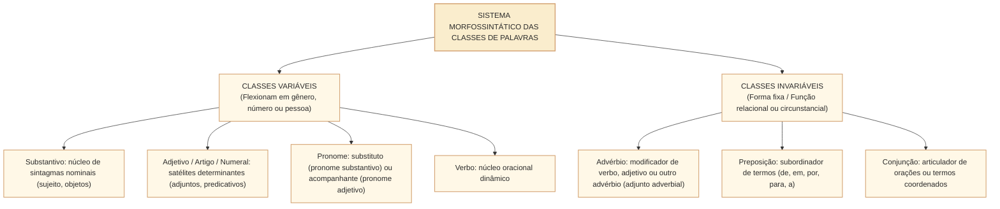
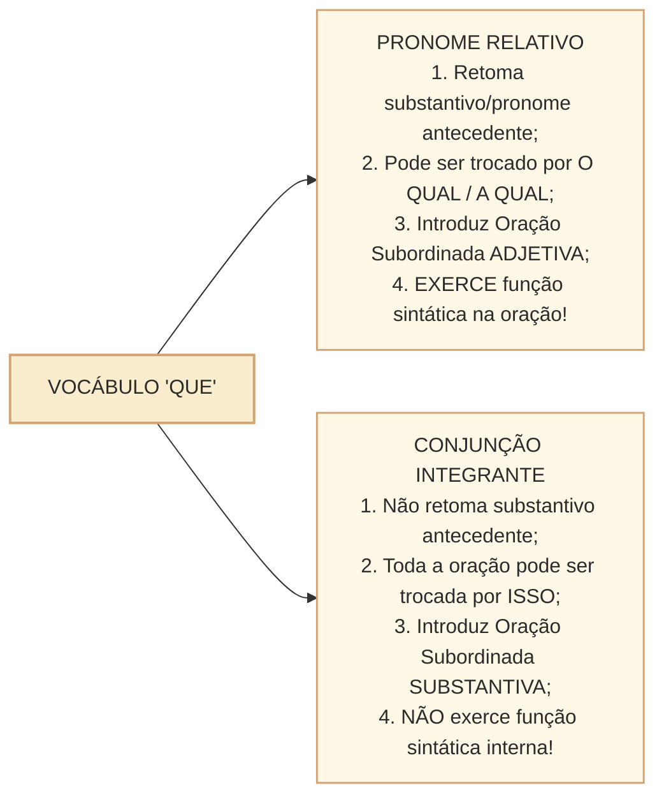

# Classes de palavras e suas funções no período: morfossintaxe de nomes, pronomes e conectivos no padrão Cebraspe

## 1. Situação concreta e a visão morfossintática exigida pelo Cebraspe

Na análise linguística de proposições legislativas e peças administrativas da Câmara dos Deputados, uma palavra não pode ser classificada isoladamente como peça estática de dicionário. Sua natureza morfológica interage diretamente com o papel sintático que desempenha na oração — relação denominada **morfossintaxe**. Observe o seguinte par de enunciados em um debate de comissão:

> **Enunciado 1**: *"O **projeto** que a bancada apresentou recebeu parecer **bastante** favorável."*  
> **Enunciado 2**: *"Exigimos que a Mesa **projete** os gastos e apresente **bastantes** justificativas."*

Veja como a função no período governa a classe gramatical:
- Em (1), **que** retoma o substantivo antecedente *projeto*, funcionando como **pronome relativo** (e exercendo a função sintática de objeto direto de *apresentou*); já **bastante** modifica o adjetivo *favorável*, sendo um **advérbio de intensidade** (invariável);
- Em (2), **que** introduz uma oração inteira que serve de objeto direto para *Exigimos*, classificando-se como **conjunção subordinativa integrante** (sem função sintática interna); já **bastantes** modifica o substantivo plural *justificativas*, atuando como **pronome indefinido adjetivo** (variável, equivalente a *muitas*).

Nas provas do **Cebraspe**, o domínio das **10 classes de palavras** concentra-se exatamente nessas **fronteiras de transição morfossintática**:
1. **Substantivo $\times$ Adjetivo** e a mudança de sentido pela inversão posicional;
2. **Adjetivo $\times$ Advérbio** (palavras invariáveis que modificam verbos versus variáveis que qualificam nomes);
3. **As múltiplas faces morfossintáticas da palavra "QUE"** (pronome relativo, conjunção integrante, conjunção explicativa/causal/consecutiva, preposição acidental e partícula expletiva);
4. **As funções da palavra "SE"** (pronome apassivador, índice de indeterminação do sujeito, parte integrante do verbo, pronome reflexivo e conjunção);
5. **Preposições essenciais $\times$ relacionais (nocionais)**.

---

## 2. Eixo Nominal e Circunstancial: Substantivo, Adjetivo e Advérbio

### 2.1. Substantivo $\times$ Adjetivo e o Efeito Semântico da Posição
- **Substantivo**: É a classe que nomeia seres, conceitos, ações ou estados, exercendo a função primordial de **núcleo** das funções sintáticas nominais (sujeito, objeto direto, objeto indireto, complemento nominal, aposto).
  - *Derivação Imprópria (Substantivação)*: Qualquer palavra da língua antecedida por um artigo (ou outro determinante) converte-se em substantivo: *"O **não** da oposição obstruiu a pauta"* (*não*, originalmente advérbio, foi substantivado pelo artigo *o*).
- **Adjetivo**: Qualifica, restringe ou caracteriza o substantivo, exercendo apenas **duas funções sintáticas possíveis** na língua portuguesa: **Adjunto Adnominal** (dentro do sintagma nominal) ou **Predicativo** (do sujeito ou do objeto).
- **Mudança de Posição (Anteposição $\times$ Posposição)**: O Cebraspe cobra intensamente a mudança de sentido e de classe gramatical provocada pela inversão entre substantivo e adjetivo:

| Expressão com Adjetivo Posposto | Sentido Literal / Objetivo | Expressão com Adjetivo Anteposto | Sentido Figurado / Subjetivo |
| :--- | :--- | :--- | :--- |
| **Servidor alto** | Estatura física elevada. | **Alto servidor** | Elevada hierarquia / escalão superior. |
| **Parlamentar grande** | Porte físico corpulento. | **Grande parlamentar** | Notável estatura política e moral. |
| **Sessão simples** | Sessão sem complexidade técnica. | **Simples sessão** | Mera sessão comum, sem relevância especial. |
| **Deputado novo** | Jovem em idade. | **Novo deputado** | Recém-empossado (mesmo que idoso). |
| **Proposta certa** | Proposta correta, adequada. | **Certa proposta** | Determinada proposta (muda para **pronome indefinido**!). |

---

### 2.2. Adjetivo $\times$ Advérbio: O Teste da Variabilidade
Uma das questões clássicas da banca envolve palavras homônimas que ora atuam como adjetivo (ou pronome indefinido), ora como advérbio:

| Vocábulo | Como Adjetivo / Pronome (VARIÁVEL) | Como Advérbio (INVARIÁVEL) | Critério de Identificação Infalível |
| :--- | :--- | :--- | :--- |
| **Bastante(s)** | *"Havia **bastantes** deputados no plenário."* (= muitos deputados; modifica substantivo). | *"Os deputados estavam **bastante** cansados."* (= muito cansados; modifica adjetivo). | Se puder trocar por **muito(s)/muita(s)** no plural, varia! Se modificar verbo ou adjetivo, é invariável! |
| **Meio(a)** | *"O relator bebeu **meia** xícara de café."* (numeral fracionário: metade). | *"A relatora parecia **meio** preocupada."* (advérbio de intensidade: um pouco). | *Meio* = *um pouco* é advérbio e **nunca varia** (*meio preocupada*, jamais "meia preocupada"!). |
| **Caro / Barato** | *"As obras públicas tiveram custos **caros**."* (adjetivo qualificando *custos*). | *"Aqueles contratos custaram **caro** aos cofres."* (advérbio modificando o verbo *custar*). | Modificando o verbo (*custar caro, falar alto*), permanece invariável. |
| **Anexo / Incluso** | *"Seguem **anexas** as planilhas orçamentárias."* (Adjetivo: concorda em gênero e número!). | **Em anexo** (locução adverbial invariável: *"Seguem **em anexo** as planilhas"*). | *Anexo* isolado é adjetivo e concorda; *em anexo* é invariável (embora o MRPR recomende evitar *em anexo*). |

---

## 3. Morfossintaxe dos Pronomes Relativos e Conjunções: O Duelo do "QUE"

No Cebraspe, distinguir se o vocábulo **que** é um **pronome relativo** ou uma **conjunção subordinativa integrante** é obrigatório em praticamente todas as provas:

### 3.1. Outras Funções do "QUE" Cobradas na Banca
Além de pronome relativo e conjunção integrante, o *que* pode atuar como:
- **Conjunção Coordenativa Explicativa**: *"Votem logo, **que** (= pois/porque) a sessão será encerrada."*
- **Conjunção Subordinativa Consecutiva**: *"A repercussão foi **tão** intensa **que** o projeto foi retirado de pauta."* (antecedido por intensificador *tão, tanto, tal, tamanho*).
- **Preposição Acidental** (equivale à preposição *de* em locuções com *ter* ou *haver*): *"A comissão **tem que** (= tem de) votar o parecer hoje."*
- **Partícula Expletiva ou de Realce** (pode ser retirada sem qualquer prejuízo sintático ou semântico, frequentemente na locução **é que**): *"Os parlamentares **é que** decidem a pauta"* $\rightarrow$ *"Os parlamentares decidem a pauta"*.

---

## 4. Morfossintaxe da Partícula "SE": As Cinco Funções Essenciais

A partícula **se** é a campeã absoluta de cobrança morfossintática no Cebraspe:

| Classificação do "SE" | Estrutura Gramatical Típica | Papel Sintático e Efeito na Concordância | Exemplo no Contexto da Câmara |
| :--- | :--- | :--- | :--- |
| **1. Pronome Apassivador (PA)** | Verbo Transitivo Direto (VTD) ou VTDI + **SE** (sem preposição no termo seguinte). | Transforma o objeto direto em **Sujeito Paciente**. O verbo **concorda obrigatoriamente** com esse sujeito! | *"Aprovaram-**se** as emendas orçamentárias."* (= As emendas foram aprovadas). |
| **2. Índice de Indeterminação do Sujeito (IIS)** | Verbo Intransitivo (VI), Transitivo Indireto (VTI) ou de Ligação (VL) + **SE**. | Torna o sujeito indeterminado. O verbo fica **obrigatoriamente na 3ª pessoa do singular**! | *"Trata-**se** de matérias urgentes."* / *"Precisa-**se** de relatores técnicos."* |
| **3. Parte Integrante do Verbo (PIV)** | Verbos essencialmente pronominais (*queixar-se, arrepender-se, abster-se, ater-se, suicidar-se*). | Faz parte da própria morfologia do verbo; não exerce função sintática autônoma de objeto. | *"Cinco deputados **abstiveram-se** de votar na sessão."* |
| **4. Pronome Reflexivo / Recíproco** | Sujeito animado que pratica e recebe a ação verbal (equivale a *a si mesmo* ou *mutuamente*). | Exerce função sintática de **Objeto Direto** ou **Objeto Indireto**. | *"Os líderes **cumprimentaram-se** após o acordo."* (Recíproco = objeto direto). |
| **5. Conjunção Subordinativa** | **Condicional** (= *caso*) ou **Integrante** (após verbos como *saber, perguntar, verificar*). | Introduz oração subordinada condicional ou substantiva. | *"A Mesa verificará **se** há quórum."* (Conjunção integrante = verificará *isso*). |

---

## 5. Preposições: Nocionais (Lexicais) $\times$ Relacionais (Gramaticais)

O Cebraspe distingue as preposições conforme a origem e a carga semântica:
1. **Preposição Relacional (Gramatical / Funcional)**: É exigida obrigatoriamente pela **regência** de um verbo ou de um nome. É vazia de sentido próprio e atua apenas como elo sintático (*"O deputado concorda **com** o relator"*; *"A obediência **ao** regimento"*). Sua retirada acarreta **erro gramatical**.
2. **Preposição Nocional (Lexical)**: Introduz adjuntos adverbiais ou adnominais e possui **conteúdo semântico próprio** (posse, matéria, causa, companhia, instrumento, lugar). Ex.: *"A mesa **de** madeira do plenário"* (matéria); *"Falaram **sobre** a inflação"* (assunto).

---

## 6. Casos Práticos na Interpretação e Gramática Cebraspe

### Caso 1: Transposição da Voz Passiva Sintética para a Analítica
- **Trecho analisado**:  
  > *"Discutiram-se longamente no plenário os projetos de resolução da Mesa Diretora."*
- **Questão da Banca**: Na oração, a partícula "se" funciona como índice de indeterminação do sujeito, razão pela qual a forma verbal "Discutiram" poderia ser substituída por "Discutiu", no singular.
- **Análise Cebraspe**:
  - O verbo *discutir* é **transitivo direto** (quem discute, discute *algo*).
  - Portanto, a partícula *se* é **pronome apassivador** (PA), e o sintagma plural *os projetos de resolução da Mesa Diretora* é o **sujeito paciente** da oração (= *Os projetos de resolução foram discutidos*).
  - Como o verbo deve concordar com o sujeito paciente plural, a forma *Discutiram-se* é a única gramaticalmente correta; a troca por *Discutiu-se* acarretaria erro grave de concordância verbal!
  - *Julgamento*: Item **ERRADO**.

### Caso 2: A Palavra "Certo" e a Mudança de Classe Gramatical
- **Trecho analisado**:  
  > *"Em **certos** momentos da história parlamentar, o diálogo supera a polarização."*
- **Questão da Banca**: A posposição do vocábulo "certos" ao substantivo "momentos" (*momentos certos*) preservaria sua classe gramatical original e o sentido do texto.
- **Análise Cebraspe**:
  - Anteposto ao substantivo (*certos momentos*), o vocábulo significa *alguns, determinados*, classificando-se morfologicamente como **pronome indefinido adjetivo**.
  - Posposto ao substantivo (*momentos certos*), passa a significar *momentos exatos, adequados, corretos*, convertendo-se em **adjetivo qualificativo**.
  - *Julgamento*: Item **ERRADO**, pois há alteração simultânea de classe morfológica e de sentido.

---

## 7. Questões Inéditas Comentadas no Padrão Cebraspe

### Questão 1
*(Inédita: estilo Cebraspe / Câmara dos Deputados – Analista Legislativo)*  
No período “A comissão exigiu que fossem divulgados os relatórios que a auditoria havia concluído”, as duas ocorrências do vocábulo “que” pertencem à mesma classe gramatical, atuando ambas como pronomes relativos.

- [ ] Certo
- [ ] Errado

> **Gabarito: ERRADO**  
> **Comentário**: As duas ocorrências possuem naturezas morfossintáticas distintas:
> 1. O primeiro **que** (*"exigiu **que** fossem divulgados..."*) introduz uma oração subordinada substantiva objetiva direta (toda a oração equivale a *exigiu **isso***), classificando-se como **conjunção subordinativa integrante**;
> 2. O segundo **que** (*"os relatórios **que** a auditoria havia concluído"*) retoma o substantivo antecedente *os relatórios* (equivale a *os quais*) e introduz oração subordinada adjetiva restritiva, classificando-se como **pronome relativo**.

---

### Questão 2
*(Inédita: estilo Cebraspe / Câmara dos Deputados – Analista Legislativo)*  
Em “Apresentaram-se bastantes razões jurídicas para que o parecer fosse considerado bastante consistente”, os vocábulos “bastantes” e “bastante” exercem, respectivamente, as funções de pronome indefinido adjetivo e de advérbio de intensidade.

- [ ] Certo
- [ ] Errado

> **Gabarito: CERTO**  
> **Comentário**: O item aplica com exatidão a morfossintaxe de *bastante*:
> 1. **bastantes razões**: determina o substantivo feminino plural *razões* com sentido quantitativo indefinido (equivalente a *muitas razões*), flexionando-se no plural como **pronome indefinido adjetivo**;
> 2. **bastante consistente**: modifica o adjetivo *consistente* com sentido de intensidade (equivalente a *muito consistente*), mantendo-se invariável como **advérbio de intensidade**.

---

### Questão 3
*(Inédita: estilo Cebraspe / Câmara dos Deputados – Analista Legislativo)*  
No trecho “Trata-se de prerrogativas constitucionais irrenunciáveis do Poder Legislativo”, a partícula “se” classifica-se como pronome apassivador, de modo que a flexão do verbo no plural — “Tratam-se” — seria gramaticalmente legítima para concordar com “prerrogativas constitucionais”.

- [ ] Certo
- [ ] Errado

> **Gabarito: ERRADO**  
> **Comentário**: Nessa acepção, o verbo *tratar* é **transitivo indireto** (quem trata, trata *de* algo). Diante de verbo transitivo indireto acompanhado da partícula *se*, esta funciona como **índice de indeterminação do sujeito (IIS)**, e o termo preposicionado (*de prerrogativas...*) é objeto indireto (nunca sujeito, pois sujeito não é regido por preposição!). Consequentemente, o verbo deve permanecer **obrigatoriamente na 3ª pessoa do singular** (*Trata-se de prerrogativas*), sendo a forma *"Tratam-se de..."* um erro clássico de concordância.

---

### Questão 4
*(Inédita: estilo Cebraspe / Câmara dos Deputados – Analista Legislativo)*  
Na frase “O pronunciamento do líder gerou um mal-estar profundo, pois o mero adiamento da sessão não resolvia o problema”, a substituição de “mero adiamento” por “adiamento mero” manteria a correção e o sentido original do texto, dada a liberdade posicional dos adjetivos em língua portuguesa.

- [ ] Certo
- [ ] Errado

> **Gabarito: ERRADO**  
> **Comentário**: Determinados adjetivos e pronomes sofrem restrições posicionais severas ou mudam radicalmente de sentido quando deslocados. O adjetivo *mero*, no sentido de *simples, apenas*, costuma anteceder o substantivo nas combinações formais *mero adiamento* e *mera formalidade*. A posposição *adiamento mero* é pouco natural nesse contexto e **não constitui substituição equivalente**; por isso a afirmação de preservação simultânea da correção e do sentido, feita no item, é ERRADA. Evita-se transformar uma tendência de posição lexical em proibição universal sem fonte.

---

### Questão 5
*(Inédita: estilo Cebraspe / Câmara dos Deputados – Analista Legislativo)*  
No período “A secretaria parlamentar remeteu anexas ao ofício as notas técnicas solicitadas pelo relator”, o vocábulo “anexas” classifica-se como adjetivo e concorda regularmente em gênero e número com o substantivo “notas”.

- [ ] Certo
- [ ] Errado

> **Gabarito: CERTO**  
> **Comentário**: Na norma culta, a palavra **anexo** (assim como *incluso* e *apenso*), quando não precedida de preposição, é um **adjetivo** (referido ao objeto direto *as notas técnicas* no período; a classificação funcional fina depende da análise sintática adotada para o predicativo e do vínculo com *ao ofício*. Compare com *"As notas técnicas seguem anexas"*, em que *anexas* caracteriza o sujeito), devendo concordar obrigatoriamente em gênero e número com o substantivo a que se refere (*anexas as notas*).

---

### Questão 6
*(Inédita: estilo Cebraspe / Câmara dos Deputados – Analista Legislativo)*  
No fragmento “Os cidadãos é que exercem a soberania popular por meio do sufrágio”, a expressão “é que” atua como locução expletiva de realce, podendo ser suprimida do período sem prejuízo para a correção gramatical ou para a estrutura sintática básica da oração.

- [ ] Certo
- [ ] Errado

> **Gabarito: CERTO**  
> **Comentário**: A locução **é que** é uma **partícula expletiva ou de realce** intransitiva e invariável, cuja única finalidade estilística é dar ênfase ao termo antecedente (*Os cidadãos*). Sua retirada integral (*"Os cidadãos exercem a soberania popular..."*) mantém a estrutura sintática direta (Sujeito + Verbo + Objeto Direto) perfeitamente íntegra e gramaticalmente correta.

---

## 8. Relações com Outras Unidades e Próximos Passos

- **Unidade Anterior**: [[3 - Materias/Portugues/21 - tempo modo e aspecto verbal na construcao do texto|Tempo, modo e aspecto verbal na construção do texto: correlação de tempos e efeitos discursivos no padrão Cebraspe]].
- **Artigos Fundamentais Conexos**: [[3 - Materias/Portugues/02 - sujeito|02 • Sujeito e termos da oração]]; [[3 - Materias/Portugues/06 - concordancia verbal e nominal|06 • Concordância verbal e nominal]].
- **Próxima Unidade**: **CAM-LP-012 · Termos essenciais e integrantes da oração** (Tipologia do sujeito, transitividade verbal, objetos direto/indireto, complemento nominal $\times$ adjunto adnominal e agente da passiva no padrão Cebraspe).
