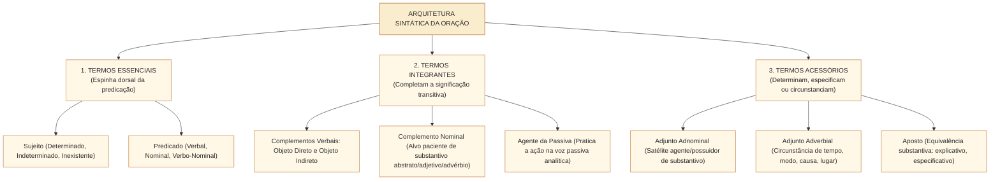
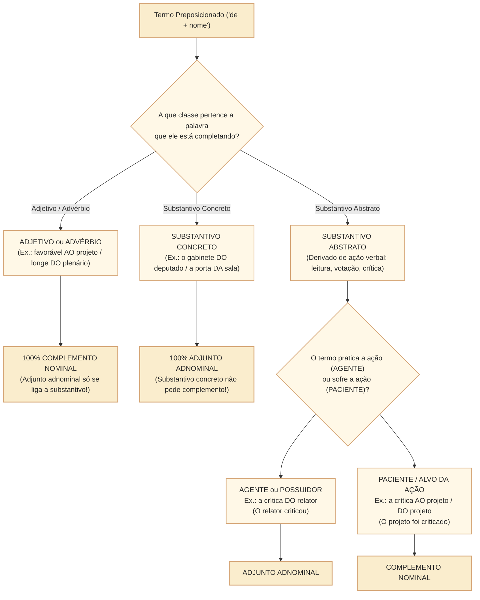

# Termos essenciais, integrantes e acessórios da oração: sintaxe do período simples no padrão Cebraspe

## 1. Situação concreta e a análise sintática de alto nível no Cebraspe

Na elaboração e na interpretação de textos legislativos e pareceres da Câmara dos Deputados, a identificação exata das funções sintáticas é a chave que destrava três dos temas mais decisivos da prova: **concordância verbal** (achar o verdadeiro núcleo do sujeito posposto), **pontuação** (proibição de separar com vírgula o sujeito do verbo e o verbo de seus complementos) e **crase** (distinguir objeto direto de objeto indireto). Considere o período extraído de um parecer regimental:

> *"Aos relatores da comissão cabem, nesta fase processual, **a análise das emendas** e **o envio do parecer ao Plenário**."*

Um leitor desatento suporia que *Aos relatores da comissão* é o sujeito porque inicia a frase. Contudo, **nenhum núcleo de sujeito pode ser regido por preposição!** Ao inverter a ordem para a forma direta, revela-se a estrutura sintática: *"A análise das emendas e o envio do parecer ao Plenário (Sujeito Composto Posposto) cabem (Verbo Transitivo Indireto no plural) aos relatores da comissão (Objeto Indireto)"*. Além disso, em *a análise **das emendas***, o termo preposicionado sofre a ação de ser analisado (**Complemento Nominal**), diferentemente de *os relatores **da comissão***, onde o termo indica pertencimento/origem (**Adjunto Adnominal**).

Nas provas do **Cebraspe**, a sintaxe da oração é cobrada exatamente nessas fronteiras de alta precisão:
1. **Identificação do sujeito posposto, oracional e inexistente** (verbos impessoais *haver* e *fazer*);
2. **Distinção entre sujeito oculto/elíptico (determinado) e sujeito indeterminado**;
3. **Transitividade verbal contextual e objetos pleonásticos / preposicionados**;
4. **O duelo clássico entre Complemento Nominal (CN) e Adjunto Adnominal (AA)**;
5. **Tipos de Aposto (explicativo, restritivo/especificativo, resumitivo, enumerativo) e Vocativo**.

---

## 2. Termos Essenciais: Sujeito e Predicado

### 2.1. Tipologia Rigorosa do Sujeito e Armadilhas do Cebraspe

| Classificação do Sujeito | Definição e Estrutura Sintática | Exemplo no Contexto Parlamentar | Ponto Crítico no Cebraspe |
| :--- | :--- | :--- | :--- |
| **Determinado Simples** | Possui **um único núcleo** explícito na oração (ainda que acompanhado de vários adjuntos). | *"O novo **regimento** das comissões entrou em vigor."* | Não confundir adjunto adnominal preposicionado (*das comissões*) com núcleo do sujeito! |
| **Determinado Composto** | Possui **dois ou mais núcleos** explícitos coordenados entre si. | *"A **Mesa Diretora** e o **Colégio de Líderes** aprovaram a pauta."* | Se o sujeito composto vier **posposto** ao verbo, o verbo pode concordar no plural ou com o núcleo mais próximo! |
| **Determinado Oculto (Elíptico / Desinencial)** | Não está materialmente expresso na oração, mas **é perfeitamente identificado** pela desinência verbal ou pelo texto anterior. | *"Os deputados encerraram os debates e $\varnothing$ **iniciaram** a votação."* | **Sujeito oculto é determinado!** O Cebraspe tenta classificá-lo como indeterminado; o item é **ERRADO**. |
| **Sujeito Oracional** | O sujeito é uma **oração inteira** (subordinada substantiva subjetiva, reduzida ou desenvolvida). | *"É indispensável **que a comissão vote o parecer hoje**."* / *"Cabe à Mesa **conduzir os trabalhos**."* | Quando o sujeito é oracional, o verbo da oração principal fica **obrigatoriamente na 3ª pessoa do singular**! |
| **Sujeito Indeterminado** | Existe um agente da ação, mas não se pode (ou não se quer) identificá-lo nem pelo contexto nem pela desinência. | 1. 3ª pessoa do plural sem antecedente (*"**Protocolaram** denúncia anônima"*); 2. VTI/VI/VL + **SE** (*"**Precisa-se** de assessores"*). | Se houver referente expresso no período anterior para o verbo na 3ª pessoa do plural, o sujeito passa a ser **oculto/elíptico**, e não indeterminado! |
| **Oração Sem Sujeito (Sujeito Inexistente)** | Verbos **impessoais**, cujo processo não é atribuído a nenhum ser. O verbo é **intransigente na 3ª pessoa do singular**. | 1. **Haver** (= existir, ocorrer ou tempo decorrido): *"Havia **muitas emendas**"*; 2. **Fazer** (tempo ou clima): *"Faz **dois anos** que a lei vigora"*. | **Existir, Ocorrer e Acontecer NÃO são impessoais!** *"Existiam muitas emendas"* (*muitas emendas* é sujeito plural!). |

---

### 2.2. Tipos de Predicado e Predicativos
- **Predicado Verbal**: Seu núcleo é um verbo significativo (transitivo ou intransitivo), sem predicativo (*"O relator **leu o parecer**"*).
- **Predicado Nominal**: Formado por **Verbo de Ligação** (*ser, estar, permanecer, ficar, continuar, parecer, tornar-se*) + **Predicativo do Sujeito** (*"A sessão plenária **estava tumultuada**"*).
- **Predicado Verbo-Nominal**: Possui dois núcleos simultâneos (um verbo transitivo/intransitivo + um predicativo do sujeito ou do objeto). Ex.: *"Os parlamentares **saíram exaustos** da sessão"* (*saíram* = VI + *exaustos* = predicativo do sujeito); *"A comissão **julgou inconstitucional** o projeto"* (*julgou* = VTD + *inconstitucional* = predicativo do objeto *o projeto*).

---

## 3. Termos Integrantes: Complementos Verbais e Agente da Passiva

### 3.1. Objeto Direto (OD) e Objeto Indireto (OI)
- **Objeto Direto**: Completa um Verbo Transitivo Direto (VTD) **sem preposição obrigatória**. Substitui-se pelos pronomes oblíquos átonos **o, a, os, as** (e variantes **lo, la, no, na**).
  - *Caso Especial — Objeto Direto Preposicionado*: Por razões estilísticas, de clareza ou diante de pronomes oblíquos tônicos, o OD pode vir precedido de preposição facultativa: *"O projeto beneficia **a todos**"* / *"Amava **a Deus**"* / *"Cumpriu **com o dever**"*.
- **Objeto indireto**: Completa verbo que seleciona preposição, como *necessitar de informações* ou *obedecer ao regimento*. A substituição pronominal **depende da regência e do referente**: em alguns casos cabe *lhe/lhes* (*obedecer-lhe*); em outros é necessária forma preposicionada (*necessitar delas*, *confiar nelas*). Não se deve ensinar *lhe* como substituto universal de todo objeto indireto.
  - *Atenção aos pronomes átonos*: **o, a, os, as** retomam tipicamente objetos diretos (*"Eu **o** convidei"*). **Lhe/lhes** podem realizar complemento indireto em determinadas regências (*"Obedecemos-**lhes**"*) e expressar posse afetada (*"Roubaram-**lhe** a carteira"* = roubaram a carteira *dele*). A função depende do verbo e da construção, e o pronome **não substitui indiscriminadamente qualquer complemento com preposição**.

---

## 4. O Confronto Clássico do Cebraspe: Complemento Nominal $\times$ Adjunto Adnominal

Quando um termo preposicionado (especialmente iniciado pela preposição **de**, como *"do relator"*, *"da lei"*, *"dos gastos"*) está ligado a um substantivo, como saber se é **Complemento Nominal (CN)** ou **Adjunto Adnominal (AA)**?

### 4.1. Tabela Definitiva de Diferenciação: CN $\times$ AA

| Critério | Adjunto Adnominal (AA) | Complemento Nominal (CN) |
| :--- | :--- | :--- |
| **A quem se liga?** | **Exclusivamente a Substantivo** (concreto ou abstrato). | A **Substantivo Abstrato**, a **Adjetivo** ou a **Advérbio**. |
| **Sentido diante de Substantivo Abstrato** | **Sentido ATIVO (Agente)** ou de **Posse/Especificação**. | **Sentido PASSIVO (Paciente / Alvo da ação)**. |
| **Exemplo Comparado 1** | *"A votação **dos deputados** durou horas."* (Os deputados votaram = **Agente $\rightarrow$ AA**). | *"A votação **da emenda** durou horas."* (A emenda foi votada = **Paciente $\rightarrow$ CN**). |
| **Exemplo Comparado 2** | *"O respeito **do cidadão** é fundamental."* (O cidadão respeita = **Agente $\rightarrow$ AA**). | *"O respeito **às leis** é fundamental."* (As leis são respeitadas = **Paciente $\rightarrow$ CN**). |

---

## 5. Termos Acessórios: Aposto $\times$ Vocativo

### 5.1. Modalidades de Aposto Cobradas pela Banca
O **aposto** é um termo de base substantiva que explica, resume, enumera ou especifica outro nome:
1. **Aposto Explicativo** (sempre isolado por vírgulas, travessões ou parênteses): *"Ulysses Guimarães, **presidente da Assembleia Constituinte**, promulgou a Carta de 1988."*
2. **Aposto Enumerativo** (após dois-pontos ou travessão): *"Três princípios regem a despesa: **legalidade, economicidade e transparência**."*
3. **Aposto Resumitivo / Recapitulativo** (expresso por pronome indefinido como *tudo, nada, ninguém* após enumeração): *"Emendas, destaques, requerimentos, **tudo** foi apreciado na sessão."*
4. **Aposto Especificativo (Restritivo)** (**NÃO tem vírgula!** Liga-se a um substantivo genérico por meio de nome próprio, especificando-o): *"O deputado **João Silva** discursou no plenário"*; *"A Lei Complementar **nº 101/2000** rege as finanças"*; *"O rio **São Francisco**."*

### 5.2. Vocativo
É um termo isolado (sempre separado por vírgula) que serve exclusivamente para **interpelar, chamar ou invocar o interlocutor** no discurso direto:
- *"Senhor Presidente, peço a palavra pela ordem."* / *"Nobre colega, conceda-me um aparte."*
- *Diferença para o Aposto*: O vocativo não mantém relação sintática com nenhum termo interno da oração (não pertence nem ao sujeito nem ao predicado); o aposto equivale sintaticamente ao substantivo a que se refere.

---

## 6. Casos Práticos na Análise Sintática do Cebraspe

### Caso 1: Sujeito Posposto e Objeto Indireto Anteposto
- **Trecho analisado**:  
  > *"Couberam às comissões permanentes da Câmara o exame preliminar e a votação terminativa das propostas."*
- **Questão da Banca**: A forma verbal "Couberam" está flexionada no plural para concordar com o termo "às comissões permanentes da Câmara", que exerce a função de sujeito da oração.
- **Análise Cebraspe**:
  - *às comissões permanentes* inicia-se com preposição (*a + as = às*). Sujeito jamais é regido por preposição! Esse termo é o **objeto indireto** do verbo *caber*.
  - O verdadeiro sujeito da oração está posposto e é composto: **o exame preliminar e a votação terminativa das propostas** (núcleos: *exame* e *votação*). É com esse sujeito composto que o verbo *Couberam* concorda!
  - *Julgamento*: Item **ERRADO**.

### Caso 2: A Fronteira entre Adjunto Adnominal e Complemento Nominal
- **Trecho analisado**:  
  > *"A aprovação **do projeto** dependia da manifestação **dos líderes**."*
- **Questão da Banca**: Os termos "do projeto" e "dos líderes" desempenham a mesma função sintática no período: ambos são complementos nominais.
- **Análise Cebraspe**:
  - Ambos se ligam a substantivos abstratos (*aprovação* e *manifestação*). Aplicamos o teste agente $\times$ paciente:
  - Em *aprovação **do projeto***: o projeto não aprova nada; ele **é aprovado** (sofre a ação = paciente). Logo, *do projeto* é **Complemento Nominal (CN)**.
  - Em *manifestação **dos líderes***: os líderes **se manifestam** (praticam a ação = agente). Logo, *dos líderes* é **Adjunto Adnominal (AA)**.
  - *Julgamento*: Item **ERRADO**.

---

## 7. Questões Inéditas Comentadas no Padrão Cebraspe

### Questão 1
*(Inédita: estilo Cebraspe / Câmara dos Deputados – Analista Legislativo)*  
No período “Havia diversas proposições aguardando parecer na comissão, mas não existiam relatores designados para o exame de mérito”, os sintagmas “diversas proposições” e “relatores designados” exercem a função sintática de sujeito de suas respectivas orações.

- [ ] Certo
- [ ] Errado

> **Gabarito: ERRADO**  
> **Comentário**: O item cobra o clássico contraste sintático entre os verbos *haver* e *existir*:
> 1. O verbo **haver**, no sentido de *existir*, é **impessoal** (oração sem sujeito). Portanto, *diversas proposições* exerce a função de **objeto direto** de *Havia*;
> 2. O verbo **existir**, por sua vez, é **pessoal**. Assim, o sintagma *relatores designados* é efetivamente o **sujeito** plural com o qual concorda a forma verbal *existiam*. Como apenas o segundo termo é sujeito, o item está errado.

---

### Questão 2
*(Inédita: estilo Cebraspe / Câmara dos Deputados – Analista Legislativo)*  
Em “Os membros da Mesa Diretora reuniram-se pela manhã e deliberaram sobre a pauta da semana”, o sujeito da forma verbal “deliberaram” classifica-se como indeterminado, dado que se encontra flexionado na terceira pessoa do plural sem pronome reto expresso.

- [ ] Certo
- [ ] Errado

> **Gabarito: ERRADO**  
> **Comentário**: Embora a forma verbal *deliberaram* esteja na 3ª pessoa do plural e não possua sujeito explícito na segunda oração coordenada, o seu referente está **expressamente declarado na oração imediatamente anterior** (*Os membros da Mesa Diretora*). Como o referente é perfeitamente recuperável pelo contexto imediato, o sujeito classifica-se como **determinado oculto (elíptico ou desinencial)**, e não como indeterminado.

---

### Questão 3
*(Inédita: estilo Cebraspe / Câmara dos Deputados – Analista Legislativo)*  
No fragmento “A fiscalização dos contratos públicos exige o estrito cumprimento das normas licitatórias”, os termos preposicionados “dos contratos públicos” e “das normas licitatórias” exercem a função sintática de complemento nominal.

- [ ] Certo
- [ ] Errado

> **Gabarito: CERTO**  
> **Comentário**: Ambos os termos ligam-se a substantivos abstratos de ação (*fiscalização* e *cumprimento*) e desempenham papel semântico **passivo (paciente / alvo da ação)**:
> 1. *fiscalização dos contratos públicos*: os contratos **são fiscalizados** (paciente $\rightarrow$ **Complemento Nominal**);
> 2. *cumprimento das normas licitatórias*: as normas **são cumpridas** (paciente $\rightarrow$ **Complemento Nominal**).

---

### Questão 4
*(Inédita: estilo Cebraspe / Câmara dos Deputados – Analista Legislativo)*  
Na frase “Ao Presidente da Câmara compete promulgar as resoluções do Plenário”, o termo “Ao Presidente da Câmara” exerce a função de objeto indireto, ao passo que a oração reduzida “promulgar as resoluções do Plenário” funciona como sujeito oracional de “compete”.

- [ ] Certo
- [ ] Errado

> **Gabarito: CERTO**  
> **Comentário**: Análise sintática impecável. Quem compete (nesse sentido jurídico de caber atribuição), compete *algo* (Sujeito) *a alguém* (Objeto Indireto). Colocando na ordem direta: *"Promulgar as resoluções do Plenário (Oração Subordinada Substantiva Subjetiva Reduzida de Infinitivo = **Sujeito Oracional**) compete (Verbo Transitivo Indireto) ao Presidente da Câmara (**Objeto Indireto**)"*.

---

### Questão 5
*(Inédita: estilo Cebraspe / Câmara dos Deputados – Analista Legislativo)*  
No período “A comissão examinou três documentos: o parecer, o relatório e a minuta”, o segmento “o parecer, o relatório e a minuta” exerce função de aposto enumerativo em relação ao termo “três documentos”.

- [ ] Certo
- [ ] Errado

> **Gabarito: CERTO**  
> **Comentário**: O segmento após os dois-pontos **enumera os três documentos anunciados** pelo termo antecedente, explicando quais são eles. Trata-se de **aposto enumerativo**, e não de objeto direto adicional do verbo *examinou*. A expressão *três documentos* já integra o objeto direto, e a enumeração a especifica. Esta versão substitui a classificação controversa de *da moralidade administrativa* como aposto especificativo, sem afirmar que a banca examinou esta questão inédita.

---

### Questão 6
*(Inédita: estilo Cebraspe / Câmara dos Deputados – Analista Legislativo)*  
Em “A assessoria técnica entregou-lhe o relatório consolidado”, os termos “-lhe” e “o relatório consolidado” exercem, respectivamente, as funções sintáticas de objeto direto e objeto indireto da forma verbal “entregou”.

- [ ] Certo
- [ ] Errado

> **Gabarito: ERRADO**  
> **Comentário**: O item inverteu a ordem das funções sintáticas na correspondência com *"respectivamente"*. O verbo *entregar* é transitivo direto e indireto (VTDI: quem entrega, entrega *algo* [OD] *a alguém* [OI]). O pronome oblíquo átono **-lhe** (equivalente a *a ele/a ela*) exerce a função de **objeto indireto**, enquanto o sintagma nominal não preposicionado **o relatório consolidado** exerce a função de **objeto direto**.

---

## 8. Relações com Outras Unidades e Próximos Passos

- **Unidade Anterior**: [[3 - Materias/Portugues/22 - classes de palavras e suas funcoes no periodo|CAM-LP-011 · Classes de palavras e suas funções no período: morfossintaxe]].
- **Artigo Fundamental Conexo**: [[3 - Materias/Portugues/02 - sujeito|02 • Sujeito e termos da oração (Visão Sintética)]].
- **Próxima Unidade**: **CAM-LP-013 · Coordenação: relações sintáticas e semânticas** (Período composto por coordenação, orações sindéticas $\times$ assindéticas, polissemia da conjunção *e* e pontuação de coordenadas no padrão Cebraspe).
