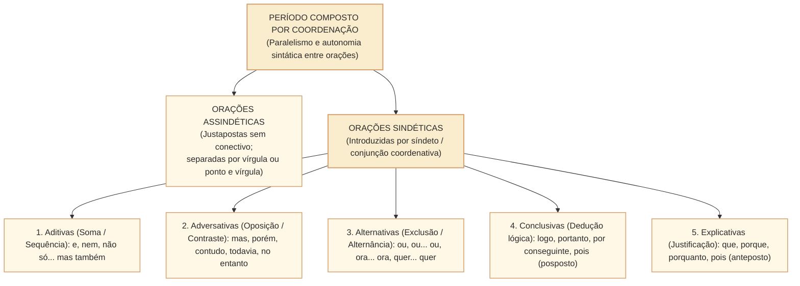
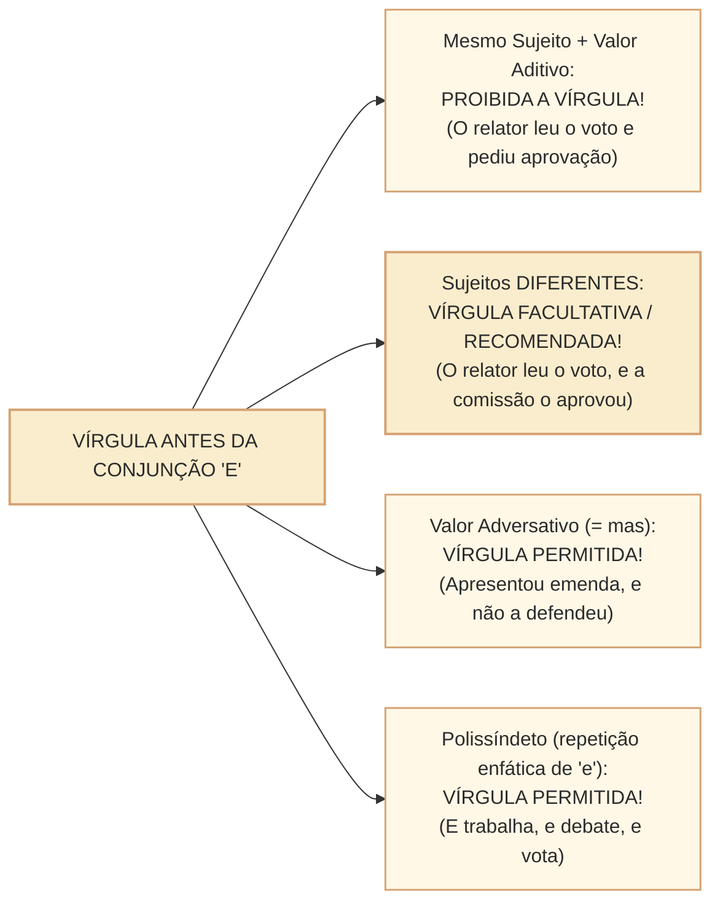

# Coordenação: relações sintáticas, polissemia de conectivos e pontuação do período composto no padrão Cebraspe

## 1. Situação concreta e o estatuto sintático da coordenação

Na elaboração de votos e discursos na Câmara dos Deputados, o encadeamento de fatos e argumentos de mesma hierarquia gramatical opera por meio do **período composto por coordenação**. Considere o trecho de uma nota oficial da Mesa Diretora:

> *"A Presidência instalou a comissão especial, convocou os líderes partidários **e** fixou o cronograma das audiências públicas; a oposição, **entretanto**, obstruiu a indicação dos relatores."*

Nesse período, temos quatro orações que se articulam sem que nenhuma exerça função sintática interna (sujeito, objeto, complemento nominal ou adjunto) em relação às demais:
1. *"A Presidência instalou a comissão especial"* $\rightarrow$ **Oração Coordenada Assindética** (ligada apenas por pausa/vírgula, sem conjunção);
2. *"convocou os líderes partidários"* $\rightarrow$ **Oração Coordenada Assindética**;
3. *"e fixou o cronograma das audiências públicas"* $\rightarrow$ **Oração Coordenada Sindética Aditiva** (introduzida pelo síndeto/conjunção *e*);
4. *"a oposição, entretanto, obstruiu a indicação dos relatores"* $\rightarrow$ **Oração Coordenada Sindética Adversativa** (com a conjunção *entretanto* deslocada e isolada entre vírgulas).

Nas provas do **Cebraspe**, a cobrança das orações coordenadas exige atenção a quatro pontos de fronteira:
1. **Independência sintática $\neq$ independência semântica**: as orações coordenadas são sintaticamente autônomas, mas mantêm estreita interdependência lógica e discursiva;
2. **A polissemia da conjunção "E"**: quando o *e* deixa de ser aditivo e passa a ter valor **adversativo** (= *mas*) ou **consecutivo/conclusivo** (= *e por isso*);
3. **Pontuação nas orações coordenadas**: os três casos em que a **vírgula antes da conjunção "E"** é permitida ou recomendada;
4. **O deslocamento das conjunções adversativas e conclusivas** (*porém, contudo, todavia, portanto, logo, pois*) e as mudanças de pontuação conforme a posição e o valor do conectivo.

---

## 2. As Cinco Modalidades de Orações Coordenadas Sindéticas

| Classificação | Valor Lógico-Discursivo | Conjunções e Locuções Canônicas | Exemplo no Contexto Parlamentar |
| :--- | :--- | :--- | :--- |
| **1. Aditiva** | Soma, acréscimo de informações positivas ou negativas, progressão sequencial de ações. | *e, nem (= e não), não só... mas também, não apenas... como ainda, tanto... quanto*. | *"A comissão **não só** aprovou o relatório, **como também** rejeitou todos os destaques."* |
| **2. Adversativa** | Contraste, oposição, ressalva, compensação ou quebra de expectativa em relação à oração anterior. | *mas, porém, contudo, todavia, entretanto, no entanto, não obstante, senão (= mas sim)*. | *"O quórum de instalação foi atingido, **todavia** não houve consenso para iniciar a votação."* |
| **3. Alternativa** | Alternância de fatos ou exclusão mútua (a realização de um fato impede o outro). | *ou, ou... ou, ora... ora, já... já, quer... quer, seja... seja*. | *"**Ou** o Executivo edita medida provisória, **ou** envia projeto em urgência constitucional."* |
| **4. Conclusiva** | Dedução lógica, fechamento racional ou consequência inferida da premissa anterior. | *logo, portanto, por conseguinte, por isso, assim, destarte, dessarte, **pois** (posposto ao verbo)*. | *"A emenda cria despesa sem fonte de custeio; deve, **pois**, ser declarada incompatível."* |
| **5. Explicativa** | Justificativa de uma ordem/imperativo anterior ou explicação da razão de se afirmar algo. | *que, porque, porquanto, **pois** (anteposto ao verbo)*. | *"Retirem a proposição de pauta, **porquanto** o autor solicitou o seu arquivamento."* |

---

## 3. A Polissemia de Conectivos Coordenativos no Cebraspe

O Cebraspe avalia o valor real do conectivo no contexto, e não a sua etiqueta de tabela:

### 3.1. Os Valores Atípicos da Conjunção "E"
1. **"E" com Valor Adversativo (= *mas, porém*)**: Ocorre quando a segunda oração quebra a expectativa criada pela primeira.
   - *Exemplo*: *"O parlamentar discursou por trinta minutos contra o projeto **e** (= mas) acabou votando a favor do texto básico."*
   - *Atenção*: Nesse caso, a vírgula antes do *e* adversativo é **plenamente aceita e recomendada** para marcar a pausa de contraste!
2. **"E" com Valor Consecutivo / Conclusivo (= *e por isso, portanto*)**: Ocorre quando a primeira oração expressa a causa e a segunda expressa a consequência imediata.
   - *Exemplo*: *"A bancada obstruiu os trabalhos durante toda a madrugada, **e** (= e por isso) a sessão teve de ser encerrada sem deliberação."*

### 3.2. A Conjunção "MAS" com Valor Aditivo Enfático
Embora *mas* seja o protótipo da conjunção adversativa, ela atua como **aditiva** na estrutura correlata **não só... mas também** (ou *não apenas... mas ainda*):
- *"A reforma administrativa altera **não só** o regime dos novos servidores, **mas (também)** a estrutura das carreiras."* (Aqui há soma de argumentos na mesma direção persuasiva, e não oposição!).

### 3.3. A Conjunção "NEM" e a Locução "TAMPOUCO"
- **Nem** equivale a **e não** (conjunção coordenativa aditiva negativa): *"O relator não acolheu as emendas **nem** (= e não) aceitou o pedido de vista."*
  - *Erro clássico*: Escrever *"e nem"* é redundância na norma estrita, embora admitido como reforço estilístico por alguns gramáticos.
- **Tampouco** equivale a **também não** (advérbio / conector de exclusão aditiva): *"Não compareceu à comissão, **tampouco** justificou a ausência."*
  - *Armadilha ortográfica*: Nunca confundir **tampouco** (*também não*) com **tão pouco** (*muito pouco*, intensificador de quantidade: *"Havia **tão pouco** tempo disponível"*).

---

## 4. Pontuação nas Orações Coordenadas: As Regras de Ouro do Cebraspe

### 4.1. A Regra da Vírgula Antes do "E"
1. **Sujeitos idênticos**: Se as orações ligadas por *e* aditivo compartilham sujeito, **em geral dispensa-se a vírgula** antes do *e*, especialmente quando há simples sequência de ações. O contexto pode justificar marcação estilística, intercalação ou outro motivo de pontuação:
   - *"A comissão analisou o mérito da proposta **e** emitiu parecer favorável."*
2. **Sujeitos diferentes**: Entre orações coordenadas ligadas por *e*, a vírgula é **frequentemente aceitável e útil para a clareza**, mas não decorre de uma obrigação automática. A análise depende do tamanho e das relações sintáticas dos segmentos:
   - *"O presidente da comissão encerrou os debates**, e** os deputados iniciaram a votação nominal."* (As duas pontuações são possíveis neste exemplo, sem necessidade de atribuir um julgamento universal à banca).

### 4.2. Pontuação das Conjunções Adversativas e Conclusivas (Posição Inicial $\times$ Posição Deslocada)
- **Conjunção *MAS***: Deve vir **obrigatoriamente no início** da oração coordenada adversativa, precedida de vírgula (ou ponto e vírgula): *"Debateram o tema**, mas** não votaram."* (Nunca se coloca vírgula imediatamente após *mas*, salvo se houver uma oração ou adjunto intercalado: *"Debateram, mas**, apesar do esforço,** não votaram"*).
- **Conjunções móveis (*porém, contudo, todavia, entretanto, no entanto, logo, portanto, por conseguinte*)**:
  1. **No início da 2ª oração**: precedidas de vírgula (ou ponto e vírgula), podendo ou não haver pausa após elas (*"O prazo venceu**; portanto,** o processo foi arquivado"* ou *"O prazo venceu**, portanto** o processo foi arquivado"*);
  2. **Deslocadas após o sujeito ou verbo**: conectivos intercalados como *todavia* e *portanto* costumam ser delimitados por vírgulas; não estender mecanicamente essa estrutura a *mas*, *logo* ou a todos os empregos de *pois*.
     - *"O prazo regimental venceu; o processo**, portanto,** foi arquivado."*

---

## 5. Casos Práticos na Interpretação e Reescrita Cebraspe

### Caso 1: Sujeitos Distintos e Retirada da Vírgula Antes do "E"
- **Trecho analisado**:  
  > *"A Consultoria de Orçamento divulgou a nota técnica sobre os subsídios, e a Comissão Mista de Orçamento convocou reunião extraordinária."*
- **Proposta da Banca**: A supressão da vírgula empregada imediatamente antes da conjunção "e" prejudicaria a correção gramatical do período, visto que as orações coordenadas possuem sujeitos distintos.
- **Análise Cebraspe**:
  - Quando as orações coordenadas ligadas por *e* possuem sujeitos diferentes (*A Consultoria* $\neq$ *a Comissão Mista*), o emprego da vírgula é **facultativo** (recomendado por clareza, mas não obrigatório).
  - Portanto, a retirada da vírgula **não acarreta incorreção gramatical**.
  - *Julgamento*: Item **ERRADO** (a banca adora afirmar que a vírgula de sujeitos diferentes é "obrigatória"; lembre-se de que ela é **facultativa**!).

### Caso 2: A Conjunção "Pois" e a Fronteira Explicativa $\times$ Conclusiva
- **Trecho analisado**:  
  > *"Não houve deliberação na sessão de ontem, **pois** o painel eletrônico apresentou falha técnica."*
- **Proposta da Banca**: Caso se deslocasse a conjunção "pois" para imediatamente após a forma verbal "apresentou", isolando-a entre vírgulas (*apresentou, pois, falha técnica*), preservar-se-iam a correção gramatical e a relação lógica original do período.
- **Análise Cebraspe**:
  - No trecho original, *pois* está anteposto ao verbo (*apresentou*), exercendo função **explicativa/causal** (a falha do painel foi a causa de não haver deliberação).
  - Ao deslocar *pois* para depois do verbo entre vírgulas, a conjunção converte-se em **conclusiva** (= *portanto*). Isso inverteria absurdamente a lógica do período, fazendo parecer que a falha técnica do painel foi uma consequência de não ter havido sessão!
  - *Julgamento*: Item **ERRADO** (mantém a correção gramatical estrutural, mas destrói a coerência e o sentido lógico original!).

---

## 5A. Coordenação entre termos: além das orações

O programa da Câmara menciona expressamente **coordenação entre termos e entre orações**. A coordenação entre termos reúne unidades de **mesma função sintática** no interior de uma oração, enquanto a coordenação oracional relaciona **predicações com núcleos verbais próprios**. O emprego de *e* ou *ou*, por si só, não decide a classificação: identifique os núcleos e as funções.

**Caso progressivo 1, sujeito composto:** *“O relator e a presidente apresentaram a proposta.”* Os grupos nominais *o relator* e *a presidente* são termos coordenados e compõem o sujeito; há apenas uma oração, cujo núcleo verbal é *apresentaram*. A concordância no plural decorre do sujeito composto, não de duas orações.

**Caso progressivo 2, orações coordenadas:** *“O relator apresentou a proposta e a presidente solicitou alterações.”* Há dois núcleos verbais, *apresentou* e *solicitou*, organizados em duas orações ligadas por *e*. A função semântica aditiva não altera esse diagnóstico sintático.

**Caso de fronteira:** *“A comissão analisou projetos e emendas.”* *Projetos* e *emendas* são núcleos coordenados do objeto direto, embora compartilhem um único verbo. Já em *“A comissão analisou projetos e encaminhou emendas”* há coordenação entre predicações (*analisou* / *encaminhou*) com sujeito comum recuperável.

A expressão *“propostas técnicas e administrativas”* também pode coordenar adjetivos que caracterizam o mesmo núcleo. A presença de **dois elementos** não exige, portanto, duas orações. Na reescrita, preserve a função de cada termo, a concordância e o escopo de operadores como *apenas*, *nem* e *ou*.

**Teste comentado, C/E inédito:** “Em ‘A comissão avaliou relatórios e pareceres’, a conjunção *e* coordena duas orações independentes.” **ERRADO.** Há somente uma forma verbal, *avaliou*, e os dois substantivos são termos coordenados do objeto direto.

**Relações:** [[3 - Materias/Portugues/22 - classes de palavras e suas funcoes no periodo|Classes de palavras e funções]] e [[3 - Materias/Portugues/23 - termos essenciais integrantes e acessorios da oracao|Termos da oração]]. O teste acima é um caso didático adicional e **não substitui os seis itens formais da bateria**.

---

## 6. Questões Inéditas Comentadas no Padrão Cebraspe

### Questão 1
*(Inédita: estilo Cebraspe / Câmara dos Deputados – Analista Legislativo)*  
No período “O governo articulou a liberação de emendas parlamentares e substituiu integrantes das comissões, e ainda assim não obteve os votos necessários para aprovar a PEC”, a segunda ocorrência da conjunção “e” introduz uma oração coordenada com valor semântico adversativo.

- [ ] Certo
- [ ] Errado

> **Gabarito: CERTO**  
> **Comentário**: Na primeira ocorrência (*articulou... e substituiu*), a conjunção *e* tem valor puramente aditivo (soma de ações do governo). Já na segunda ocorrência (*", e ainda assim não obteve os votos"*), a conjunção *e* — reforçada pela locução *ainda assim* — estabelece evidente relação de **contraste e quebra de expectativa** (equivalendo a *mas, porém, contudo*), classificando-se semântica e discursivamente como **adversativa**.

---

### Questão 2
*(Inédita: estilo Cebraspe / Câmara dos Deputados – Analista Legislativo)*  
Em “O Senado Federal aprovou o texto-base da proposta, e a Câmara dos Deputados iniciou a análise das alterações promovidas pelos senadores”, a presença da vírgula antes da conjunção “e” justifica-se pelo fato de as orações coordenadas possuírem sujeitos distintos.

- [ ] Certo
- [ ] Errado

> **Gabarito: CERTO**  
> **Comentário**: A primeira oração tem como sujeito *O Senado Federal*, enquanto a segunda tem como sujeito *a Câmara dos Deputados*. Na norma culta, quando orações coordenadas unidas pela conjunção *e* apresentam **sujeitos diferentes**, é perfeitamente legítimo o emprego da vírgula antes do conectivo para demarcar a fronteira sintática entre as proposições.

---

### Questão 3
*(Inédita: estilo Cebraspe / Câmara dos Deputados – Analista Legislativo)*  
No trecho “A proposta não atendia aos limites fiscais da Lei de Responsabilidade Fiscal; tampouco contava com estimativa de impacto orçamentário”, o vocábulo “tampouco” poderia ser substituído pela expressão “tão pouco” sem prejuízo para a correção gramatical ou para o sentido do texto.

- [ ] Certo
- [ ] Errado

> **Gabarito: ERRADO**  
> **Comentário**: As expressões possuem naturezas morfológicas e semânticas completamente distintas:
> 1. **tampouco** (grafado junto, com *m*) é advérbio/conector de exclusão aditiva que significa **também não / nem sequer** (*"também não contava com estimativa"*);
> 2. **tão pouco** (separado) é a combinação do advérbio de intensidade *tão* com o pronome/advérbio *pouco*, significando **muito pouco**. A substituição geraria incorreção gramatical e truncamento semântico no período.

---

### Questão 4
*(Inédita: estilo Cebraspe / Câmara dos Deputados – Analista Legislativo)*  
As orações que compõem um período composto por coordenação caracterizam-se pela independência sintática, o que significa que uma oração coordenada não exerce função sintática de termo essencial, integrante ou acessório no interior de outra.

- [ ] Certo
- [ ] Errado

> **Gabarito: CERTO**  
> **Comentário**: O item apresenta a definição gramatical exata de coordenação. Ao contrário das orações subordinadas (que funcionam como sujeito, objeto direto, complemento nominal, adjunto adnominal ou adjunto adverbial da oração principal), as **orações coordenadas são sintaticamente independentes entre si**, relacionando-se por encadeamento lógico sem subordinação estrutural.

---

### Questão 5
*(Inédita: estilo Cebraspe / Câmara dos Deputados – Analista Legislativo)*  
No período “A comissão especial analisou o mérito da proposição; o Plenário, todavia, rejeitou o substitutivo apresentado”, as vírgulas que isolam a conjunção “todavia” são obrigatórias em razão do deslocamento desse conectivo adversativo para posição pós-sujeito.

- [ ] Certo
- [ ] Errado

> **Gabarito: CERTO**  
> **Comentário**: Na frase examinada, **todavia** aparece intercalado após o sujeito (*o Plenário*) e é corretamente delimitado por **duas vírgulas**. O gabarito CERTO se refere a essa construção. Não se deve estender a mesma prescrição a todas as conjunções em quaisquer posições: *mas* possui distribuição diferente, e *pois* varia segundo função e posição.

---

### Questão 6
*(Inédita: estilo Cebraspe / Câmara dos Deputados – Analista Legislativo)*  
Em “O novo sistema eletrônico de votação não só agilizou a apuração do quórum, mas também ampliou a transparência das deliberações”, a conjunção “mas” introduz uma ressalva que restringe o alcance da afirmação contida na primeira oração.

- [ ] Certo
- [ ] Errado

> **Gabarito: ERRADO**  
> **Comentário**: No par correlativo **não só... mas também** (ou *não apenas... como também*), o conector *mas* perde o seu valor opositivo/adversativo e assume valor estritamente **aditivo enfático**. Não há qualquer restrição ou ressalva à primeira oração, mas sim a **soma** de dois benefícios positivos gerados pelo novo sistema eletrônico (*agilizou a apuração + ampliou a transparência*).

---

## 7. Relações com Outras Unidades e Próximos Passos

- **Unidade Anterior**: [[3 - Materias/Portugues/23 - termos essenciais integrantes e acessorios da oracao|CAM-LP-012 · Termos essenciais, integrantes e acessórios da oração]].
- **Artigos Fundamentais Conexos**: [[3 - Materias/Portugues/07 - oracoes coordenadas e subordinadas|07 • Orações coordenadas e subordinadas]]; [[3 - Materias/Portugues/20 - conectores relacoes logicas e sequenciacao|CAM-LP-009 · Conectores, relações lógicas e sequenciação]].
- **Próxima Unidade**: **CAM-LP-014 · Subordinação substantiva, adjetiva e adverbial** (Morfossintaxe das orações subordinadas desenvolvidas e reduzidas, restrição $\times$ explicação nas adjetivas e efeitos de sentido no padrão Cebraspe).
