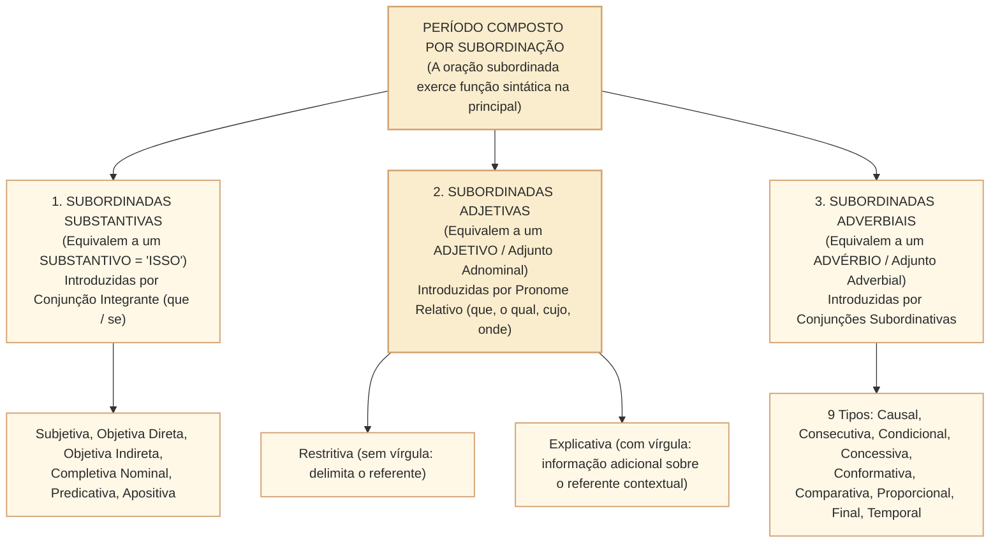
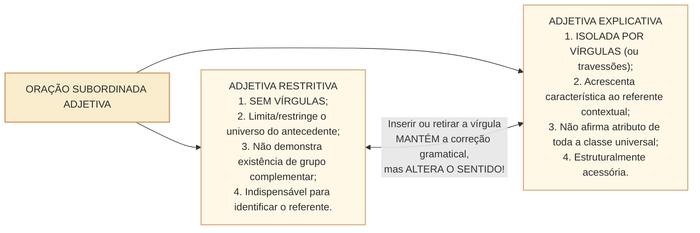

# Subordinação substantiva, adjetiva e adverbial: morfossintaxe, formas reduzidas e efeitos de sentido no padrão Cebraspe

## 1. Situação concreta e o mecanismo de encaixe da subordinação

Diferente da coordenação (em que as orações mantêm autonomia sintática), a **subordinação (ou hipotaxe)** ocorre quando uma oração inteira passa a funcionar como um **termo sintático encaixado dentro da estrutura da oração principal**. Na redação de proposições e pareceres na Câmara dos Deputados, compreender esse encaixe é decisivo tanto para a concordância quanto para a interpretação jurídica. Compare dois dispositivos:

> **Dispositivo A (Sem vírgulas)**: *"Os servidores da Câmara **que acumulam cargos remunerados indevidamente** responderão a processo disciplinar."*  
> **Dispositivo B (Com vírgulas)**: *"Os servidores presentes à reunião**, que receberam treinamento sobre o sistema,** apresentaram sugestões."*

A simples inserção ou retirada de vírgulas antes da oração subordinada adjetiva introduzida pelo pronome relativo *que* altera radicalmente o escopo lógico da norma:
- No **Dispositivo A**, a **oração subordinada adjetiva restritiva** (sem vírgulas) delimita o grupo ao qual se atribui a resposta a processo, sem comprovar que existam servidores fora desse grupo. Se inseríssemos vírgulas, o atributo passaria a ser apresentado como informação adicional sobre os servidores identificados no contexto, mudando o escopo comunicativo.
- No **Dispositivo B**, a **oração subordinada adjetiva explicativa** (isolada por vírgulas) apresenta o treinamento como informação adicional sobre **os servidores presentes à reunião identificados no contexto**. Não demonstra que todos os servidores da instituição tenham recebido treinamento nem estabelece regra sobre estabilidade.

Nas provas do **Cebraspe**, a subordinação é um dos tópicos mais cobrados de toda a prova de Língua Portuguesa:
1. **O contraste semântico e de pontuação nas Adjetivas Restritivas $\times$ Explicativas**;
2. **A função sintática interna dos Pronomes Relativos** (*que, quem, o qual, cujo, onde*);
3. **As seis modalidades de Orações Subordinadas Substantivas** (e o impacto da subjetiva na concordância no singular);
4. **As nove modalidades de Orações Subordinadas Adverbiais e sua pontuação** (vírgula obrigatória quando antepostas $\times$ facultativa na ordem direta);
5. **Desenvolvimento de Orações Reduzidas** (infinitivo, gerúndio e particípio).

---

## 2. Orações Subordinadas Substantivas: O Teste do "ISSO"

As **orações subordinadas substantivas** desempenham funções próprias de um substantivo. Para identificá-las de imediato, substitua toda a oração subordinada pelo pronome demonstrativo **ISSO** (ou *disso, a isso*):

| Classificação da Substantiva | Equivalente com "ISSO" | Função em Relação à Oração Principal | Exemplo no Contexto Parlamentar |
| :--- | :--- | :--- | :--- |
| **1. Subjetiva** | **ISSO** é necessário / Convém **ISSO** / Sabe-se **ISSO**. | Funciona como **Sujeito** do verbo da oração principal (que fica na **3ª pessoa do singular**!). | *"É urgente **que o Plenário aprove a medida provisória**."* (= *Isso* é urgente). |
| **2. Objetiva Direta** | O relator afirmou **ISSO**. | Completa um **Verbo Transitivo Direto** sem preposição. | *"A Mesa Diretora informou **que a sessão será reaberta às 14h**."* |
| **3. Objetiva Indireta** | O líder necessita **DISSO**. | Completa um **Verbo Transitivo Indireto** com preposição obrigatória. | *"Os parlamentares não se opuseram **a que o projeto tramitasse em regime de urgência**."* |
| **4. Completiva Nominal** | Temos certeza **DISSO** / Favorável **A ISSO**. | Completa um **Substantivo Abstrato**, **Adjetivo** ou **Advérbio** com preposição. | *"O relator tinha convicção **de que a emenda era constitucional**."* |
| **5. Predicativa** | O fato é **ISSO**. | Funciona como **Predicativo do Sujeito** após verbo de ligação *ser*. | *"A exigência regimental é **que haja maioria absoluta no plenário**."* |
| **6. Apositiva** | Só desejamos uma coisa: **ISSO**. | Funciona como **Aposto** de um nome antecedente (geralmente após dois-pontos). | *"O parecer fixou uma condição: **que os gastos respeitem a LDO**."* |

> **Atenção no Cebraspe**: Nas orações **Objetivas Indiretas** e **Completivas Nominais**, a gramática normativa autoriza a **elipse (omissão) da preposição** antes da conjunção integrante *que*: tanto *"O relator tinha convicção **de que** a emenda era constitucional"* quanto *"O relator tinha convicção **que** a emenda era constitucional"* são consideradas **corretas** pelo Cebraspe!

---

## 3. Orações Subordinadas Adjetivas: Restrição $\times$ Explicação e Pronomes Relativos

As **orações subordinadas adjetivas** exercem a função sintática de **adjunto adnominal** de um substantivo ou pronome antecedente e são sempre introduzidas por um **pronome relativo** (*que, quem, o qual, cujo, onde, quanto*).

### 3.1. A Regra de Ouro do Cebraspe: Restritiva $\times$ Explicativa

> **Tese Central do Cebraspe sobre Vírgula nas Adjetivas**:  
> A inserção (ou supressão) de vírgula(s) para isolar uma oração subordinada adjetiva **mantém a correção gramatical do período, mas ALTERA O SEU SENTIDO ORIGINAL** (converte restrição em explicação, ou vice-versa!).

---

### 3.2. Emprego Normativo dos Pronomes Relativos no Cebraspe

| Pronome Relativo | Regras de Emprego e Regência | Exemplo Correto | Erro Clássico Cobrado na Prova |
| :--- | :--- | :--- | :--- |
| **CUJO(A)(S)** | 1. Indica **POSSE** entre dois substantivos; 2. Concorda com o termo **consequente**; 3. **NUNCA admite artigo depois dele** (*cujo o* é erro gravíssimo!); 4. Recebe a preposição exigida pelo verbo/nome seguinte (*a cujo, de cujo, em cujo*). | *"O projeto **cujo** relator discursou"* / *"A lei **a cujos** artigos obedecemos"* (obedecer *a*). | Escrever *"cujo o relator"* ou omitir a preposição exigida pelo verbo (*"A comissão cujo presidente confiamos"* $\rightarrow$ o correto é **em cujo** presidente confiamos!). |
| **ONDE / AONDE / DONDE** | Referem-se a **lugar ou espaço locativo contextual**, incluindo referências figuradas ou institucionais quando a leitura de localização é clara. - **Onde**: permanência ou localização (*em que*); - **Aonde**: destino com verbo que seleciona *a* (*a que*); - **Donde**: origem (*de onde*). | *"O plenário **onde** ocorreu a sessão"* / *"O plenário **aonde** o parlamentar se dirigiu"*. | Em texto formal, evitar *onde* para marcar apenas tempo ou evento (*"o ano onde nasceu"*, *"a reunião onde se discutiu a proposta"*): prefira **em que** / **na qual**. A adequação depende do referente e da regência. |
| **QUEM** | Retoma pessoa ou ser personificado. **Geralmente vem precedido de preposição quando é complemento** (*a quem, de quem, com quem*), mas **pode aparecer sem preposição como sujeito**: *"Foi a deputada quem apresentou a emenda"*. | *"O parlamentar **a quem** o presidente concedeu a palavra"* / *"Foi ela **quem** relatou o projeto"*. | Generalizar que todo *quem* relativo exige preposição, inclusive na função de sujeito. Referência: [Ciberdúvidas, uso de *quem* e *que*](https://ciberduvidas.iscte-iul.pt/consultorio/perguntas/o-uso-dos-pronomes-quem-e-que/31037). |

---

## 4. Orações Subordinadas Adverbiais e Pontuação

As **orações subordinadas adverbiais** exercem a função sintática de **adjunto adverbial** da oração principal (expressando causa, consequência, condição, concessão, conformidade, comparação, proporção, finalidade ou tempo).

### 4.1. A Regra da Vírgula nas Orações Adverbiais
- **Ordem Direta (Oração Principal + Oração Subordinada Adverbial Posposta)**:  
  A vírgula é **FACULTATIVA** (em regra, não se usa vírgula, mas sua presença é aceita, especialmente nas concessivas, causais e condicionais longas).  
  *"A sessão foi encerrada **porque o quórum não foi atingido**."* (Sem vírgula ou com vírgula = correto!).
- **Ordem Inversa / Deslocada (Oração Adverbial Anteposta ou Intercalada)**:  
  A vírgula é **OBRIGATÓRIA**!  
  *"**Porque o quórum não foi atingido,** a sessão foi encerrada."* / *"A sessão**, porque o quórum não foi atingido,** foi encerrada."*

---

## 5. Orações Reduzidas (Infinitivo, Gerúndio e Particípio)

Uma oração subordinada é chamada de **reduzida** quando **não possui conectivo** (conjunção ou pronome relativo) e apresenta o verbo em uma das três formas nominais (**infinitivo, gerúndio ou particípio**). Para classificá-la no Cebraspe, basta **desenvolvê-la** (inserir o conectivo e conjugar o verbo):
1. **Reduzida de Infinitivo**:  
   *"É fundamental **analisar o impacto fiscal**."* $\rightarrow$ Desenvolvida: *"É fundamental **que se analise o impacto fiscal**"* (Subordinada Substantiva Subjetiva).  
   *"**Ao encerrar a sessão**, o presidente convocou outra."* $\rightarrow$ Desenvolvida: *"**Quando encerrou a sessão**..."* (Subordinada Adverbial Temporal).
2. **Reduzida de Gerúndio**:  
   *"**Persistindo o empate na votação**, prevalecerá o voto de qualidade."* $\rightarrow$ Desenvolvida: *"**Caso persista o empate**..."* (Subordinada Adverbial Condicional).
3. **Reduzida de Particípio**:  
   *"**Concluída a leitura do relatório**, iniciou-se a discussão."* $\rightarrow$ Desenvolvida: *"**Assim que foi concluída a leitura**..."* (Subordinada Adverbial Temporal).

---

## 5A. Subordinação entre termos: relações internas à oração

O edital também inclui **subordinação entre termos**, isto é, dependências que ocorrem **sem uma segunda oração**. Um núcleo pode exigir ou admitir outro termo que o complete, determine ou caracterize. É necessário distinguir a relação sintática entre termos da subordinação **entre orações**, em que uma oração inteira desempenha função em relação à principal.

**Caso progressivo 1, regência verbal:** *“A comissão necessita de informações.”* O verbo *necessita* exige o complemento preposicionado *de informações*, que é **objeto indireto**. Há **uma oração**, embora exista relação de dependência entre núcleo verbal e complemento.

**Caso progressivo 2, regência nominal:** *“A necessidade de informações motivou o pedido.”* O substantivo abstrato *necessidade* recebe o complemento preposicionado *de informações*, analisável como **complemento nominal**, e o grupo todo integra o sujeito. A função sintática mudou em relação ao caso anterior, ainda sem criar outra oração.

**Caso progressivo 3, oração substantiva:** *“A comissão necessita de que as informações sejam publicadas.”* Agora o conteúdo exigido por *necessita de* é **uma oração subordinada substantiva objetiva indireta**, introduzida por *de que*, com verbo próprio (*sejam publicadas*). A forma reduzida pode exigir análise adicional; conte os núcleos verbais e verifique a função da oração encaixada.

**Caso de fronteira, adjunto adnominal versus complemento nominal:** em *“a análise dos relatórios”*, *dos relatórios* designa o alvo da análise, favorecendo a leitura de **complemento nominal**. Em *“a análise da comissão”*, *da comissão* pode designar quem analisa, favorecendo a leitura de **adjunto adnominal**. O mesmo *de* não determina sozinho a classificação: examine o **papel semântico do termo** e o sentido do substantivo.

**Teste comentado, C/E inédito:** “Em ‘A comissão depende de recursos’, a existência de objeto indireto prova que o período é composto por subordinação.” **ERRADO.** A dependência é **entre termos da mesma oração**; não há segunda forma verbal ou oração subordinada.

**Relações:** [[3 - Materias/Portugues/23 - termos essenciais integrantes e acessorios da oracao|Termos essenciais, integrantes e acessórios]], [[3 - Materias/Portugues/28 - regencia verbal e nominal transitividade e sentidos|Regência]] e [[3 - Materias/Portugues/24 - coordenacao relacoes sintaticas e semanticas|Coordenação]]. O teste é um caso didático extra, distinto dos seis itens formais.

---

## 6. Casos Práticos na Interpretação e Reescrita Cebraspe

### Caso 1: Supressão de Vírgula em Oração Adjetiva Explicativa
- **Trecho analisado**:  
  > *"As emendas parlamentares impositivas, que possuem execução orçamentária obrigatória pela União, foram regulamentadas pela EC nº 86/2015."*
- **Proposta da Banca**: A retirada das vírgulas que isolam o trecho "que possuem execução orçamentária obrigatória pela União" manteria a correção gramatical do período, mas alteraria as suas relações semânticas originais.
- **Análise Cebraspe**:
  - Com vírgulas, a oração adjetiva é **explicativa** (apresenta a característica como informação adicional sobre as emendas impositivas referidas no contexto).
  - Sem vírgulas, a oração passa a ser **restritiva** (usa a característica para delimitar o referente, **sem implicar a existência de emendas fora do grupo**).
  - Do ponto de vista estritamente sintático, a retirada das vírgulas **mantém a correção gramatical**, mas **altera o sentido original**.
  - *Julgamento*: Item **CERTO**.

### Caso 2: Regência do Pronome Relativo "Cujo"
- **Trecho analisado**:  
  > *"A comissão especial examinou o projeto de lei **cujo** teor a sociedade tanto necessitava."*
- **Proposta da Banca**: O período apresenta perfeita correção gramatical no emprego do pronome relativo "cujo".
- **Análise Cebraspe**:
  - Olhe para o verbo da oração adjetiva: *necessitava*. Quem necessita, necessita **DE** alguma coisa (*necessitava do teor do projeto*).
  - Portanto, a preposição **de** exigida pelo verbo *necessitar* deve obrigatoriamente anteceder o pronome relativo *cujo*: *"examinou o projeto de lei **de cujo** teor a sociedade tanto necessitava"*.
  - *Julgamento*: Item **ERRADO** (faltou a preposição *de* antes de *cujo*).

---

## 7. Questões Inéditas Comentadas no Padrão Cebraspe

### Questão 1
*(Inédita: estilo Cebraspe / Câmara dos Deputados – Analista Legislativo)*  
No período “Os projetos de lei que criam despesas obrigatórias sem estimativa de impacto orçamentário são considerados inadequados pela comissão”, a inserção de uma vírgula logo após “projetos de lei” e outra após “orçamentário” preservaria a correção gramatical do texto, mas modificaria o seu sentido original.

- [ ] Certo
- [ ] Errado

> **Gabarito: CERTO**  
> **Comentário**: No texto original, a oração *que criam despesas obrigatórias sem estimativa de impacto orçamentário* está sem vírgulas, classificando-se como **subordinada adjetiva restritiva** (restringe a inadequação apenas aos projetos que criam despesas sem estimativa). Ao isolá-la entre duas vírgulas, a estrutura permanece gramaticalmente correta, porém converte-se em **subordinada adjetiva explicativa**, apresentando a característica como informação adicional sobre **os projetos de lei referidos naquele contexto**, sem autorizar uma afirmação sobre todos os projetos existentes.

---

### Questão 2
*(Inédita: estilo Cebraspe / Câmara dos Deputados – Analista Legislativo)*  
Em “O Regimento Interno da Câmara dos Deputados, cujas normas disciplinam o processo legislativo, exige quórum qualificado para a votação de emendas constitucionais”, o pronome “cujas” estabelece relação de posse com “O Regimento Interno” e concorda em gênero e número com o substantivo “normas”.

- [ ] Certo
- [ ] Errado

> **Gabarito: CERTO**  
> **Comentário**: O pronome relativo **cujo(a)(s)** possui valor semântico possessivo, retomando o termo antecedente possuidor (*O Regimento Interno*) e concordando morfologicamente em gênero e número com o termo consequente possuído (*normas* — feminino plural: *cujas normas*).

---

### Questão 3
*(Inédita: estilo Cebraspe / Câmara dos Deputados – Analista Legislativo)*  
No fragmento “É imprescindível que a Mesa Diretora publique a pauta com antecedência regimental”, a oração introduzida pela conjunção “que” exerce a função sintática de objeto direto da forma verbal “É”.

- [ ] Certo
- [ ] Errado

> **Gabarito: ERRADO**  
> **Comentário**: O verbo *ser* (*É*) é um verbo de ligação, e *imprescindível* é o predicativo do sujeito. Ao aplicarmos o teste do *ISSO* (*"**Isso** é imprescindível"*), constatamos que a oração *que a Mesa Diretora publique a pauta...* exerce a função sintática de **sujeito** da oração principal, classificando-se como **oração subordinada substantiva subjetiva** (jamais objeto direto, pois verbo de ligação não tem objeto!).

---

### Questão 4
*(Inédita: estilo Cebraspe / Câmara dos Deputados – Analista Legislativo)*  
No trecho “Caso o relator acolha as emendas de plenário, o projeto retornará à comissão temática”, a vírgula empregada após “plenário” é de uso obrigatório, visto que a oração subordinada adverbial condicional encontra-se anteposta à oração principal.

- [ ] Certo
- [ ] Errado

> **Gabarito: CERTO**  
> **Comentário**: Na ordem direta do período composto (Oração Principal + Oração Subordinada Adverbial), a vírgula é facultativa. Contudo, quando a **oração subordinada adverbial é deslocada para o início do período (anteposta à principal)**, o uso da vírgula para demarcá-la torna-se **estritamente obrigatório** segundo a prescrição gramatical.

---

### Questão 5
*(Inédita: estilo Cebraspe / Câmara dos Deputados – Analista Legislativo)*  
Em “Naquela sessão solene, onde foram debatidas as diretrizes da reforma administrativa, houve intensa participação popular”, o emprego do pronome “onde” está em perfeita conformidade com a norma-padrão, dado que retoma “sessão solene”.

- [ ] Certo
- [ ] Errado

> **Gabarito: ERRADO**  
> **Comentário**: Na redação formal conservadora, **onde** retoma referente de valor **locativo**, que pode incluir espaços delimitados por usos figurados ou institucionais; não é correto afirmar que sempre exige lugar fisicamente material. Neste contexto, *sessão solene* designa **evento**, de modo que **em que** ou **na qual** é a substituição editorial mais segura: *"Naquela sessão solene, **na qual / em que** foram debatidas..."*. O gabarito ERRADO refere-se à afirmação de **perfeita adequação** no registro formal adotado, e não à inexistência de todos os usos não físicos de *onde*.

---

### Questão 6
*(Inédita: estilo Cebraspe / Câmara dos Deputados – Analista Legislativo)*  
No período “Encerrada a fase de discussão da matéria, o presidente anunciou o início da votação nominal”, o segmento “Encerrada a fase de discussão da matéria” constitui uma oração subordinada adverbial temporal reduzida de particípio.

- [ ] Certo
- [ ] Errado

> **Gabarito: CERTO**  
> **Comentário**: O segmento tem como núcleo verbal o particípio *Encerrada* e não apresenta conjunção explícita (forma reduzida). Ao desenvolvermos a oração (*"**Quando foi encerrada / Assim que se encerrou** a fase de discussão da matéria..."*), fica evidente a sua natureza de **oração subordinada adverbial temporal reduzida de particípio**.

---

## 8. Relações com Outras Unidades e Próximos Passos

- **Unidade Anterior**: [[3 - Materias/Portugues/24 - coordenacao relacoes sintaticas e semanticas|CAM-LP-013 · Coordenação: relações sintáticas, polissemia de conectivos e pontuação]].
- **Artigos Fundamentais Conexos**: [[3 - Materias/Portugues/07 - oracoes coordenadas e subordinadas|07 • Orações coordenadas e subordinadas]]; [[3 - Materias/Portugues/03 - pontuacao e virgula|03 • Pontuação e vírgula]].
- **Próxima Unidade**: **CAM-LP-015 · Pontuação e efeitos na estrutura e no sentido** (Sistematização integral das regras de vírgula, ponto e vírgula, dois-pontos, travessões e parênteses no padrão Cebraspe).
