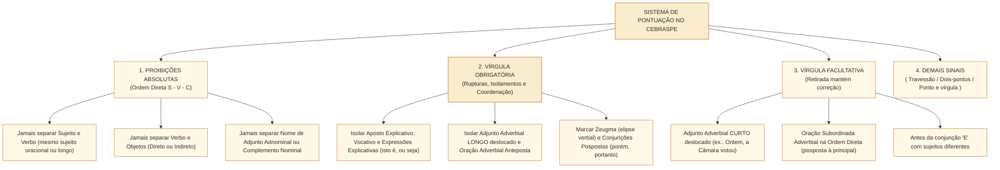
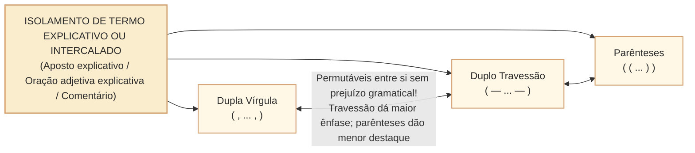

# Pontuação e efeitos na estrutura e no sentido: vírgula, dois-pontos, ponto e vírgula e travessões no padrão Cebraspe

## 1. Situação concreta e a natureza sintático-discursiva da pontuação

Na técnica legislativa e na redação oficial da Câmara dos Deputados, os sinais de pontuação não são "marcas para tomar fôlego na leitura em voz alta": são **operadores lógicos e sintáticos** que demarcam a fronteira entre termos, assinalam inversões da ordem canônica e determinam o alcance jurídico de dispositivos. Na língua portuguesa, a ordem direta canônica da oração é **Sujeito $\rightarrow$ Verbo $\rightarrow$ Complementos Verbais (Objetos) $\rightarrow$ Adjuntos Adverbiais (S-V-C-A)**. Enquanto os termos essenciais e integrantes permanecem em sua posição natural, sem intercalações, **nenhum sinal de pontuação pode interromper o fluxo entre eles**.

Observe o efeito devastador de uma única vírgula ou de sua ausência em textos normativos:

> **Caso A (Violação Sintática — Sujeito Longo)**: *"O presidente da Comissão de Constituição e Justiça e de Cidadania da Câmara dos Deputados**,** convocou sessão extraordinária."* (**ERRADO!** Por mais extenso que seja o sujeito, jamais se separa o sujeito do verbo por uma única vírgula!).  
> **Caso B (Dupla Vírgula de Intercalação Legítima)**: *"O presidente da comissão**, atendendo a requerimento das lideranças partidárias,** convocou sessão extraordinária."* (**CORRETO!** Aqui não há uma vírgula separando sujeito e verbo, mas sim um **par de vírgulas** isolando uma oração reduzida intercalada!).

Nas provas do **Cebraspe**, a pontuação responde por até 25% das questões gramaticais e avalia:
1. **As proibições absolutas da vírgula** (entre sujeito e verbo; entre verbo e complementos; entre nome e complemento nominal/adjunto adnominal);
2. **Os casos de vírgula obrigatória $\times$ vírgula facultativa** (especialmente nos adjuntos adverbiais deslocados de curta vs. longa extensão);
3. **A permutabilidade entre sinais de pontuação**: quando **vírgulas duplas, travessões duplos e parênteses** podem substituir-se mutuamente;
4. **O emprego do ponto e vírgula (;)** em enumerações legislativas e em períodos coordenados com conjunções deslocadas;
5. **O emprego dos dois-pontos (:)** e das **aspas (" ")**.

---

## 2. O Regime da Vírgula: Proibições, Obrigatoriedades e Facultatividades

### 2.1. As Três Proibições Inegociáveis (Ordem Direta S-V-C)
Na estrutura sintática direta, é **erro gramatical absoluto** empregar uma única vírgula entre:
1. **Sujeito e Verbo** (inclusive quando o sujeito vem **posposto** ao verbo ou quando é uma **oração subordinada substantiva subjetiva**!):
   - *Errado*: *"Ficou decidido na reunião**,** que o parecer será votado amanhã."* (A oração *que o parecer será votado amanhã* é o sujeito de *Ficou decidido*; a vírgula é proibida!).
   - *Errado*: *"Compareceram à audiência pública**,** os ministros de Estado e os diretores das agências."* (O sujeito posposto não pode ser separado do verbo!).
2. **Verbo e seus Complementos (Objeto Direto e Objeto Indireto)**:
   - *Errado*: *"A Mesa Diretora informou aos líderes**,** que a pauta estava trancada."*
3. **Substantivo e seu Adjunto Adnominal ou Complemento Nominal**:
   - *Errado*: *"A obediência**,** ao Regimento Interno garante a estabilidade democrática."*

> **Cuidado com a Pegadinha da Intercalação**: Se houver um termo deslocado (como um adjunto adverbial ou aposto) **entre** o sujeito e o verbo, esse termo virá isolado por **duas vírgulas** (*Sujeito, termo intercalado, verbo*). Nesse caso, se a banca perguntar se **ambas** as vírgulas podem ser retiradas caso o termo seja removido, está certo; mas se a banca propuser retirar **apenas uma** das duas vírgulas, o item estará **ERRADO**, pois a vírgula sobrevivente passaria a separar criminosamente o sujeito do verbo!

---

### 2.2. Quadro Geral: Vírgula Obrigatória $\times$ Vírgula Facultativa no Cebraspe

| Situação Sintática | Status da Vírgula no Cebraspe | Efeito da Retirada / Inserção | Exemplo no Contexto Parlamentar |
| :--- | :--- | :--- | :--- |
| **Adjunto Adverbial CURTO Deslocado** (1 ou 2 palavras: *Ontem, Hoje, Aqui, Em 2026, Na Câmara*) | **FACULTATIVA** | Retirar ou inserir a vírgula **mantém a correção e o sentido**! | *"Em 2026**,** a Câmara instalou a comissão"* = *"Em 2026 a Câmara instalou a comissão"*. |
| **Adjunto Adverbial LONGO Deslocado** (3 ou mais palavras / locuções extensas) | **OBRIGATÓRIA** | A retirada da vírgula **prejudica a correção gramatical**! | *"Durante a sessão extraordinária da última quarta-feira**,** os líderes fecharam acordo."* |
| **Adjunto Adverbial no Final da Oração** (Ordem Direta) | **FACULTATIVA** (em regra, sem vírgula) | Pode ser separado por vírgula apenas para dar ênfase estilística. | *"Os deputados votaram o projeto ontem à noite."* |
| **Aposto Explicativo** | **OBRIGATÓRIA** (isolado por par de vírgulas, se no meio) | Em certos contextos, retirar a vírgula pode convertê-lo em especificativo, **alterando o sentido**; em nomes únicos, gera **erro gramatical**! | *"A Constituição de 1988**,** marco da redemocratização**,** fortaleceu o Parlamento."* |
| **Vocativo** | **OBRIGATÓRIA** | Retirar a vírgula gera **erro gramatical grave**! | *"Senhor Presidente**,** solicito verificação de quórum."* |
| **Termos de Mesma Função em Enumeração** | **OBRIGATÓRIA** | Separa elementos coordenados assindéticos. | *"Analisaram-se projetos**,** emendas**,** pareceres e requerimentos."* |
| **Expressões Explicativas ou Retificativas** (*isto é, ou seja, a saber, por exemplo, aliás, ou melhor*) | **OBRIGATÓRIA** (sempre isoladas!) | Retirar as vírgulas acarreta **erro gramatical**. | *"O quórum de votação**, ou seja,** a maioria absoluta**,** foi atingido."* |
| **Zeugma (Omissão de Verbo Anterior)** | **OBRIGATÓRIA** | Assinala a elipse verbal na segunda oração. | *"A Câmara analisa o projeto em 45 dias; o Senado**,** em igual prazo."* |

---

## 3. Travessões, Parênteses, Dois-Pontos e Ponto e Vírgula

O Cebraspe formula inúmeras questões propondo a **substituição de um sinal de pontuação por outro**:

### 3.1. A Equivalência entre Vírgulas Duplas, Travessões Duplos e Parênteses
Para isolar **apostos explicativos, orações subordinadas adjetivas explicativas ou expressões intercaladas**, o redator pode utilizar:
- **Duas vírgulas** (*, ... ,*);
- **Dois travessões** (*— ... —*);
- **Parênteses** (*( ... )*).

> **Regra de Julgamento no Cebraspe**: A substituição de um par de vírgulas por um par de travessões (ou por parênteses) em termos intercalados **mantém integralmente a correção gramatical e o sentido básico**, conferindo apenas maior realce estilístico (no caso dos travessões). **Atenção**: Se o termo explicativo estiver no **final do período**, usa-se apenas **um travessão** antes dele e o **ponto final** depois (*"A Câmara aprovou a PEC — proposta que reformula o sistema tributário."*).

---

### 3.2. Dois-Pontos (:) e Suas Quatro Funções Canônicas
Os dois-pontos marcam uma pausa suspensiva que anuncia um esclarecimento do que foi dito antes:
1. **Introduzir Aposto Enumerativo ou Explicativo**: *"A Mesa compõe-se de sete membros**:** Presidente, dois Vice-Presidentes e quatro Secretários."*
2. **Introduzir Citação Direta ou Discurso Direto**: *"O relator declarou**:** 'O parecer é pela constitucionalidade'."*
3. **Introduzir Oração Subordinada Substantiva Apositiva**: *"O regimento impõe apenas uma regra**:** que o prazo seja respeitado."*
4. **Introduzir Explicação, Causa ou Consequência (Substituindo Conectivo)**: *"A sessão não pôde ser aberta**:** (= porque / pois) faltava quórum mínimo no plenário."*
   - *Atenção no Cebraspe*: Nesse quarto caso, os dois-pontos **podem ser substituídos por vírgula seguida da conjunção "pois" ou "porque"** (ou por um travessão simples) sem qualquer prejuízo gramatical ou semântico!

---

### 3.3. Ponto e Vírgula (;) no Discurso Oficial e Legislativo
O ponto e vírgula representa uma pausa intermediária entre a vírgula e o ponto final, sendo empregado no Cebraspe para:
1. **Separar Orações Coordenadas que já possuem vírgulas internas** (especialmente quando há **zeugma** do verbo na segunda oração ou conjunção adversativa/conclusiva deslocada entre vírgulas!):
   - *"A CCJC analisa a admissibilidade constitucional**;** a Comissão de Finanças, a adequação orçamentária."*
   - *"O projeto era meritório**;** apresentava, contudo, vício de iniciativa."*
2. **Separar itens de enumerações complexas, alíneas e incisos de leis**.

---

## 4. Casos Práticos na Interpretação e Reescrita Cebraspe

### Caso 1: Retirada de Uma Única Vírgula de Termo Intercalado
- **Trecho analisado**:  
  > *"O Colégio de Líderes, durante a reunião extraordinária da manhã, definiu a pauta de votações."*
- **Proposta da Banca**: A supressão da vírgula empregada imediatamente após "manhã" manteria a correção gramatical do período.
- **Análise Cebraspe**:
  - O sintagma *durante a reunião extraordinária da manhã* é um adjunto adverbial intercalado entre o sujeito (*O Colégio de Líderes*) e o verbo (*definiu*).
  - Por estar intercalado no meio da oração, ele funciona como uma "gaveta" que precisa ser aberta pela primeira vírgula e fechada pela segunda.
  - Se retirarmos **apenas** a segunda vírgula (após *manhã*), a primeira vírgula continuará lá, separando indevidamente o sujeito do seu verbo!
  - *Julgamento*: Item **ERRADO**. Em termos intercalados, ou se mantêm as duas vírgulas, ou (quando facultativas em adjuntos curtos) retiram-se **ambas simultaneamente**, jamais apenas uma!

### Caso 2: Substituição de Dois-Pontos por Travessão ou Conjunção Explicativa
- **Trecho analisado**:  
  > *"A reforma regimental alcançou seu objetivo primordial: reduziu o tempo de obstrução meramente protelatória."*
- **Proposta da Banca**: Os dois-pontos poderiam ser substituídos por um travessão ou por uma vírgula seguida da conjunção "pois", sem prejuízo para a correção gramatical e a coerência do texto.
- **Análise Cebraspe**:
  - Os dois-pontos introduzem uma oração que esclarece e explicita em que consistiu o alcance do objetivo primordial.
  - Tanto o travessão simples quanto a estrutura *, pois* cumprem com exatidão essa função explicativa/esclarecedora na norma culta.
  - *Julgamento*: Item **CERTO**.

---

## 5. Questões Inéditas Comentadas no Padrão Cebraspe

### Questão 1
*(Inédita: estilo Cebraspe / Câmara dos Deputados – Analista Legislativo)*  
No período “Em 2026, a Câmara dos Deputados implementou novos protocolos de governança digital”, a supressão da vírgula empregada logo após “2026” preservaria a correção gramatical e o sentido original do texto.

- [ ] Certo
- [ ] Errado

> **Gabarito: CERTO**  
> **Comentário**: A expressão *Em 2026* é um **adjunto adverbial de tempo de curta extensão** (apenas duas palavras) deslocado para o início da oração. Segundo a prescrição gramatical adotada pelo Cebraspe, quando o adjunto adverbial deslocado é curto, o emprego da vírgula é **facultativo**. Assim, a sua retirada mantém intactos tanto a correção gramatical quanto o sentido do período.

---

### Questão 2
*(Inédita: estilo Cebraspe / Câmara dos Deputados – Analista Legislativo)*  
Em “O Regimento Interno da Câmara — norma que disciplina as funções legislativa e fiscalizadora da Casa — exige maioria absoluta para aprovação de lei complementar”, a substituição dos travessões por parênteses ou por vírgulas manteria a correção gramatical do período.

- [ ] Certo
- [ ] Errado

> **Gabarito: CERTO**  
> **Comentário**: O segmento *norma que disciplina as funções legislativa e fiscalizadora da Casa* é um **aposto explicativo** intercalado após o sujeito *O Regimento Interno da Câmara*. Na norma-padrão, os termos explicativos intercalados podem ser isolados indiferentemente por **duplo travessão, dupla vírgula ou parênteses**, mantendo-se a correção sintática em todas as três opções.

---

### Questão 3
*(Inédita: estilo Cebraspe / Câmara dos Deputados – Analista Legislativo)*  
No trecho “Aqueles parlamentares que subscreveram o requerimento de urgência e os líderes dos blocos partidários da base aliada compareceram à reunião da Mesa”, a inserção de uma vírgula imediatamente após “aliada” seria recomendável para facilitar a leitura, dada a longa extensão do sujeito composto.

- [ ] Certo
- [ ] Errado

> **Gabarito: ERRADO**  
> **Comentário**: Todo o segmento *Aqueles parlamentares que subscreveram o requerimento de urgência e os líderes dos blocos partidários da base aliada* constitui o **sujeito composto** da forma verbal *compareceram*. Na gramática da língua portuguesa, **é terminantemente proibido separar o sujeito do seu verbo por vírgula**, independentemente do tamanho ou da complexidade do sujeito!

---

### Questão 4
*(Inédita: estilo Cebraspe / Câmara dos Deputados – Analista Legislativo)*  
No período “A Comissão de Finanças e Tributação avaliou a adequação orçamentária da proposta; a CCJC, a sua constitucionalidade”, o ponto e vírgula separa orações coordenadas que estabelecem contraste de atribuições, e a vírgula após “CCJC” assinala a elipse da forma verbal “avaliou”.

- [ ] Certo
- [ ] Errado

> **Gabarito: CERTO**  
> **Comentário**: O item descreve com precisão cirúrgica a combinação clássica entre **ponto e vírgula** e **vírgula vicária (zeugma)**. O ponto e vírgula é utilizado para separar orações coordenadas paralelas cuja segunda oração já possui vírgula interna; por sua vez, a vírgula posposta a *CCJC* marca a omissão (elipse/zeugma) do verbo *avaliou*, anteriormente expresso.

---

### Questão 5
*(Inédita: estilo Cebraspe / Câmara dos Deputados – Analista Legislativo)*  
Na frase “O relator do projeto, com base nos dados técnicos fornecidos pelo tribunal de contas, rejeitou as emendas que ampliavam o gasto público”, a retirada apenas da vírgula posta após “projeto” manteria a correção gramatical, visto que isolaria o adjunto adverbial antes do verbo.

- [ ] Certo
- [ ] Errado

> **Gabarito: ERRADO**  
> **Comentário**: A expressão *com base nos dados técnicos fornecidos pelo tribunal de contas* é um adjunto adverbial intercalado entre o sujeito (*O relator do projeto*) e o verbo (*rejeitou*). Como está no meio da oração, as duas vírgulas funcionam em par indissociável. Se suprimirmos apenas a primeira vírgula (após *projeto*), a segunda vírgula (após *contas*) ficará isolada entre o conjunto do sujeito e o verbo, produzindo erro grave de pontuação!

---

### Questão 6
*(Inédita: estilo Cebraspe / Câmara dos Deputados – Analista Legislativo)*  
No fragmento “Restou comprovado nos autos do processo administrativo que a contratação atendeu ao interesse público”, a inserção de uma vírgula imediatamente antes da conjunção “que” prejudicaria a correção gramatical do período.

- [ ] Certo
- [ ] Errado

> **Gabarito: CERTO**  
> **Comentário**: O que foi que restou comprovado nos autos? *Que a contratação atendeu ao interesse público* (**ISSO** restou comprovado). Trata-se de uma **oração subordinada substantiva subjetiva**, que funciona como **sujeito** da locução verbal *Restou comprovado*. Como é proibido separar o verbo do seu sujeito (mesmo quando o sujeito é oracional e vem posposto ao verbo), a inserção de vírgula antes de *que* acarretaria erro gramatical!

---

## 6. Relações com Outras Unidades e Próximos Passos

- **Unidade Anterior**: [[3 - Materias/Portugues/25 - subordinacao substantiva adjetiva e adverbial|CAM-LP-014 · Subordinação substantiva, adjetiva e adverbial]].
- **Artigo Fundamental Conexo**: [[3 - Materias/Portugues/03 - pontuacao e virgula|03 • Pontuação e vírgula (Resumo Prático)]].
- **Próxima Unidade**: **CAM-LP-016 · Concordância verbal e nominal: regras e casos de fronteira** (Concordância com sujeito composto posposto, partícula *se*, expressões partitivas, porcentagens, *mais de um*, verbos impessoais e concordância nominal no padrão Cebraspe).
