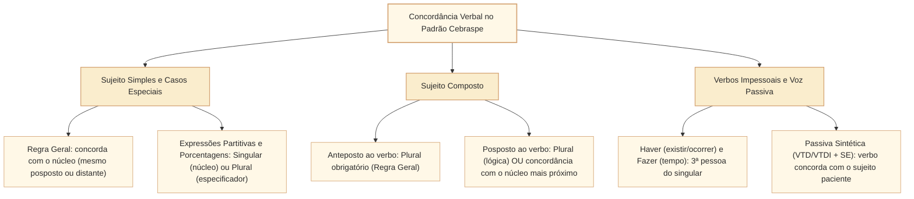
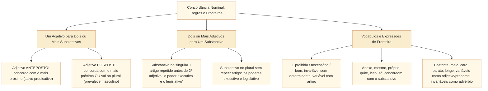

# Concordância verbal e nominal: regras e casos de fronteira no padrão Cebraspe

## 1. Situação-problema: o sujeito distante, o verbo impessoal e a concordância facultativa na redação parlamentar

Durante a revisão final de um parecer na Comissão de Finanças e Tributação (CFT) da Câmara dos Deputados, o analista legislativo depara-se com três períodos que suscitam controvérsia entre os revisores:

> **Período 1:** *"A maioria dos parlamentares titulares da comissão **votou** favoravelmente ao substitutivo, mas **houveram** divergências regimentais quanto ao destaque."*
> **Período 2:** *"Seguem **anexo** as planilhas orçamentárias; **é proibido** a inclusão de novas emendas após o encerramento da discussão."*
> **Período 3:** *"Coube aos relatores setoriais **analisar** os vetos que **foram** apensados ao projeto."*

Se a prova do Cebraspe questionar a correção gramatical desses fragmentos e as substituições possíveis, o candidato precisará distinguir com precisão cirúrgica o que é **opção estilística legítima** (dupla concordância abonada pela norma culta) do que constitui **erro gramatical absoluto**:

1. No **Período 1**, *"A maioria dos parlamentares ... votou"* está **perfeitamente correto**, e a substituição por ***votaram*** também manteria a correção gramatical (sujeito partitivo admite concordância lógica com o núcleo singular *maioria* ou atrativa com o especificador plural *parlamentares*). Porém, a forma ***"houveram divergências"*** é **erro grave**: o verbo *haver* no sentido de existir é **impessoal** (oração sem sujeito) e permanece obrigatoriamente na 3ª pessoa do singular (***houve divergências***).
2. No **Período 2**, há **dois desvios normativos**: o adjetivo *anexo* deve concordar em gênero e número com o substantivo a que se refere (*"Seguem **anexas** as planilhas"*, embora a locução adverbial invariável *"em anexo"* seja admitida com reservas estilísticas), e a estrutura *"é proibido"* exige concordância obrigatória no feminino quando o substantivo sujeito vem determinado por artigo (*"**é proibida** a inclusão"*).
3. No **Período 3**, o infinitivo ***analisar*** é o núcleo de uma **oração subordinada substantiva subjetiva reduzida de infinitivo** (o sujeito oracional do verbo *coube*); por isso, *coube* fica obrigatoriamente no singular. Já o verbo ***foram*** concorda no plural com o antecedente do pronome relativo *que* (*os vetos*).

Esta unidade sistematiza a arquitetura da **concordância verbal e nominal** exigida pelo Cebraspe, aprofundando as regras gerais, os casos de dupla concordância (facultatividade sintática) e os casos de fronteira que mais geram armadilhas nas provas da Câmara dos Deputados.

---

## 2. Arquitetura da concordância verbal: regra geral e sujeito composto

A **concordância verbal** é o mecanismo morfossintático pelo qual o verbo se flexiona em **número** (singular ou plural) e **pessoa** (1ª, 2ª ou 3ª) para harmonizar-se com o núcleo do seu **sujeito** (concordância gramatical ou lógica), ou, em casos especiais abonados pela norma-padrão, com termos adjuntos ou com a ideia de pluralidade (concordância atrativa ou ideológica/silepse).

### 2.1. A armadilha número 1 do Cebraspe: sujeito simples distante ou posposto

Na ordem direta curta (*"O deputado discursou"*), ninguém erra a concordância. O Cebraspe constrói seus itens de prova intercalando **longos adjuntos adnominais preposicionados, apostos ou orações adjetivas** no plural entre o núcleo do sujeito singular e o verbo, ou invertendo a ordem para **Verbo + Sujeito (VS)**:

* **Intercalação longa:** *"O **aumento** [das despesas correntes com pessoal ativo e inativo nas diversas esferas da administração pública] **compromete** [e não 'comprometem'] a meta fiscal."* $\rightarrow$ O verbo concorda estritamente com o núcleo do sujeito (*aumento*, singular), jamais com os núcleos dos adjuntos preposicionados (*despesas*, *esferas*).
* **Ordem inversa (sujeito posposto):** *"Ainda **faltam** aos órgãos de controle interno **instrumentos** eficazes de auditoria contínua."* $\rightarrow$ Quem falta? *Instrumentos eficazes* (sujeito posposto plural). O verbo deve ir ao plural (*faltam*).

### 2.2. Sujeito composto: posição anteposta versus posposta

A posição do sujeito composto em relação ao verbo altera diretamente as possibilidades de concordância:

| Posição e Natureza do Sujeito Composto | Regra de Concordância Verbal | Exemplos Aplicados ao Contexto Legislativo |
| :--- | :--- | :--- |
| **1. Sujeito composto ANTEPOSTO ao verbo** (regra geral) | **Plural obrigatório** (concordância lógica). | *"O **relator** e o **presidente** da comissão **assinaram** a ata."* |
| **2. Sujeito composto ANTEPOSTO com núcleos sinônimos ou em gradação** | **Plural** (preferencial) **OU Singular** (concordância com o núcleo mais próximo). | *"A **decência** e a **honradez** parlamentar **exigem / exige** transparência."* *"Um **olhar**, um **gesto**, uma **palavra** **bastava / bastavam**."* |
| **3. Sujeito composto ANTEPOSTO resumido por pronome indefinido tudo, nada, ninguém, cada um** | **Singular obrigatório**, concordando com o termo resumitivo. | *"Emendas, destaques, requerimentos, **tudo** **foi arquivado** pela Mesa."* |
| **4. Sujeito composto POSPOSTO ao verbo** | **Dupla concordância legítima:** **Plural** (soma dos núcleos) **OU concordância com o núcleo mais próximo** (atrativa). | *"**Discursaram / Discursou** na sessão solene o **presidente** da Câmara e os **líderes** partidários."* |
| **5. Sujeito composto com pessoas gramaticais diferentes** | Prioridade gramatical: **1ª pessoa > 2ª pessoa > 3ª pessoa** no plural. | *"O relator (3ª) e **eu** (1ª) **elaboramos** (1ª pl. - nós) o parecer."* *"**Tu** (2ª) e o **assessor** (3ª) **revisastes** (2ª pl. - vós) / **revisaram** (3ª pl. - vocês) o texto."* |
| **6. Núcleos ligados pela conjunção alternativa OU / NEM** | • **Exclusão mútua:** **Singular obrigatório**. • **Inclusão / adição / retificação:** **Plural** (ou próximo). | • Exclusão: *"Pedro **ou** Paulo **ocupará** a presidência da comissão."* (só há uma vaga). • Inclusão: *"O dolo **ou** a fraude **anulam** o certame."* |
| **7. Núcleos ligados pela preposição COM** | • Sem vírgulas (companhia/soma): **Plural**. • Isolado entre vírgulas (adjunto de companhia): **Singular** (concorda com o 1º núcleo). | • *"O **ministro** com sua **comitiva** **compareceram** à Câmara."* • *"O **ministro**, com sua comitiva, **compareceu** à Câmara."* |

---

## 3. Casos especiais de concordância verbal: partitivos, porcentagens, pronomes e verbos impessoais

### 3.1. Expressões partitivas, coletivos especificados, porcentagens e frações

Quando o sujeito é formado por uma **expressão partitiva** (*a maioria de, a maior parte de, grande parte de, metade de, uma porção de*) ou por um **coletivo** (*um grupo de, um bando de*) seguido de um **especificador no plural**, o Cebraspe cobra sistematicamente a **dupla possibilidade de concordância**:

* **Concordância gramatical (com o núcleo partitivo singular):** *"A **maioria** dos deputados **aprovou** a matéria."* (Forma preferencial na redação oficial).
* **Concordância atrativa/nocional (com o termo especificador plural):** *"A maioria dos **deputados** **aprovaram** a matéria."*
* **Sentença clássica do Cebraspe:** *"A substituição de 'aprovou' por 'aprovaram' preserva a correção gramatical do período"* $\rightarrow$ **CERTO**.

Para **porcentagens** e **frações**, a regra segue a mesma lógica, mas exige atenção aos determinantes:

1. **Porcentagem + especificador plural:** admite concordância com o número percentual ou com o substantivo especificador:
   * *"**1%** dos eleitores **compareceu / compareceram**."*
   * *"**30%** do orçamento **foi executado / foram executados**."*
2. **Porcentagem antecedida por determinante (artigo ou pronome plural):** o determinante força o **plural obrigatório**:
   * *"**Os** 30% do orçamento **foram executados**."* (Incorreto: *foi executado*).
3. **Frações:** o verbo concorda prioritariamente com o **numerador** da fração, admitindo também a concordância atrativa com o especificador:
   * *"**Um** terço dos processos **foi julgado** (ou **foram julgados**)."*
   * *"**Dois** terços da Câmara **aprovaram** a emenda constitucional."*

### 3.2. Expressões de quantidade aproximada (*mais de um, menos de dois, cerca de*)

* **Mais de um + substantivo singular:** leva o verbo para o **singular**, concordando com o numeral *um*:
  * *"Mais de **um** parlamentar **apresentou** voto em separado."*
* **Exceções de plural com *mais de um*:** o verbo vai para o **plural** apenas quando a expressão é **repetida** ou indica **reciprocidade**:
  * *"Mais de um deputado, mais de um senador **defenderam** a proposta."* (Repetição).
  * *"Mais de um parlamentar **agrediram-se** verbalmente no plenário."* (Reciprocidade).
* **Cerca de / perto de / menos de + numeral plural:** o verbo concorda com o numeral plural:
  * *"Cerca de **vinte** emendas **foram rejeitadas**."*

### 3.3. Pronomes relativos *QUE* e *QUEM*

A diferença entre *que* e *quem* na função de sujeito da oração adjetiva é um clássico de prova:

| Pronome Relativo | Regra de Concordância Verbal | Exemplo Canônico |
| :--- | :--- | :--- |
| **QUE** | O verbo concorda **obrigatoriamente** em número e pessoa com o **antecedente** do pronome *que*. | *"Fui **eu** que **religi** (1ª sing.) a minuta."* *"Fomos **nós** que **propusemos** (1ª pl.) a emenda."* *"Assinaram **os dois analistas** que **revisaram** (3ª pl.) o parecer."* |
| **QUEM** | Admite **dupla concordância**: 1. Na **3ª pessoa do singular** (concordando com o próprio pronome *quem*, que equivale a *aquele que*); **OU** 2. Concordando em número e pessoa com o **antecedente**. | *"Fui **eu** quem **redigiu** (3ª sing. - tradicional) / quem **redigi** (1ª sing. - antecedente) a minuta."* *"Fomos **nós** quem **propôs** (3ª sing.) / quem **propusemos** (1ª pl.) a emenda."* |

* **Atenção para *"um dos que"*:** Na construção *"um dos + substantivo plural + que"*, o verbo da oração adjetiva vai preferencialmente para o **plural** (concordando com o conjunto), mas admite o **singular** quando se quer destacar apenas o indivíduo ou quando há exclusividade lógica:
  * *"O deputado foi um dos **parlamentares** que **votaram** (ou **votou**) contra o texto."*

### 3.4. Verbos impessoais, locuções verbais e passiva sintética

1. **Verbos impessoais (*haver* = existir/ocorrer/tempo decorrido; *fazer* = tempo decorrido/clima; fenômenos da natureza em sentido próprio):**
   * Não possuem sujeito; ficam **invariavelmente na 3ª pessoa do singular**: *"Deve **haver** soluções técnicas"*, *"**Faz** dez anos que a lei entrou em vigor"*.
   * **Contaminação na locução verbal:** o verbo impessoal principal (*haver, fazer*) **transmite sua impessoalidade ao verbo auxiliar** (*dever, poder, ir, começar a, continuar a*):
     * **Correto:** *"Pode **haver** contestações"*, *"Vai **fazer** cinco meses"*.
     * **Incorreto:** *"Podem haver contestações"*, *"Vão fazer cinco meses"*.
   * **Contraste com *existir, ocorrer, acontecer, surgir*:** esses verbos são **pessoais** (têm sujeito) e concordam normalmente no plural, inclusive em locuções: *"Podem **existir** contestações"*, *"Devem **ocorrer** debates"*.
2. **Voz passiva sintética (VTD/VTDI + pronome apassivador *se*) versus Índice de indeterminação do sujeito (VTI/VI/VL + *se*):**
   * Com **VTD ou VTDI**, o termo sem preposição é o **sujeito paciente**, e o verbo concorda obrigatoriamente com ele: *"**Analisaram-se** os **recursos**"*, *"Não se **devem aprovar** tais **medidas**"*.
   * Com **VTI, VI ou VL**, o sujeito é **indeterminado**, e o verbo fica obrigatoriamente na **3ª pessoa do singular**: *"**Trata-se** de **questões** regimentais"*, *"**Procedeu-se** às **apurações**"*, *"Não se **pode abrir** mão de **garantias**"*.
   * **Pegadinha clássica com oração subjetiva:** Em *"Espera-se **que as emendas sejam aprovadas**"*, o sujeito de *espera-se* é a **oração inteira** (*que as emendas sejam aprovadas* = *Espera-se ISSO*). Como todo sujeito oracional equivale a um substantivo singular, o verbo principal fica **obrigatoriamente no singular** (*Espera-se*, e nunca *Esperam-se que...*).

### 3.5. Concordância do verbo *SER* e dos pronomes *quais/quantos de nós*

O verbo **ser** é o único verbo da língua portuguesa que pode concordar ora com o sujeito, ora com o **predicativo do sujeito**:

* **Horas, datas e distâncias (verbo *ser* impessoal):** concorda obrigatoriamente com a expressão numérica do predicativo: *"**É** uma hora"*, *"**São** duas horas"*, *"**São** dez quilômetros até o Congresso"*. Nas datas, admite o plural (*"Hoje **são** 15 de março"*) ou o singular por elipse da palavra *dia* (*"Hoje **é** [dia] 15 de março"*).
* **Sujeito pessoa ou pronome pessoal:** a pessoa gramatical e o substantivo próprio/pessoa **prevalecem sempre** sobre coisas no plural: *"**João** **é** as alegrias da casa"*, *"As metas da secretaria **somos** **nós**"*.
* **Sujeito coisa singular + predicativo coisa plural:** o verbo concorda preferencialmente no **plural** com o predicativo: *"O problema da sessão **foram** os **requerimentos** protelatórios"*.
* **Sujeito *tudo, isto, isso, aquilo, o que* + predicativo plural:** admite o plural (preferencial) ou o singular: *"Tudo **são / é** flores"*, *"O que se viu **foram** debates acalorados"*.
* **Expressões de quantidade/preço/peso (*é muito, é pouco, é suficiente, é demais*):** o verbo *ser* fica invariavelmente no **singular**: *"Dez milhões de reais **é pouco** para a obra"*, *"Três horas de sessão **é suficiente**"*.
* **Pronomes interrogativos ou indefinidos seguidos de *de nós / de vós*:**
  * Se o primeiro pronome estiver no **singular** (*qual, algum, nenhum, cada um*), o verbo fica obrigatoriamente na **3ª pessoa do singular**: *"**Qual** de nós **relatará** o projeto?"*.
  * Se o primeiro pronome estiver no **plural** (*quais, quantos, alguns, muitos*), o verbo pode ficar na **3ª pessoa do plural** (concordando com o pronome inicial) ou concordar com o **pronome pessoal** (*nós/vós*): *"**Quais** de nós **relatarão** (3ª pl.) / **relataremos** (1ª pl.) o projeto?"*.

---

## 4. Arquitetura da concordância nominal: regras gerais e vocábulos de fronteira

A **concordância nominal** rege a adaptação de gênero (masculino/feminino) e número (singular/plural) dos determinantes (artigos, pronomes, numerais) e modificadores (adjetivos e particípios) ao **substantivo** a que se referem.

### 4.1. Posição do adjetivo em relação a dois ou mais substantivos

1. **Adjetivo ANTEPOSTO a dois ou mais substantivos (função de adjunto adnominal):** concorda obrigatoriamente com o substantivo **mais próximo**:
   * *"O relator apresentou **sólida** **fundamentação** e **argumentos**."*
   * *"O relator apresentou **sólidos** **argumentos** e **fundamentação**."*
   * *Exceção:* Se os substantivos forem nomes próprios/parentesco ou se o adjetivo exercer função de **predicativo** (do sujeito ou do objeto), admite-se também o plural: *"Julgou **inconstitucionais** (ou **inconstitucional**) o **artigo** e a **emenda**."*
2. **Adjetivo POSPOSTO a dois ou mais substantivos:** admite **dupla concordância**:
   * **Concordância atrativa (com o substantivo mais próximo):** *"A comissão analisou o **orçamento** e a **diretriz** **aprovada**."*
   * **Concordância lógica/gramatical (no plural, prevalecendo o masculino se houver gêneros diferentes):** *"A comissão analisou o **orçamento** e a **diretriz** **aprovados**."*

### 4.2. Quadro sinóptico dos vocábulos de fronteira na concordância nominal

O Cebraspe concentra suas questões de concordância nominal em palavras que mudam de comportamento conforme a presença de determinantes ou a mudança de classe morfológica:

| Vocábulo / Expressão | Comportamento Variável (Adjetivo / Pronome) | Comportamento Invariável (Advérbio / Expressão Fixa) |
| :--- | :--- | :--- |
| **É proibido / É necessário / É bom / É permitido / É preciso** | **Variável** quando o substantivo sujeito vem **determinado** por artigo ou pronome: *"**É proibida a** entrada de estranhos."*, *"**São necessárias estas** reformas."* | **Invariável (masculino singular)** quando o substantivo sujeito vem **sem determinante** (sentido genérico): *"**É proibido** entrada."*, *"**É necessário** cautela."* |
| **Anexo / Incluso / Apenso** | Adjetivos: concordam em gênero e número com o substantivo: *"Seguem **anexas / inclusas / apensas** as notas técnicas."* | A locução adverbial ***"em anexo"*** é invariável: *"Seguem **em anexo** as notas técnicas."* |
| **Mesmo / Próprio** | Pronomes de reforço (= *em pessoa*): concordam com o nome/pronome: *"**Elas mesmas / próprias** redigiram o voto."* | *Mesmo* como advérbio (= *realmente, até, de fato*) é invariável: *"Elas redigiram **mesmo** o voto."* |
| **Bastante** | Pronome indefinido ou adjetivo (= *muitos / suficientes*): concorda no plural: *"Há **bastantes** razões."*, *"As provas são **bastantes**."* | Advérbio de intensidade (= *muito*) antes de verbo, adjetivo ou advérbio: invariável: *"Os deputados estão **bastante** preocupados."* |
| **Meio** | Numeral fracionário ou adjetivo (= *metade*): concorda com o substantivo: *"Passou **meia** hora."*, *"Disse **meias** palavras."* | Advérbio de intensidade (= *um pouco*) modificando adjetivo: invariável: *"A sessão ficou **meio** tensa."* |
| **Só / Sós** | Adjetivo (= *sozinho/sozinhos*): concorda em número: *"Os relatores ficaram **sós** na sala."* | Advérbio (= *apenas, somente*) ou locução ***a sós***: invariáveis: *"**Só** os relatores votaram."*, *"Conversaram **a sós**."* |
| **Quite / Leso** | Adjetivos: concordam obrigatoriamente com o substantivo: *"Os servidores estão **quites** com o erário."*, *"Crime de **lesa**-pátria / **leso**-patrimônio."* | Não possuem uso adverbial invariável. |
| **Obrigado / Agradecido** | Adjetivos: concordam com o gênero e número de quem fala: *"**Muito obrigada**, disse a deputada."* | — |
| **Menos / Alerta / Pseudo** | *Alerta* só varia como substantivo (*"Soaram dois **alertas**"*). | **Invariáveis:** *"Havia **menos** propostas"* (não existe *menas*), *"Os seguranças estão **alerta**"*, *"**Pseudo**-histórias"*. |
| **Haja vista** | Admite variação no plural (*"**Hajam vista** os resultados"*) quando o substantivo seguinte não tem preposição. | Preferencialmente invariável no singular, com ou sem a preposição *a*: *"**Haja vista** os resultados / **Haja vista aos** resultados"*. (Jamais usar *"haja visto"*). |
| **Possível** | Concorda com o artigo da expressão superlativa: *"Projetos **o** mais claros **possível**"* $\times$ *"Projetos **os** mais claros **possíveis**."* | — |

---

## 5. Casos progressivos e casos de fronteira em textos da Câmara dos Deputados

### Caso 1: Sujeito partitivo com oração adjetiva ("A maioria dos deputados que...")
Considere o período:
> *"A maioria dos deputados titulares que **participaram** da audiência pública **manifestou** apoio à proposta."*

* **Análise sintática de fronteira:** Há **dois verbos** no período, cada um com seu respectivo sujeito:
  1. O verbo ***manifestou*** (oração principal) tem como sujeito a expressão partitiva *"A maioria dos deputados titulares"*. Por isso, admite tanto o singular (***manifestou***, concordando com *maioria*) quanto o plural (***manifestaram***, concordando com *deputados*).
  2. O verbo ***participaram*** (oração subordinada adjetiva restritiva) tem como sujeito o pronome relativo ***que***. A pergunta decisiva é: quem é o antecedente semântico do *que*? Se a restrição se aplica aos *deputados titulares* (entre os deputados que participaram, a maioria apoiou), o verbo fica no plural (***participaram***). Se o redator quiser referir-se ao coletivo *maioria*, o singular (***participou***) também é abonado pela gramática normativa.
* **Como o Cebraspe cobra:** A banca costuma afirmar que, nesse tipo de construção, **ambos os verbos** admitem flexão no singular ou no plural sem prejuízo da correção gramatical $\rightarrow$ **CERTO**.

### Caso 2: Fronteira entre passiva sintética, indeterminação do sujeito e sujeito oracional
Compare os três enunciados:
1. *"Nas comissões permanentes, **analisam-se** minuciosamente **as emendas parlamentares**."*
2. *"Nas comissões permanentes, **procede-se** minuciosamente **à análise das emendas**."*
3. *"Nas comissões permanentes, **espera-se** **que as emendas sejam analisadas no prazo**."*

* **Explicação estrutural:**
  * No enunciado **1**, *analisar* é verbo transitivo direto (VTD); *as emendas parlamentares* é sujeito paciente plural $\rightarrow$ verbo obrigatoriamente no plural (***analisam-se***).
  * No enunciado **2**, *proceder* no sentido de realizar é verbo transitivo indireto (VTI, regendo preposição *a*); o *se* é índice de indeterminação do sujeito $\rightarrow$ verbo obrigatoriamente na 3ª pessoa do singular (***procede-se***).
  * No enunciado **3**, *esperar* é VTD e o *se* é pronome apassivador, mas o sujeito paciente é uma **oração subordinada substantiva subjetiva** (*que as emendas sejam analisadas no prazo*). Como todo sujeito oracional impõe concordância na 3ª pessoa do singular, o verbo fica obrigatoriamente no singular (***espera-se***), sendo **incorreto** escrever *"esperam-se que..."*.

---

## 6. Itens comentados no padrão Cebraspe (Certo/Errado)

*(Inédita: estilo Cebraspe / Câmara dos Deputados – Analista Legislativo)*
> **Texto de referência:**
> "Ao longo da atual sessão legislativa, mais de um terço das proposições apresentadas pelas lideranças partidárias tratava de matérias tributárias, embora ainda houvesse dúvidas técnicas sobre o impacto fiscal das medidas e faltassem estimativas oficiais da receita."

**Item 1.** *(Inédita: estilo Cebraspe / Câmara dos Deputados – Analista Legislativo)* A substituição da forma verbal **tratava** por **tratavam** preservaria a correção gramatical e a coerência do período, dada a natureza partitiva e fracionária da expressão que exerce a função de sujeito dessa forma verbal.
* **Gabarito:** **CERTO**.
* **Fundamentação:** O sujeito da forma verbal *tratava* é *"mais de um terço das proposições apresentadas pelas lideranças partidárias"*. Quando o sujeito é constituído por expressão fracionária ou partitiva (*um terço de*) seguida de substantivo especificador no plural (*das proposições*), a norma culta abona a dupla concordância: no singular (*tratava*, concordando com o numerador *um terço*) ou no plural (*tratavam*, concordando por atração com o especificador *proposições*).

**Item 2.** *(Inédita: estilo Cebraspe / Câmara dos Deputados – Analista Legislativo)* Caso o vocábulo **dúvidas** fosse considerado o núcleo do sujeito da oração introduzida por **embora**, a forma verbal **houvesse** deveria ser flexionada no plural — **houvessem** —, em paralelismo sintático com a forma verbal **faltassem**.
* **Gabarito:** **ERRADO**.
* **Fundamentação:** O verbo *haver*, quando empregado no sentido de *existir*, é **impessoal** (oração sem sujeito) e deve permanecer invariavelmente na 3ª pessoa do singular (*houvesse*). O termo *"dúvidas técnicas"* exerce a função sintática de **objeto direto** de *houvesse*, e não de sujeito. Já o verbo *faltar* (*faltassem*) é pessoal e concorda regularmente no plural com o seu sujeito posposto (*"estimativas oficiais da receita"*).

**Item 3.** *(Inédita: estilo Cebraspe / Câmara dos Deputados – Analista Legislativo)* No trecho *"Coube à Mesa Diretora e ao Colégio de Líderes a definição do calendário de votações"*, a substituição de **Coube** por **Couberam** manteria a correção gramatical do período, visto que o verbo antecede um termo composto.
* **Gabarito:** **ERRADO**.
* **Fundamentação:** Armadilha clássica de identificação do sujeito. O termo *"à Mesa Diretora e ao Colégio de Líderes"* é introduzido pela preposição *a* (objeto indireto de *caber*) e **não pode ser sujeito**, pois núcleo de sujeito não é regido por preposição. O verdadeiro sujeito do verbo *Coube* é o termo simples posposto ***"a definição do calendário de votações"*** (núcleo: *definição*, singular). Portanto, o verbo deve permanecer obrigatoriamente no singular (*Coube*).

**Item 4.** *(Inédita: estilo Cebraspe / Câmara dos Deputados – Analista Legislativo)* Na sentença *"Já passa das vinte horas, e ainda não se votaram os destaques aos quais se referiam a liderança do governo e a oposição"*, tanto a flexão singular em **passa** quanto as flexões plurais em **votaram** e **referiam** atendem integralmente às prescrições da norma-padrão.
* **Gabarito:** **CERTO**.
* **Fundamentação:** (1) O verbo *passar*, quando indica tempo seguido da preposição *de* (*"passa das vinte horas"*), é **impessoal** e fica na 3ª pessoa do singular. (2) Em *"não se votaram os destaques"*, temos voz passiva sintética (*votar* é VTD + *se* apassivador), e o verbo concorda no plural com o sujeito paciente *os destaques*. (3) Em *"aos quais se referiam a liderança do governo e a oposição"*, o sujeito composto posposto (*a liderança do governo e a oposição*) autoriza a concordância lógica no plural (*referiam*) ou a atrativa no singular (*referia*).

**Item 5.** *(Inédita: estilo Cebraspe / Câmara dos Deputados – Analista Legislativo)* O período *"É necessário cautela na tramitação de matérias urgentes, haja vista as repercussões financeiras que seguem anexas ao relatório"* está inteiramente de acordo com as regras de concordância nominal e verbal da língua portuguesa.
* **Gabarito:** **CERTO**.
* **Fundamentação:** (1) A expressão *"É necessário"* permanece invariável no masculino singular porque o substantivo sujeito *cautela* não está determinado por artigo ou pronome. (2) A expressão *"haja vista"* é corretamente empregada de forma invariável (admitindo também *"hajam vista"* diante de substantivo plural sem preposição). (3) O adjetivo *"anexas"* concorda regularmente no feminino plural com o referente *"as repercussões financeiras"* (retomado pelo relativo *que*).

**Item 6.** *(Inédita: estilo Cebraspe / Câmara dos Deputados – Analista Legislativo)* Se, no trecho *"No âmbito das comissões, exige-se que os pareceres contenham estimativa de impacto orçamentário"*, a conjunção **que** fosse suprimida e o verbo **contenham** fosse flexionado no infinitivo (**conterem**), a forma verbal **exige-se** deveria ser obrigatoriamente alterada para **exigem-se**, para concordar com **os pareceres**.
* **Gabarito:** **ERRADO**.
* **Fundamentação:** Mesmo que a oração subordinada substantiva subjetiva desenvolvida (*"que os pareceres contenham..."*) seja convertida na forma reduzida de infinitivo (*"conterem os pareceres estimativa..."*), o sujeito do verbo *exigir* continua sendo a **oração inteira** (sujeito oracional: *exige-se ISSO*), e o termo *os pareceres* continua sendo o sujeito interno do infinitivo *conterem*, e não de *exigir*. Como todo sujeito oracional leva o verbo principal para a 3ª pessoa do singular, a forma ***exige-se*** deve permanecer no singular.

---

## 7. Relações com outros conceitos e notas da biblioteca

* **Sintaxe do sujeito e termos da oração (pré-requisito direto):** [[3 - Materias/Portugues/23 - termos essenciais integrantes e acessorios da oracao|23 • Termos essenciais, integrantes e acessórios da oração (CAM-LP-012)]] e [[3 - Materias/Portugues/02 - sujeito|02 • Sujeito e termos da oração]].
* **Classes de palavras e funções do "SE" e do "QUE":** [[3 - Materias/Portugues/22 - classes de palavras e suas funcoes no periodo|22 • Classes de palavras e suas funções no período (CAM-LP-011)]].
* **Nota de base preexistente sobre concordância:** [[3 - Materias/Portugues/06 - concordancia verbal e nominal|06 • Concordância verbal e nominal]].
* **Próximo passo (Regência verbal e nominal):** [[3 - Materias/Portugues/04 - regencia|04 • Regência verbal e nominal]].

## 8. Referências teóricas e normativas

* BECHARA, Evanildo. **Moderna Gramática Portuguesa**. 39. ed. Rio de Janeiro: Nova Fronteira, 2019. (Capítulos sobre Concordância Verbal e Concordância Nominal).
* CUNHA, Celso; CINTRA, Lindley. **Nova Gramática do Português Contemporâneo**. 7. ed. Rio de Janeiro: Lexikon, 2017.
* BRASIL. Presidência da República. **Manual de Redação da Presidência da República**. 3. ed. rev., atual. e ampl. Brasília: Presidência da República, 2018.
* ROCHA LIMA, Carlos Henrique da. **Gramática Normativa da Língua Portuguesa**. 53. ed. Rio de Janeiro: José Olympio, 2017.
