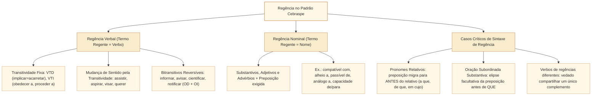

# Regência verbal e nominal: transitividade, preposições e mudanças de sentido no padrão Cebraspe

## 1. Situação-problema: quando uma preposição altera a correção gramatical ou inverte o sentido da norma

Na redação de um parecer da Comissão de Constituição e Justiça e de Cidadania (CCJC) da Câmara dos Deputados, o analista legislativo examina quatro construções enviadas pelo gabinete do relator:

> **Trecho 1:** *"A emenda substitutiva **implica em** aumento de despesa sem a correspondente fonte de custeio."*
> **Trecho 2:** *"O texto original **visava** o aperfeiçoamento do controle externo, razão pela qual o relator **procedeu** a leitura do voto."*
> **Trecho 3:** *"A proposição **a que** os parlamentares fizeram referência e **de cujos** dispositivos discordaram foi retirada de pauta."*
> **Trecho 4:** *"A Mesa Diretora **informou** os deputados **sobre** a mudança do horário da sessão extraordinária."*

Como o Cebraspe avalia cada um desses quatro casos em itens de **correção gramatical** e **reescrita textual**?

1. No **Trecho 1**, há um **desvio clássico da norma-padrão**: o verbo ***implicar***, no sentido de *acarretar, produzir como consequência*, é **transitivo direto (VTD)** e **rejeita a preposição *em*** (*"implica aumento de despesa"*).
2. No **Trecho 2**, embora *visar* no sentido de *ter como objetivo* seja tradicionalmente transitivo indireto (*"visava ao aperfeiçoamento"*), a gramática contemporânea e o próprio Cebraspe **abonam também a transitividade direta** sem preposição (*"visava o aperfeiçoamento"*). Já em *"procedeu a leitura"*, há **erro gramatical**: *proceder* no sentido de *realizar, dar início* é **transitivo indireto (VTI)** e exige a preposição *a*, o que tornaria obrigatório o acento grave indicativo de crase diante do substantivo feminino (*"**procedeu à** leitura"*).
3. No **Trecho 3**, a regência com pronomes relativos está **exemplar**: quem faz referência, faz referência **a** algo (*"**a que** fizeram referência"*), e quem discorda, discorda **de** algo (*"**de cujos** dispositivos discordaram"* — a preposição exigida pelo verbo *discordar* migra obrigatoriamente para antes do relativo *cujos*).
4. No **Trecho 4**, o verbo bitransitivo ***informar*** está corretamente construído no esquema **OD (pessoa: *os deputados*) + OI (coisa: *sobre a mudança / da mudança*)**. Se o redator quisesse converter *os deputados* em objeto indireto (*"informou **aos deputados**"*), a segunda parte teria de tornar-se obrigatoriamente objeto direto sem preposição (*"**a mudança** do horário"*), pois a norma culta proíbe dois objetos indiretos para o mesmo verbo (*"informou aos deputados sobre a mudança"* é incorreto).

Esta unidade estuda em profundidade a **regência verbal e nominal**, o repertório completo dos verbos que mudam de sentido conforme a transitividade, a migração de preposições antes de pronomes relativos e as restrições de regência compartilhada cobradas pelo Cebraspe.

---

## 2. Fundamentos da regência: subordinação, termo regente e termo regido

A **regência** é o mecanismo sintático de dependência (subordinação) pelo qual um **termo regente** (verbo ou nome: substantivo, adjetivo ou advérbio) seleciona e governa seus **termos regidos** (complementos verbais ou nominais), determinando se a ligação ocorrerá **diretamente** (sem preposição) ou **indiretamente** (mediada por uma preposição específica, chamada *preposição relacional*).

---

## 3. Repertório estratégico de regência verbal: transitividade e mudança de sentido

O Cebraspe avalia a regência verbal em duas frentes: (1) se a inserção ou supressão de uma preposição **mantém a correção gramatical** e (2) se essa alteração **preserva ou muda o sentido original do texto**.

### 3.1. Verbos cuja transitividade altera o sentido

| Verbo | Como Transitivo Direto (VTD — sem preposição) | Como Transitivo Indireto (VTI — com preposição) |
| :--- | :--- | :--- |
| **ASSISTIR** | **Ajudar, prestar assistência, socorrer, assessorar:** *"A consultoria legislativa **assistiu o relator** (assistiu-o)."* | 1. **Ver, presenciar, acompanhar** (rege prep. ***a***; **não admite *lhe***, usa-se ***a ele/a ela***): *"Os deputados **assistiram à sessão** (assistiram **a ela**)."* 2. **Caber, pertencer direito** (rege prep. ***a***; **admite *lhe***): *"**Assiste ao parlamentar** (**assiste-lhe**) o direito de voz."* 3. **Morar, residir** (intransitivo com prep. ***em*** — raro): *"O servidor **assiste em** Brasília."* |
| **ASPIRAR** | **Inalar, sorver, respirar:** *"Os presentes **aspiraram a poeira** do arquivo (aspiraram-na)."* | **Desejar, almejar, pretender** (rege prep. ***a***; **não admite *lhe***, usa-se ***a ele/a ela***): *"O partido **aspira à presidência** da Casa (aspira **a ela**)."* |
| **VISAR** | 1. **Mirar** (apontar arma) ou **pôr visto / assinar / rubricar:** *"O diretor **visou os documentos** (visou-os)."* 2. **Ter em vista, objetivar:** embora a tradição prescreva VTI (*visar a*), o Cebraspe **aceita também como VTD** (*"A lei **visa proteger / visa o bem comum**"*). | **Ter em vista, almejar, ter como objetivo** (rege prep. ***a***; **não admite *lhe***, usa-se ***a ele/a ela***): *"A reforma **visa ao equilíbrio** fiscal (visa **a ele**)."* |
| **QUERER** | **Desejar, pretender, ter vontade de:** *"A bancada **quer a aprovação** imediata do texto."* | **Estimar, ter afeto, gostar muito de** (rege prep. ***a***; **admite *lhe***): *"O decano **quer muito aos colegas** (**quer-lhes** bem)."* |
| **PROCEDER** | *(Não possui uso como VTD na norma-padrão)* | 1. **Ter fundamento, fazer sentido** (Intransitivo — VI): *"As alegações da defesa **não procedem**."* 2. **Originar-se, provir** (VI/VTI com prep. ***de***): *"O recurso **procede da** comissão especial."* 3. **Dar início, realizar, executar** (VTI com prep. ***a***): *"A Mesa **procedeu à apuração** dos votos."* |
| **IMPLICAR** | **Acarretar, gerar, produzir como consequência** (**VTD** — **sem** a preposição *em*): *"A renúncia **implica a perda** das prerrogativas."* | 1. **Ter implicância, antipatizar** (VTI com prep. ***com***): *"O líder **implicava com** o regimento."* 2. **Envolver-se, comprometer-se** (VTDI / pronominal com prep. ***em***): *"O agente **implicou-se em** irregularidades."* |
| **CHAMAR** | **Convocar, fazer vir** (VTD): *"O presidente **chamou os líderes** ao gabinete."* | 1. **Invocar** (VTI com prep. ***por***): *"Chamou **pela** segurança."* 2. **Qualificar, apelidar, tachar** (admite **quatro construções** com predicativo do objeto): • VTD + predicativo sem prep.: *"Chamaram **o ato** (OD) **inconstitucional**."* • VTD + prep. *de*: *"Chamaram **o ato** (OD) **de inconstitucional**."* • VTI + sem prep.: *"Chamaram **ao ato** (OI) **inconstitucional**."* • VTI + prep. *de*: *"Chamaram **ao ato** (OI) **de inconstitucional**."* |

### 3.2. Verbos de regência crítica constante em provas

1. **OBEDECER e DESOBEDECER:** São **estritamente transitivos indiretos (VTI)** e exigem a preposição ***a*** (*"obedecer **ao** Regimento Interno"*, *"desobedecer **às** normas constitucionais"*). Admitem o pronome ***lhe/lhes***. Apesar de serem VTI, são uma raríssima exceção histórica que **admite voz passiva analítica** (*"O Regimento foi obedecido"*).
2. **PREFERIR:** No padrão culto, é bitransitivo (**VTDI**) no esquema ***preferir X (OD) a Y (OI com preposição "a")***.
   * **Proibições absolutas com *preferir*:** Jamais usar *preferir mais*, *preferir antes*, *preferir muito mais* (pleonasmos viciosos) nem usar *do que* ou *que* (*"Prefiro o debate **ao** adiamento"*, e nunca *"Prefiro mais o debate do que o adiamento"*).
3. **INFORMAR, AVISAR, CERTIFICAR, NOTIFICAR, CIENTIFICAR, PREVENIR, INCUMBIR:** São bitransitivos (**VTDI**) com **dupla construção reversível**:
   * **Esquema A (OD = pessoa + OI = coisa com *de / sobre*):** *"A secretaria informou **os parlamentares** (OD: **os**) **da pauta / sobre a pauta** (OI)."*
   * **Esquema B (OI = pessoa com *a* + OD = coisa sem preposição):** *"A secretaria informou **aos parlamentares** (OI: **lhes**) **a pauta** (OD)."*
   * *Com oração subordinada:* Se a "coisa" for uma oração iniciada por *que*, pode-se dizer tanto *"Informou **os parlamentares de que** a sessão foi suspensa"* (ou com elipse da preposição: *"Informou **os parlamentares que**..."*) quanto *"Informou **aos parlamentares que** a sessão foi suspensa"*.
4. **LEMBRAR e ESQUECER (e *recordar*):**
   * **Sem pronome oblíquo reflexivo** (*me, te, se, nos, vos*): são **VTD** (sem preposição): *"O relator **esqueceu o prazo**"*, *"Eu **lembrei o precedente** do STF"*.
   * **Pronominais** (*lembrar-se, esquecer-se, recordar-se*): são **VTI** e exigem obrigatoriamente a preposição ***de***: *"O relator **esqueceu-se do** prazo"*, *"Eu **lembrei-me do** precedente"*.
   * *Sentido de "vir à lembrança / ocorrer":* Funciona como *agradar*: *"Aquela cláusula não **lhe** lembrou"* (= não veio à memória dele).
5. **PAGAR e PERDOAR:**
   * Quando o complemento é **coisa** (a dívida, o imposto, a ofensa), é **objeto direto (VTD)**: *"O Estado **pagou os precatórios**"* (*pagou-os*), *"A lei **perdoou as multas**"*.
   * Quando o complemento é **pessoa/instituição** (quem recebe o pagamento ou o perdão), é **objeto indireto (VTI com preposição *a*)**: *"O Estado **pagou aos fornecedores**"* (*pagou-lhes*).
   * Com ambos: **VTDI**: *"O Estado **pagou os precatórios aos fornecedores**."*
6. **AGRADAR:**
   * No sentido de **fazer carinho / acariciar**, é **VTD**: *"A mãe **agradou o filho**."*
   * No sentido de **ser agradável / satisfazer / contentar**, é **VTI (rege preposição *a*)**: *"O substitutivo **agradou à bancada** governista (*agradou-lhe*)."*
7. **SIMPATIZAR e ANTIPATIZAR:** São **VTI (regem preposição *com*)**, mas **NÃO são pronominais** (jamais usar *me, se, nos*): *"O eleitorado **simpatizou com** a proposta"* (Incorreto: *"simpatizou-se com"*).
8. **CHEGAR, IR, DIRIGIR-SE, RETORNAR, COMPARECER:** Na norma culta, exigem a preposição ***a*** (ou ***para***) na indicação de destino, e não a preposição *em*: *"Os deputados **chegaram ao** plenário"*, *"O ministro **compareceu à** comissão"*.
9. **MORAR, RESIDIR, SITUAR-SE, SEDIAR-SE:** Exigem a preposição ***em***, e não a preposição *a*: *"O servidor **reside na** Asa Norte (em + a)"*, e não *"reside à Rua X"*.
10. **RESPONDER:** No sentido de dar resposta a algo ou a alguém, é **VTI (rege preposição *a*)** quanto ao destinatário ou à pergunta (*"O ministro **respondeu aos questionamentos** da oposição"*), embora admita OD para o conteúdo exato do que foi dito (*"Respondeu **que não havia irregularidades**"*).
11. **CUSTAR:** No sentido de *ser difícil / penoso*, tem como sujeito uma **oração reduzida de infinitivo**, fica na **3ª pessoa do singular** e a pessoa é objeto indireto: *"**Custou ao relator** (**Custou-lhe**) **aceitar** a emenda"* (Na norma-padrão estrita, evita-se *"O relator custou a aceitar"*).

---

## 4. Casos críticos de sintaxe de regência no Cebraspe

### 4.1. Regência com pronomes relativos: a migração obrigatória da preposição

Esta é uma das estruturas mais cobradas em toda a prova de Língua Portuguesa do Cebraspe. Quando uma oração subordinada adjetiva é introduzida por um pronome relativo (*que, quem, o qual, cujo, onde*), **o verbo ou o nome situado dentro da oração adjetiva manda a sua preposição para ANTES do pronome relativo**:

$$\text{Preposição exigida pelo verbo/nome da 2ª oração} + \text{Pronome Relativo}$$

* **Exemplos práticos:**
  1. *"A comissão analisou o projeto. Os cidadãos **confiam no (em + o)** projeto."*
     $\rightarrow$ *"A comissão analisou o projeto **em que / no qual** os cidadãos **confiam**."*
  2. *"Foram aprovadas as metas. O governo **aludia às (a + as)** metas."*
     $\rightarrow$ *"Foram aprovadas as metas **a que / às quais** o governo **aludia**."*
  3. *"O parecer citou a jurisprudência. Os ministros **basearam-se na (em + a)** jurisprudência."*
     $\rightarrow$ *"O parecer citou a jurisprudência **em que / na qual** os ministros **se basearam**."*
  4. **Com o relativo *CUJO*:** O pronome *cujo* nunca tem artigo depois dele, mas **recebe antes de si a preposição exigida pelo verbo ou nome subordinante**:
     * *"A lei **a cujos** artigos **obedecemos**..."* (*obedecer **a***).
     * *"O relatório **de cujas** conclusões **discordamos**..."* (*discordar **de***).
     * *"O fundo **com cujos** recursos **contamos**..."* (*contar **com***).

### 4.2. Supressão (elipse) ou manutenção da preposição antes de oração subordinada substantiva

Nas **orações subordinadas substantivas objetivas indiretas** e **completivas nominais** (iniciadas pela conjunção integrante *que* ou reduzidas de infinitivo), a preposição é teoricamente exigida pelo verbo ou nome regente (*necessitar de, convencer-se de, ter certeza de, insistir em*). Contudo, a gramática normativa (Bechara, Celso Cunha) e a jurisprudência consolidada do Cebraspe estabelecem que:

* **Antes da conjunção integrante *QUE*, a preposição pode ser mantida ou elidida (suprimida) sem prejuízo da correção gramatical:**
  * *"A comissão tem certeza **de que** o projeto é constitucional"* $\equiv$ *"A comissão tem certeza **que** o projeto é constitucional"* (**Ambas corretas no Cebraspe**).
  * *"O relator insistiu **em que** a votação ocorresse hoje"* $\equiv$ *"O relator insistiu **que** a votação ocorresse hoje"*.
* **Atenção ao contraste absoluto:** Essa elipse da preposição só é permitida diante de **conjunção integrante (*que*)** em orações substantivas. Diante de **pronome relativo (*que, o qual, cujo*)** em orações adjetivas, a supressão da preposição exigida pelo verbo é **ERRO GRAMATICAL GRAVE** (*"O projeto [em] que confio"* sem a preposição *em* é considerado **errado** pelo Cebraspe).

### 4.3. Proibição de complemento compartilhado por verbos de regências diferentes

Na língua culta formal, dois verbos coordenados que possuem **regências diferentes** (por exemplo, um VTD e um VTI, ou dois VTI que exigem preposições distintas) **não podem compartilhar um único complemento direto**:

* **Incorreto:** *"O parlamentar **leu** (VTD) e **discordou** (VTI - de) **do parecer**."* (Se disser *do parecer*, erra a regência de *leu*; se disser *o parecer*, erra a regência de *discordou*).
* **Correção padrão (desdobramento com pronome):** *"O parlamentar **leu o parecer** e **discordou dele**"* (ou *"leu-o e dele discordou"*).
* **Incorreto:** *"O cidadão **assistiu** (VTI - a) e **aplaudiu** (VTD) **a sessão**."*
* **Correção padrão:** *"O cidadão **assistiu à sessão** e **aplaudiu-a**."*

---

## 5. Regência nominal: quadro dos nomes mais cobrados

A **regência nominal** estuda as preposições selecionadas por substantivos, adjetivos e advérbios para ligar seus complementos nominais:

| Nome Regente | Preposição Exigida | Exemplo na Linguagem Legislativa e Jurídica |
| :--- | :--- | :--- |
| **Acessível / Inacessível** | *a* | *"Os dados abertos devem ser **acessíveis a** todos os cidadãos."* |
| **Acostumado / Habituado** | *a, com* | *"Parlamentares **habituados a / com** longas sessões."* |
| **Afável / Amoroso / Cruel** | *com, para com* | *"Trato **afável com / para com** os servidores."* |
| **Alheio** | *a, de* | *"O parecer manteve-se **alheio a** pressões externas."* |
| **Análogo / Semelhante / Similar** | *a* | *"Dispositivo **análogo ao** previsto na Constituição."* |
| **Ansioso** | *por, para, de* | *"Bancada **ansiosa pela (por + a)** votação do texto."* |
| **Apto / Inapto / Capaz / Incapaz** | *a, para* (apto); *de, para* (capaz) | *"Servidor **apto a / para** exercer a função."* |
| **Assíduo / Inerente / Residente / Sito** | *em* (assíduo/residente/sito); *a* (inerente) | *"Prerrogativa **inerente ao** mandato parlamentar."* |
| **Aversão / Repulsa / Horror** | *a, por, para* | *"Instituições democráticas têm **aversão ao** arbítrio."* |
| **Compatível / Incompatível** | *com* | *"A emenda é **incompatível com** o plano plurianual."* |
| **Contemporâneo / Coetâneo** | *a, de* | *"Jurista **contemporâneo à / da** Assembleia Constituinte."* |
| **Contrário / Favorável / Nocivo** | *a* | *"Parecer **favorável à** aprovação e **contrário ao** destaque."* |
| **Dúvida / Certeza / Receio** | *de, sobre, acerca de, quanto a* | *"Não há **dúvida de / sobre / quanto à** constitucionalidade."* |
| **Imune / Isento / Passível** | *a, de* (imune); *de* (isento, passível) | *"Ato administrativo **passível de** anulação."* |
| **Obediência / Respeito / Devoção** | *a, por, para com* | *"Estrito **respeito ao** devido processo legislativo."* |
| **Preferível** | *a* (sem *mais* e sem *do que*) | *"A conciliação é **preferível ao** litígio judicial."* |
| **Proeminência / Preeminência** | *sobre* | *"A Constituição tem **preeminência sobre** as leis ordinárias."* |

---

## 6. Casos progressivos e casos de fronteira em textos da Câmara dos Deputados

### Caso 1: Regência com pronome relativo + verbo bitransitivo ou transitivo indireto
Considere o período:
> *"A proposta de emenda à Constituição **a cuja** aprovação o líder do governo **aspirava** foi encaminhada à comissão especial **de que** fazem parte os deputados recém-empossados."*

* **Decomposição estrutural passo a passo:**
  1. Na primeira oração adjetiva (*"a cuja aprovação o líder do governo aspirava"*), o verbo é ***aspirar*** no sentido de *almejar, desejar*. Nessa acepção, *aspirar* é **VTI e exige a preposição *a*** (*aspirar **à** aprovação*). Como o substantivo *aprovação* vem determinado pelo pronome relativo possessivo *cuja* (a aprovação da proposta), a preposição *a* migra obrigatoriamente para antes do relativo, sem artigo após *cuja*: ***"a cuja aprovação ... aspirava"***.
  2. Na segunda oração adjetiva (*"de que fazem parte os deputados"*), a locução verbal ***fazer parte*** exige a preposição ***de*** (*fazer parte **da** comissão*). A preposição *de* migra para antes do pronome relativo *que*: ***"de que fazem parte"*** (podendo ser substituído por ***"da qual fazem parte"***).

### Caso 2: A armadilha do pronome oblíquo *o/a/os/as* versus *lhe/lhes*
Compare as substituições pronominais abaixo:
1. *"A assessoria técnica **assistiu o relator** durante a audiência"* $\rightarrow$ *"A assessoria técnica **assistiu-o**."* (**Correto**: *assistir* = ajudar/assessorar é VTD $\rightarrow$ usa *o/a*).
2. *"Os estudantes **assistiram à sessão plenária**"* $\rightarrow$ *"Os estudantes **assistiram a ela**"* (**Correto**) $\times$ *"Os estudantes **assistiram-lhe**"* (**Errado**: *assistir* = ver/presenciar é VTI, mas **rejeita o pronome *lhe***, exigindo a forma tônica preposicionada *a ele/a ela*).
3. *"O Regimento Interno **assegura aos parlamentares** o uso da palavra"* $\rightarrow$ *"O Regimento Interno **assegura-lhes** o uso da palavra"* (**Correto**: *aos parlamentares* é objeto indireto de pessoa $\rightarrow$ *lhes*).

---

## 7. Itens comentados no padrão Cebraspe (Certo/Errado)

*(Inédita: estilo Cebraspe / Câmara dos Deputados – Analista Legislativo)*
> **Texto de referência:**
> "A modernização do processo legislativo, a que a Câmara dos Deputados vem dedicando esforços contínuos, implica a revisão de práticas burocráticas e visa ao fortalecimento da transparência ativa, princípio de cujo cumprimento os órgãos públicos não podem se furtar."

**Item 1.** *(Inédita: estilo Cebraspe / Câmara dos Deputados – Analista Legislativo)* No trecho *"a que a Câmara dos Deputados vem dedicando esforços contínuos"*, o emprego da preposição **a** antes do pronome relativo justifica-se pela regência da forma verbal **dedicando**, e a expressão **a que** poderia ser substituída por **à qual** sem prejuízo da correção gramatical.
* **Gabarito:** **CERTO**.
* **Fundamentação:** O verbo *dedicar* é transitivo direto e indireto (VTDI): quem dedica, dedica algo (*esforços contínuos* = objeto direto) **a** alguma coisa (*à modernização do processo legislativo* = objeto indireto). A preposição *a* exigida pelo verbo migra para antes do pronome relativo *que* (*a que*). Como o antecedente (*A modernização*) é feminino singular, a substituição de *que* por *a qual* produz a contração obrigatória ***à qual***, mantendo integralmente a correção e o sentido.

**Item 2.** *(Inédita: estilo Cebraspe / Câmara dos Deputados – Analista Legislativo)* A inserção da preposição **em** logo após a forma verbal **implica** — escrevendo-se **implica na revisão** — preservaria a correção gramatical do período, por se tratar de regência facultativa abonada pela norma-padrão.
* **Gabarito:** **ERRADO**.
* **Fundamentação:** Na norma culta padrão cobrada pelo Cebraspe, o verbo *implicar*, quando empregado na acepção de *acarretar, produzir como consequência, tornar indispensável*, é **estritamente transitivo direto (VTD)** e **não admite a preposição *em***. A construção *"implicar em"* nessa acepção é considerada desvio gramatical.

**Item 3.** *(Inédita: estilo Cebraspe / Câmara dos Deputados – Analista Legislativo)* No segmento *"visa ao fortalecimento da transparência ativa"*, a substituição de **ao fortalecimento** por **o fortalecimento** manteria a correção gramatical e o sentido original do texto.
* **Gabarito:** **CERTO**.
* **Fundamentação:** Embora a gramática tradicional classifique o verbo *visar* (no sentido de *ter como objetivo, almejar*) prioritariamente como transitivo indireto (*visar a*), os dicionários de regência contemporâneos (como o de Celso Pedro Luft), o *Manual de Redação da Presidência da República* e a jurisprudência consolidada do Cebraspe abonam também o seu uso como **transitivo direto** sem preposição (*"visa o fortalecimento"*) com o mesmo sentido.

**Item 4.** *(Inédita: estilo Cebraspe / Câmara dos Deputados – Analista Legislativo)* Na oração *"de cujo cumprimento os órgãos públicos não podem se furtar"*, a preposição **de** é exigida pelo substantivo **princípio**, podendo ser suprimida caso o verbo **furtar** deixe de ser pronominal.
* **Gabarito:** **ERRADO**.
* **Fundamentação:** A preposição **de** antes do pronome relativo *cujo* não é exigida pelo antecedente *princípio*, mas sim pelo verbo pronominal subordinante **furtar-se**, que rege a preposição *de* ou *a* (*não podem furtar-se **do / ao** cumprimento do princípio*). Além disso, se o verbo *furtar* deixasse de ser pronominal, passaria a significar *roubar/subtrair* (VTD), alterando completamente o sentido do texto.

**Item 5.** *(Inédita: estilo Cebraspe / Câmara dos Deputados – Analista Legislativo)* Estaria gramaticalmente correta a seguinte redação alternativa para uma comunicação oficial da Câmara: *"A Secretaria-Geral da Mesa informou aos líderes partidários de que o prazo para apresentação de emendas se encerraria às dezoito horas."*
* **Gabarito:** **ERRADO**.
* **Fundamentação:** O verbo *informar* é bitransitivo (VTDI) e exige **um objeto direto e um objeto indireto**. Na frase proposta, foram empregados **dois objetos indiretos** simultaneamente: *"aos líderes partidários"* (iniciado pela preposição *a*) e *"de que o prazo..."* (iniciado pela preposição *de*). Para corrigir o período, deve-se optar por *"informou **os** líderes partidários **de que**..."* (OD + OI) ou por *"informou **aos** líderes partidários **que**..."* (OI + OD oracional).

**Item 6.** *(Inédita: estilo Cebraspe / Câmara dos Deputados – Analista Legislativo)* No período *"Os parlamentares obedeceram ao Regimento Interno e procederam à votação nominal"*, ambos os verbos são transitivos indiretos e exigem a preposição **a**, razão pela qual suas formas na voz passiva sintética — *"Obedeceu-se ao Regimento"* e *"Procedeu-se à votação"* — seriam gramaticalmente corretas.
* **Gabarito:** **ERRADO**.
* **Fundamentação:** A primeira parte da assertiva é verdadeira (ambos os verbos são transitivos indiretos e regem a preposição *a*, e as frases *"Obedeceu-se ao Regimento"* e *"Procedeu-se à votação"* estão gramaticalmente corretas). O erro está na **classificação sintática**: como *obedecer* e *proceder* são verbos transitivos indiretos (VTI), a partícula **se** em *"Obedeceu-se ao..."* e *"Procedeu-se à..."* é **índice de indeterminação do sujeito** (voz ativa com sujeito indeterminado), e **não** pronome apassivador (voz passiva sintética só ocorre com verbos transitivos diretos — VTD ou VTDI).

---

## 8. Relações com outros conceitos e notas da biblioteca

* **Nota de base preexistente sobre regência:** [[3 - Materias/Portugues/04 - regencia|04 • Regência verbal e nominal]].
* **Subordinação adjetiva e substantiva (pronomes relativos e conjunções integrantes):** [[3 - Materias/Portugues/25 - subordinacao substantiva adjetiva e adverbial|25 • Subordinação substantiva, adjetiva e adverbial (CAM-LP-014)]].
* **Termos integrantes (objeto direto, objeto indireto e complemento nominal):** [[3 - Materias/Portugues/23 - termos essenciais integrantes e acessorios da oracao|23 • Termos essenciais, integrantes e acessórios da oração (CAM-LP-012)]].
* **Próximo passo direto (Crase como consequência da regência da preposição *a*):** [[3 - Materias/Portugues/11 - crase|11 • Crase]].

## 9. Referências teóricas e normativas

* BECHARA, Evanildo. **Moderna Gramática Portuguesa**. 39. ed. Rio de Janeiro: Nova Fronteira, 2019.
* CUNHA, Celso; CINTRA, Lindley. **Nova Gramática do Português Contemporâneo**. 7. ed. Rio de Janeiro: Lexikon, 2017.
* FERNANDES, Francisco. **Dicionário de Verbos e Regimes**. 45. ed. São Paulo: Globo, 2010.
* LUFT, Celso Pedro. **Dicionário Prático de Regência Verbal** e **Dicionário Prático de Regência Nominal**. São Paulo: Ática, 2010.
