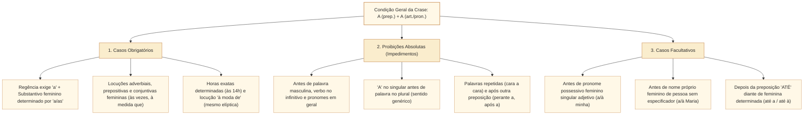

# Crase: condições de ocorrência, casos facultativos e impedimentos no padrão Cebraspe

## 1. Situação-problema: o acento grave entre a obrigação sintática, a proibição absoluta e a mudança de sentido

Ao revisar uma minuta de ato da Mesa Diretora da Câmara dos Deputados, o analista legislativo encontra três construções envolvendo o sinal indicativo de crase:

> **Construção 1:** *"As propostas foram submetidas **a** apreciação das lideranças e encaminhadas **a** comissões permanentes."*
> **Construção 2:** *"O Regimento garante prerrogativas **àquela** bancada que se mantiver fiel **à** suas diretrizes estatutárias."*
> **Construção 3:** *"A sessão extraordinária realizar-se-á de segunda **a** sexta-feira, das catorze **às** dezoito horas, cabendo **à** Secretaria-Geral lavrar a ata."*

Como o Cebraspe julga a correção gramatical e as manipulações propostas sobre esses três enunciados?

1. Na **Construção 1**, em *"submetidas **a** apreciação das lideranças"*, tanto *"submetidas **a** apreciação"* (sem artigo antes de *apreciação*, embora menos usual quando o termo vem especificado por *das lideranças*) quanto *"submetidas **à** apreciação"* são exploradas pelo Cebraspe, que costuma perguntar se a inserção do acento grave é possível ou exigida pela determinação do substantivo. Já em *"encaminhadas **a** comissões permanentes"* (*a* no singular antes de palavra no plural), a crase é **absolutamente proibida**, pois o substantivo plural está empregado em sentido genérico, sem artigo definido (*as*). Caso se inserisse o artigo plural (*"**às** comissões permanentes"*), o sentido passaria de indeterminado/geral para determinado/específico.
2. Na **Construção 2**, ***"àquela"*** está **correto** (fusão da preposição *a*, exigida pela construção verbal *garantir algo a alguém*, com o *a* inicial do demonstrativo *aquela*). Porém, ***"fiel à suas diretrizes"*** contém **erro grave**: é proibido usar *à* (singular) diante de expressão no plural (*suas diretrizes*). Ali, ou se usa apenas a preposição (*"fiel **a** suas diretrizes"*) ou se usa preposição + artigo plural (*"fiel **às** suas diretrizes"*).
3. Na **Construção 3**, o contraste entre *"de segunda **a** sexta-feira"* (sem artigo no primeiro elemento $\rightarrow$ sem crase no segundo, paralelismo sintático) e *"das catorze **às** dezoito horas"* (com artigo em *das = de + as* $\rightarrow$ crase obrigatória em *às = a + as*) demonstra a regra de ouro do **paralelismo de determinantes**.

Esta unidade sistematiza todas as condições estruturais de ocorrência da crase, o catálogo de **impedimentos absolutos**, os **casos obrigatórios**, os **três casos facultativos** e os efeitos semânticos e sintáticos cobrados pelo Cebraspe.

---

## 2. O mecanismo estrutural da crase: o encontro de dois "A"

A palavra **crase** (do grego *krâsis*, "mistura, fusão") designa o fenômeno fonético e morfossintático da **fusão de duas vogais idênticas** ($a + a$) em um único som, representado na escrita pelo **acento grave (`à`)**.

Na língua portuguesa, a crase ocorre quando o **termo regente** (verbo, substantivo, adjetivo ou advérbio) exige a **preposição `a`** e o **termo regido** começa por um segundo **`a`**, que pode pertencer a **três categorias**:

$$\text{Preposição } \mathbf{A} \text{ (exigida pelo regente)} + \begin{cases} 1.\text{ Artigo definido feminino } (\mathbf{a / as}) \rightarrow \text{\textbf{à / às}} \\ 2.\text{ Pronome demonstrativo } (\mathbf{aquele/a/os/as, aquilo}) \rightarrow \text{\textbf{àquele(s), àquela(s), àquilo}} \\ 3.\text{ Pronome demonstrativo } (\mathbf{a / as} = \text{aquela/as}) \text{ ou relativo } (\mathbf{a\ qual / as\ quais}) \rightarrow \text{\textbf{à / às, à qual / às quais}} \end{cases}$$

### 2.1. Testes operacionais de verificação imediata

1. **Teste da substituição por equivalente masculino (`ao / aos`):** Substitua o substantivo feminino por um masculino correlato. Se surgir ***ao / aos*** na frente do masculino, ocorre crase diante do feminino:
   * *"O parecer é favorável **à** emenda"* $\rightarrow$ *"favorável **ao** projeto"* (Há crase).
   * *"A comissão aprovou **a** emenda"* $\rightarrow$ *"aprovou **o** projeto"* (Não há preposição; é objeto direto $\rightarrow$ sem crase).
2. **Teste dos demonstrativos (`aquele, aquela, aquilo`):** Substitua *aquele / aquela / aquilo* por ***a este / a esta / a isto***. Se exigir a preposição *a*, haverá crase (*àquele, àquela, àquilo*):
   * *"Referiu-se **àquele** dispositivo"* $\rightarrow$ *"Referiu-se **a este** dispositivo"* (Há crase).
   * *"Revogou **aquele** dispositivo"* $\rightarrow$ *"Revogou **este** dispositivo"* (Sem crase).
3. **Teste do pronome demonstrativo reduzido (`a / as` antes de `de` ou `que`):** Quando *a / as* equivale a ***aquela / aquelas*** e vem precedido da preposição *a*, ocorre crase obrigatória:
   * *"A redação final é idêntica **à** [àquela] **que** foi aprovada no Senado."*
   * *"Suas atribuições são análogas **às** [àquelas] **do** cargo anterior."*

---

## 3. Catálogo de proibições absolutas (impedimentos da crase)

O Cebraspe explora intensamente os contextos em que o artigo definido feminino **não pode existir**, restando apenas a preposição `a` (ou apenas o artigo, sem preposição). **Jamais ocorre crase:**

| Caso de Impedimento Absoluto | Explicação Gramatical | Exemplos Corretos (Sem Crase) |
| :--- | :--- | :--- |
| **1. Antes de palavras masculinas, como regra geral** | Palavras masculinas não admitem o artigo feminino *a*. *(Há construções com palavra masculina aparente e expressão feminina elíptica, como **"à maneira de Machado de Assis"**; não estender essa análise mecanicamente a todas as locuções com substantivo masculino).* | *"Andar **a** cavalo"*, *"pagamento **a** prazo"*. **Contraste:** *vendas **à vista*** têm crase por integrar locução adverbial feminina; **não deve constar entre os exemplos de impedimento**. |
| **2. Antes de verbos (no infinitivo)** | Verbo não admite artigo. A palavra *a* antes de infinitivo é apenas preposição. | *"A comissão passou **a analisar** os vetos."*, *"Começou **a chover**."*, *"Nada **a declarar**."* |
| **3. `"A"` no singular antes de palavra no plural** | Se a palavra está no plural e o *a* está no singular, **não há artigo** (*as*); há apenas a preposição pura *a* em sentido genérico/indeterminado. | *"O relatório refere-se **a propostas** anteriores."* *"Não se submete **a pressões** partidárias."* |
| **4. Antes de pronomes pessoais, de tratamento, indefinidos e interrogativos** | Esses pronomes repelem o artigo definido. *(Exceções: *senhora, senhorita, dona, madame* quando admitem artigo, e pronomes que levam artigo próprio, como *a mesma, a própria, a outra, a tal*).* | *"Dirigiu-se **a ela / a mim / a Vossa Excelência / a qualquer** deputado / **a toda** comissão / **a ninguém** / **a quem** interessar."* |
| **5. Antes dos pronomes demonstrativos *esta, essa* e do relativo *cuja*** | *Esta, essa* e *cuja* jamais admitem artigo antes de si. | *"Aludiu **a esta** emenda e **a essa** decisão."*, *"A lei **a cuja** vigência me refiro."* |
| **6. Entre palavras idênticas repetidas** | Expressões de repetição simétrica são locuções adverbiais sem artigo. | *"Cara **a** cara"*, *"frente **a** frente"*, *"dia **a** dia"*, *"gota **a** gota"*, *"ponto **a** ponto"*. *(Mas: "Declarou guerra **à** guerra")*. |
| **7. Antes de numeral cardinal (exceto horas ou se houver artigo *as*)** | Numerais cardinais sem determinação não levam artigo. | *"O quórum caiu de cem **a** trinta deputados."* *(Mas: "Referiu-se **às** duas emendas")*. |
| **8. Após outra preposição (*perante, após, desde, com, contra, entre, para, sob, sobre*)** | Duas preposições não se fundem; após preposição, o *a* é apenas artigo. *(Exceção única: facultativa após a preposição **ATÉ**).* | *"Compareceu **perante a** comissão."*, *"A sessão foi **adiada para as** 16h."*, *"Aguardou **desde as** 10h."* |
| **9. Em objetos diretos ou sujeitos** | Sem preposição exigida pelo termo regente, o *a* é mero artigo definido. | *"A Câmara votou **a** proposta."* (OD). |

---

## 4. Casos de crase obrigatória e locuções fixas

Além da regra geral (regência de preposição *a* + artigo *a/as* diante de substantivo feminino determinado), a crase é **obrigatória** em quatro grandes grupos:

### 4.1. Locuções adverbiais, prepositivas e conjuntivas de base feminina

Mesmo quando não há um verbo transitivo indireto exigindo a preposição *a*, a tradição gramatical e o Acordo Ortográfico consagram o acento grave fixo nas locuções formadas por **núcleo feminino**:

* **Locuções adverbiais femininas (modo, tempo, lugar):** ***às vezes, à tarde, à noite, à vista, à toa, às claras, às escondidas, às pressas, à força, à mão, à tinta, à direita, à esquerda, à frente, à vontade, às avessas, à deriva, à queima-roupa, à primeira vista, à luz de***.
  * **Cuidado com locuções adverbiais de INSTRUMENTO ou MEIO no singular:** Quando uma expressão feminina singular indica mero **instrumento** (*a máquina, a lápis, a vela, a gás, a bala*) e não há risco de ambiguidade, muitos gramáticos (como Celso Cunha) e o Cebraspe admitem a escrita **sem crase** (ou com crase para evitar ambiguidade de sujeito, como em *"ferido à faca"*). Porém, se a locução adverbial for de modo, tempo ou lugar, ou estiver no plural (***às pressas, às cegas***), a crase é **obrigatória**.
* **Locuções prepositivas femininas (terminam em *de*):** ***à espera de, à procura de, à busca de, à vista de, à frente de, à custa de, à base de, à semelhança de, à mercê de, à razão de, à beira de, à luz de, à exceção de***.
* **Locuções conjuntivas femininas (terminam em *que*):** ***à medida que*** (proporção) e ***à proporção que*** (proporção).
  * *(Atenção: não existe crase em **"na medida em que"**, pois começa com a preposição *em*).

### 4.2. Indicação de horas exatas e o paralelismo sintático

* **Horas determinadas:** Usa-se crase obrigatória antes de horas exatas quando não há outra preposição antes: *"A sessão começou **à uma hora** e encerrou-se **às vinte horas**."* (Mas: *"desde **as** catorze horas"*, *"para **as** vinte horas"*, *"após **as** dezoito horas"* $\rightarrow$ sem crase por já haver outra preposição).
* **Regra do paralelismo sintático (`de... a...` $\times$ `da... à...`):**
  * Sem artigo no primeiro termo $\rightarrow$ **sem crase** no segundo: *"O expediente vai **de** segunda **a** sexta-feira, **de** 8h **a** 18h."*
  * Com artigo no primeiro termo $\rightarrow$ **com crase obrigatória** no segundo: *"O expediente vai **da** segunda **à** sexta-feira, **das** 8h **às** 18h."*

---

## 5. Os três casos facultativos clássicos e os quatro casos especiais (*casa, terra, distância, nomes de lugar*)

### 5.1. Os três casos de crase facultativa

Nos três casos abaixo, a presença ou ausência do acento grave **não altera a correção gramatical nem o sentido** (no Cebraspe, a substituição de *a* por *à* mantém a correção):

1. **Antes de pronome possessivo feminino no SINGULAR em função adjetiva** (*minha, tua, sua, nossa, vossa* + substantivo feminino singular expresso):
   * *"O deputado reportou-se **a sua / à sua** bancada."* (**Ambas corretas**).
   * **Atenção às duas armadilhas fatais nos possessivos:**
     * Se o possessivo estiver no **PLURAL** (*minhas, tuas, suas, nossas, vossas*): *"reportou-se **a suas** bases"* (sem artigo $\rightarrow$ sem crase) ou *"reportou-se **às suas** bases"* (com artigo $\rightarrow$ crase obrigatória no *às*). **Proibido:** *"reportou-se à suas bases"*.
     * Se o possessivo for **pronome substantivo** (quando o substantivo foi omitido por elipse/zeugma): o artigo torna-se obrigatório e, portanto, a crase é **OBRIGATÓRIA**: *"Não me refiro à bancada do governo, mas **à sua** [à sua bancada]."*
2. **Antes de nome próprio feminino de pessoa (antropônimo)** no uso comum:
   * *"O relator entregou o documento **a Maria / à Maria**."* (O artigo antes de nome de pessoa varia conforme a intimidade/região).
   * *Exceção:* Se for personalidade histórica/pública em registro formal distante (*"Dirigiu preces **a** Nossa Senhora"*, *"Aludiu **a** Joana d'Arc"*), não se usa artigo; se o nome vier **especificado** (*"Refiro-me **à** Maria que trabalha na CCJC"*), a crase passa a ser **obrigatória**.
3. **Depois da preposição `ATÉ`** diante de palavra feminina que admita artigo:
   * *"Os parlamentares caminharam **até a / até à** tribuna."* (A preposição *até* aceita ou não a companhia da preposição *a* na locução *até a* + artigo *a*).

### 5.2. Os quatro vocábulos especiais: *casa, terra, distância* e nomes geográficos

| Vocábulo Especial | Sem Especificador (Sentido Geral $\rightarrow$ SEM CRASE) | Com Especificador / Determinante (Sentido Determinado $\rightarrow$ COM CRASE) |
| :--- | :--- | :--- |
| **CASA** (= lar, domicílio próprio) | *"Após a sessão, os deputados voltaram **a casa**."* | *"Os deputados voltaram **à casa de seus pais**."* *"Retornaram **à Casa Legislativa**."* (Qualquer outro sentido que não seja o próprio lar, ou lar especificado). |
| **TERRA** (= chão firme, em oposição a bordo/mar/espaço) | *"Os marinheiros chegaram **a terra**."* | *"Os parlamentares regressaram **à terra natal / à Terra** (planeta)."* |
| **DISTÂNCIA** | *"A segurança acompanhava o protesto **a distância**."* | *"A segurança acompanhava o protesto **à distância de cem metros**."* (Determinada). *(Nota: na locução **"educação a distância"**, como não é determinada, o padrão culto grafa sem crase).* |
| **NOMES DE LUGAR (Topônimos)** | Teste: **"Vim DE"** $\rightarrow$ **"Vou A"** (sem crase): *"Vou **a** Brasília, **a** São Paulo, **a** Roma, **a** Curitiba."* *(Vim de Brasília).* | 1. Teste: **"Vim DA"** $\rightarrow$ **"Vou À"** (com crase): *"Vou **à** Bahia, **à** França, **à** Itália."* *(Vim da Bahia).* 2. Qualquer topônimo **especificado**: *"Vou **à** Brasília **de Juscelino Kubitschek**."* |

---

## 6. Casos progressivos e casos de fronteira em textos da Câmara dos Deputados

### Caso 1: O efeito semântico e sintático da retirada ou inserção do acento grave
O Cebraspe adora perguntar o que acontece quando se **retira** ou se **insere** o acento indicativo de crase em um período. Há três cenários distintos que não podem ser confundidos:

1. **Cenário A — Perda da correção gramatical (crase obrigatória por regência e determinação):**
   * *"O projeto foi submetido **à** Comissão de Finanças e Tributação."*
   * Se retirarmos o acento grave (*"submetido **a** Comissão"*), como se trata de um órgão único e determinado, há **prejuízo para a correção gramatical**.
2. **Cenário B — Manutenção da correção gramatical, mas com mudança de sentido (passagem de determinado para genérico/indeterminado):**
   * *"O parecer não faz menção **à** emenda aditiva."* (Refere-se a uma emenda aditiva específica, conhecida no contexto: $a \text{ prep.} + a \text{ art.}$).
   * Se retirarmos o acento grave (*"não faz menção **a** emenda aditiva"*), a frase **continua gramaticalmente correta**, pois o substantivo singular *emenda aditiva* passa a ser empregado em sentido **genérico e indeterminado** (= a qualquer emenda aditiva), restando apenas a preposição *a*.
3. **Cenário C — Inversão de função sintática (Sujeito $\leftrightarrow$ Objeto):**
   * *"A recusa da emenda deveu-se **a** relatora."* $\times$ *"A recusa da emenda deveu-se **à** relatora."*
   * Em *"O atraso prejudicou **a** votação"*, *a votação* é objeto direto. Em *"Assistiu **à** votação"*, *à votação* é objeto indireto.

### Caso 2: Crase antes de pronomes relativos (*a qual, as quais, a que*)
Compare:
1. *"A comissão **à qual** o projeto foi distribuído reuniu-se ontem."* $\rightarrow$ O verbo *distribuir* exige a preposição *a* (*distribuído **a***) + o pronome relativo *a qual* (que possui o artigo feminino *a* embutido) $\rightarrow$ **crase obrigatória (`à qual`)**.
2. *"A comissão **a que** o projeto foi distribuído reuniu-se ontem."* $\rightarrow$ O verbo *distribuir* exige a preposição *a*, mas o pronome relativo ***que* é invariável e não admite artigo antes de si** $\rightarrow$ **crase proibida (`a que`)**.
   * *Pegadinha extrema:* Quando é que pode existir **`à que`** com acento grave? Somente quando houver o pronome demonstrativo feminino ***a (= aquela)*** antes do relativo *que*: *"Não me refiro a esta comissão, mas **à que** [= àquela que] se reuniu ontem."*

---

## 7. Itens comentados no padrão Cebraspe (Certo/Errado)

*(Inédita: estilo Cebraspe / Câmara dos Deputados – Analista Legislativo)*
> **Texto de referência:**
> "No exercício da atividade parlamentar, cabe à Mesa Diretora assegurar o respeito às prerrogativas regimentais, dando publicidade a atos administrativos e garantindo condições análogas às que vigoram nas demais Casas legislativas, à medida que avança a transformação digital."

**Item 1.** *(Inédita: estilo Cebraspe / Câmara dos Deputados – Analista Legislativo)* O emprego do sinal indicativo de crase em **à Mesa Diretora** e em **às prerrogativas regimentais** deve-se à exigência da preposição **a** por um mesmo termo regente — a forma verbal **cabe**.
* **Gabarito:** **ERRADO**.
* **Fundamentação:** Embora em ambos os casos ocorra a fusão da preposição *a* com o artigo definido feminino (*a / as*), os **termos regentes são distintos**: em *"cabe **à** Mesa Diretora"*, a preposição *a* é exigida pelo verbo transitivo indireto **cabe** (*caber a*); já em *"o respeito **às** prerrogativas regimentais"*, a preposição *a* é exigida pelo substantivo abstrato **respeito** (regência nominal: *respeito a*), configurando um complemento nominal.

**Item 2.** *(Inédita: estilo Cebraspe / Câmara dos Deputados – Analista Legislativo)* No segmento *"dando publicidade a atos administrativos"*, a ausência do acento grave no vocábulo **a** justifica-se tanto pelo gênero masculino do substantivo **atos** quanto pela incompatibilidade entre a preposição no singular e o termo regido no plural.
* **Gabarito:** **CERTO**.
* **Fundamentação:** Há duplo impedimento gramatical absoluto para a crase em *"a atos administrativos"*: primeiro, o substantivo *atos* é masculino (não admite o artigo feminino *a/as*); segundo, mesmo que fosse um substantivo feminino no plural (*"a decisões administrativas"*), o emprego de *a* no singular diante de palavra no plural indica a presença exclusiva da preposição pura, sem artigo definido, o que veda o acento grave.

**Item 3.** *(Inédita: estilo Cebraspe / Câmara dos Deputados – Analista Legislativo)* Na passagem *"garantindo condições análogas às que vigoram nas demais Casas legislativas"*, o acento grave em **às** decorre da fusão da preposição exigida pelo adjetivo **análogas** com o pronome demonstrativo feminino plural **as** (equivalente a **àquelas**).
* **Gabarito:** **CERTO**.
* **Fundamentação:** Análise morfossintática exata. O adjetivo *análogas* rege a preposição *a* (*análogas a*). Antes do pronome relativo *que*, o vocábulo *as* funciona como **pronome demonstrativo** reduzido (retomando *condições* e equivalendo a *aquelas*: *"condições análogas **a aquelas** que vigoram..."*). A fusão da preposição *a* com o pronome demonstrativo *as* produz obrigatoriamente ***às***.

**Item 4.** *(Inédita: estilo Cebraspe / Câmara dos Deputados – Analista Legislativo)* Caso a locução conjuntiva **à medida que** fosse substituída por **na proporção em que**, manter-se-ia o sentido proporcional do período, mas seria obrigatório o emprego do sinal indicativo de crase na forma **nà proporção em que**.
* **Gabarito:** **ERRADO**.
* **Fundamentação:** A substituição de *à medida que* por *à proporção que* exige crase; porém, em *na proporção em que* (ou *na medida em que*, de valor causal), o vocábulo inicial **na** já resulta da contração da preposição **em** com o artigo definido feminino **a** ($em + a = na$). Não existe crase com a preposição *em*, sendo inteiramente inexistente na língua portuguesa a grafia *"nà"*.

**Item 5.** *(Inédita: estilo Cebraspe / Câmara dos Deputados – Analista Legislativo, versão editorial revista)* Considere a frase autônoma *"O relator submeteu o substitutivo a sua bancada"*. A substituição de **a sua bancada** por **à sua bancada** preservaria a correção gramatical e o sentido da frase, pois, nesse contexto, o artigo feminino antes do possessivo adjetivo **sua** é facultativo.
* **Gabarito:** **CERTO**.
* **Fundamentação:** Na frase proposta, *submeter* rege **a** para introduzir o destinatário (*submeter algo a alguém*). Antes de possessivo feminino singular que acompanha substantivo (*sua bancada*), o artigo feminino pode ocorrer ou não: *submeteu o substitutivo **a sua bancada*** (preposição sem artigo) e *submeteu o substitutivo **à sua bancada*** (preposição + artigo). **O núcleo regente e o restante da frase permanecem constantes nas duas versões**, tornando verificável a facultatividade da crase. O gabarito CERTO refere-se exclusivamente a essas duas frases, não à troca de *de* por *a* em *à apreciação de sua bancada*.

**Item 6.** *(Inédita: estilo Cebraspe / Câmara dos Deputados – Analista Legislativo)* Em *"A comissão especial funcionará de segunda a sexta-feira, das nove às dezenove horas"*, o paralelismo sintático autorizaria o emprego do acento grave em **à sexta-feira**, independentemente de qualquer alteração no vocábulo **de** que antecede **segunda**.
* **Gabarito:** **ERRADO**.
* **Fundamentação:** Pelo princípio do paralelismo sintático nas expressões correlativas de tempo ou espaço (*de... a...*), como não foi empregado artigo definido antes do primeiro elemento (*"**de** segunda"*), **não se pode empregar artigo definido — nem crase — antes do segundo elemento** (*"**a** sexta-feira"*). Para que o acento grave em ***à sexta-feira*** fosse legítimo, seria indispensável alterar previamente *"de segunda"* para ***"da segunda"***.

---

## 8. Relações com outros conceitos e notas da biblioteca

* **Nota de base preexistente sobre crase:** [[3 - Materias/Portugues/11 - crase|11 • Crase]].
* **Regência verbal e nominal (pré-requisito direto para identificar a preposição *a*):** [[3 - Materias/Portugues/28 - regencia verbal e nominal transitividade e sentidos|28 • Regência verbal e nominal: transitividade, preposições e mudanças de sentido (CAM-LP-017)]] e [[3 - Materias/Portugues/04 - regencia|04 • Regência verbal e nominal]].
* **Morfossintaxe de pronomes e preposições:** [[3 - Materias/Portugues/22 - classes de palavras e suas funcoes no periodo|22 • Classes de palavras e suas funções no período (CAM-LP-011)]].
* **Próximo passo (Colocação pronominal):** Unidade `CAM-LP-019`.

## 9. Referências teóricas e normativas

* BECHARA, Evanildo. **Moderna Gramática Portuguesa**. 39. ed. Rio de Janeiro: Nova Fronteira, 2019.
* CUNHA, Celso; CINTRA, Lindley. **Nova Gramática do Português Contemporâneo**. 7. ed. Rio de Janeiro: Lexikon, 2017.
* BRASIL. Presidência da República. **Manual de Redação da Presidência da República**. 3. ed. rev., atual. e ampl. Brasília: Presidência da República, 2018.
* SACCONI, Luiz Antonio. **Não Erre Mais!**. 31. ed. São Paulo: Nova Geração, 2012.
