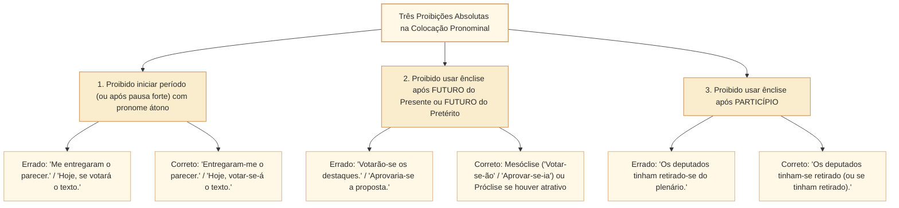

# Colocação dos pronomes átonos: próclise, mesóclise, ênclise e locuções verbais no padrão Cebraspe

## 1. Situação-problema: fatores de atração, pausas de vírgula e locuções verbais na redação parlamentar

Durante a revisão taquigráfica de um pronunciamento e de um parecer na Câmara dos Deputados, o analista legislativo examina quatro construções com pronomes oblíquos átonos (*me, te, se, o, a, lhe, nos, vos, os, as, lhes*):

> **Construção 1:** *"Ontem **votou-se** o requerimento de urgência; hoje, **se votará** o mérito do substitutivo."*
> **Construção 2:** *"Os parlamentares que **manifestaram-se** contrariamente ao texto **comprometeram-se** a apresentar emendas."*
> **Construção 3:** *"A Mesa Diretora **submeterá-o** ao Plenário assim que as lideranças **tiverem-no** analisado."*
> **Construção 4:** *"Não **se deve adiar** a deliberação da matéria orçamentária."*

Como o Cebraspe avalia a correção gramatical e as possibilidades de deslocamento pronominal em cada caso?

1. Na **Construção 1**, há **dois desvios opostos**: na primeira oração (*"Ontem **votou-se**"*), o advérbio *Ontem* não está isolado por vírgula e, por isso, funciona como **fator de próclise obrigatória** (*"Ontem **se votou**"*); na segunda oração (*"hoje, **se votará**"*), o advérbio *hoje* está **isolado por vírgula**, e a pausa anula a força atrativa do advérbio, proibindo iniciar a estrutura após a pausa com pronome átono (*"hoje, **votar-se-á**"* — mesóclise exigida pelo futuro do presente sem fator de próclise).
2. Na **Construção 2**, há erro em ***"que manifestaram-se"***: o pronome relativo *que* é fator de **próclise obrigatória** (*"que **se manifestaram**"*). Já ***"comprometeram-se"*** está **perfeito**, pois o verbo da oração principal vem após a oração adjetiva e não sofre atração do *que* interno à subordinada.
3. Na **Construção 3**, ocorrem **duas proibições absolutas da norma culta**: jamais se usa ênclise após verbo no **futuro** (*"submeterá-o"* é erro crasso; o correto é a mesóclise ***"submetê-lo-á"***) e jamais se usa ênclise após **particípio** (*"tiverem-no analisado"* está correto porque o pronome está enclítico ao auxiliar *tiverem*, ou proclítico a ele: *"o tiverem analisado"*, mas seria proibido *"tiverem analisado-o"*).
4. Na **Construção 4** (*"Não **se deve adiar**"*), embora o advérbio negativo *Não* atraia o pronome para antes do verbo auxiliar (*"Não **se** deve adiar"*), a presença do verbo principal no **infinitivo** (*adiar*) torna igualmente correta a ênclise ao infinitivo: ***"Não deve adiar-se"***.

Esta unidade sistematiza todas as regras de **colocação pronominal (posição dos pronomes átonos)** exigidas pelo Cebraspe: as três proibições absolutas, os fatores de próclise obrigatória, os contextos de colocação facultativa (dupla colocação abonada), a morfologia fonética da ênclise/mesóclise e a sintaxe das locuções verbais.

---

## 2. As três posições pronominais e as três proibições absolutas (regras de ouro)

Os **pronomes oblíquos átonos** (*me, te, se, o, a, lhe, nos, vos, os, as, lhes*) são vocábulos desprovidos de acento tônico próprio (clíticos) e, por isso, apoiam-se foneticamente no verbo em três posições:

* **Próclise (antes do verbo):** *"Não **se** aprovou a emenda."*
* **Mesóclise (no meio do verbo):** *"Aprovar-**se**-á a emenda."*
* **Ênclise (depois do verbo):** *"Aprovou-**se** a emenda."*

Antes de aplicar qualquer regra de atração, o candidato deve verificar as **três proibições absolutas** da gramática normativa, que prevalecem sobre qualquer outra tendência:

---

## 3. Fatores de próclise obrigatória (palavras atrativas)

Na ausência de pausa (vírgula) entre a palavra atrativa e o verbo, a **próclise é obrigatória** (e o deslocamento do pronome para depois do verbo gera erro gramatical) nos sete casos seguintes:

| Grupo de Fator Atrativo | Exemplos de Palavras Atrativas | Exemplo Aplicado ao Contexto da Câmara |
| :--- | :--- | :--- |
| **1. Palavras de sentido negativo** | *não, nunca, jamais, nada, ninguém, nenhum, nem, tampouco, sequer* | *"Nenhum parlamentar **se** absteve na votação nominal."* *"Jamais **nos** furtaremos ao debate."* |
| **2. Advérbios e locuções adverbiais (SEM vírgula após eles)** | *já, sempre, ainda, talvez, só, somente, apenas, também, aqui, ali, hoje, ontem, bem, mal, mais, menos, certamente* | *"Já **se** conhecem os resultados da apuração."* *"Talvez **o** designem relator."* *(Atenção: se houver vírgula após o advérbio, a atração cessa $\rightarrow$ ênclise/mesóclise: "Aqui, trabalha-**se** muito").* |
| **3. Pronomes relativos** | *que, quem, o qual, a qual, cujo, cuja, onde, quanto* | *"A proposta **a que se** referiu o líder foi aprovada."* *"O projeto **cujo** texto **se** alterou voltou à comissão."* |
| **4. Pronomes indefinidos** | *tudo, todo, toda, todos, alguém, algum, qualquer, cada, vários, muitos, poucos, outrem, ambos, quanto* | *"Tudo **se** esclareceu durante a audiência pública."* *"Poucos **lhe** deram razão no plenário."* |
| **5. Pronomes demonstrativos neutros (e demonstrativos em geral)** | *isso, isto, aquilo, este, esse, aquele* | *"Isso **nos** impõe cautela redobrada."* *"Aquilo **se** revelou uma manobra regimental."* |
| **6. Conjunções subordinativas** | *que (integrante), se, como, quando, embora, conquanto, porque, já que, visto que, caso, conforme, segundo, à medida que, para que* | *"Embora **se** reconheça o mérito, o parecer é pela rejeição."* *"Sabemos **que o** convocarão amanhã."* |
| **7. Casos sintáticos especiais** | • Preposição ***em* + gerúndio**; • Frases **interrogativas diretas** (*Quem, Que, Qual, Quando, Como, Por que*); • Frases **exclamativas** e **optativas** (que expressam desejo); • Correlações ***não só... mas também*** e ***tanto... quanto***. | • *"Em **se** tratando de matéria urgente, vota-se hoje."* • *"Quem **o** autorizou a pautar o item?"* • *"Deus **o** proteja!"* |

### 3.1. Limite de alcance do fator atrativo (armadilha de período composto)

A palavra atrativa só exerce força magnética sobre o **verbo da sua própria oração**. Ela **não atravessa fronteiras oracionais** para atrair o verbo da oração principal seguinte:

* *"Os deputados [que **se inscreveram** para falar] **dirigiram-se** (ou **se dirigiram**) à tribuna."*
  * Em *que se inscreveram*, o pronome relativo *que* torna a próclise **obrigatória** (*se inscreveram*).
  * Em *dirigiram-se*, o verbo pertence à oração principal; o relativo *que* já ficou encerrado dentro da oração adjetiva. Logo, em *dirigiram-se*, a ênclise é perfeitamente correta (e a próclise *se dirigiram* também é aceita devido ao sujeito explícito *Os deputados*).

---

## 4. Casos de colocação facultativa (dupla colocação abonada pelo Cebraspe)

Uma das perguntas mais frequentes do Cebraspe é: *"O deslocamento do pronome átono para depois (ou para antes) da forma verbal preserva a correção gramatical do período"*. Para acertar esse item, é fundamental dominar os contextos em que **tanto a próclise quanto a ênclise são corretas**:

1. **Sujeito explícito (substantivo ou pronome pessoal reto *eu, tu, ele, nós, vós, eles*) antes do verbo, sem palavra atrativa:**
   * *"O relator **manifestou-se** favoravelmente"* $\equiv$ *"O relator **se manifestou** favoravelmente"* (**Ambas corretas no Cebraspe**).
   * *"Eles **entregaram-nos** o relatório"* $\equiv$ *"Eles **nos entregaram** o relatório"*.
   * *(Cuidado: se o sujeito for um **pronome indefinido** — todos, alguém, ninguém, tudo, muitos, poucos — ou **demonstrativo** — isso, aquilo —, a próclise é **obrigatória**).*
2. **Conjunções coordenativas aditivas (`e`), alternativas (`ou`) ou adversativas (`mas, porém, contudo`) sem palavra negativa:**
   * *"O presidente abriu a sessão e **concedeu-lhe** (ou **lhe concedeu**) a palavra."*
3. **Verbo no INFINITIVO impessoal precedido de preposição (`para, de, por, em, sem, a`) ou mesmo de palavra negativa (`não`):**
   * Segundo a gramática normativa (Bechara, Rocha Lima, Celso Cunha) e a jurisprudência pacífica do Cebraspe, o **infinitivo** tem força própria para segurar o pronome em ênclise, **mesmo quando antecedido por preposição ou por advérbio de negação**:
     * *"Compareceu à comissão **para defender-se**"* $\equiv$ *"**para se defender**"* (**Ambas corretas**).
     * *"A orientação da bancada era **não abster-se**"* $\equiv$ *"**não se abster**"* (**Ambas corretas**).
     * *"Tinha o hábito **de queixar-se**"* $\equiv$ *"**de se queixar**"*.
     * *Nota específica para a preposição **A** + pronomes **o, a, os, as**:* Prefere-se a ênclise com alteração fonética (*"Começou **a analisá-lo**"*), embora com os demais pronomes (*se, me, lhe*) admita-se próclise ou ênclise (*"Passou **a dedicar-se / a se dedicar**"*).

---

## 5. Regras da mesóclise, adaptações fonéticas da ênclise e locuções verbais

### 5.1. Quando a mesóclise é obrigatória?

A **mesóclise** (intercalação do pronome no interior do verbo) é exclusiva de dois tempos verbais do modo indicativo: **Futuro do Presente** (*-rei, -rás, -rá, -remos, -reis, -rão*) e **Futuro do Pretérito** (*-ria, -rias, -ria, -ríamos, -ríeis, -riam*).

* **Condição de obrigatoriedade:** Verbo no futuro do presente ou futuro do pretérito **SEM fator de próclise obrigatória antes dele** (especialmente no início de período ou após vírgula):
  * *"**Realizar-se-á** amanhã a sessão conjunta do Congresso Nacional."*
  * *"Se houvesse acordo, **votar-se-iam** todos os destaques hoje."*
* **Hierarquia Próclise > Mesóclise:** Se houver qualquer **fator de próclise obrigatória** antes do verbo no futuro, **a próclise vence a mesóclise** (e a mesóclise torna-se incorreta):
  * *"Não **se realizará** amanhã a sessão."* (Errado: *"Não realizar-se-á"*).
  * *"O projeto **que se votará** hoje é urgente."* (Errado: *"que votar-se-á"*).
* **Como formar a mesóclise:** Corta-se o verbo na letra **`R`** do infinitivo, aplica-se a adaptação fonética (se o pronome for *o, a, os, as*, cai o *R* e vira *lo, la, los, las*) e acrescenta-se a desinência final (*-ei, -á, -ão, -ia, -iam*):
  * *Analisarão + o* $\rightarrow$ *Analisar | ão* $\rightarrow$ ***Analisá-lo-ão***.
  * *Submeteria + a* $\rightarrow$ *Submeter | ia* $\rightarrow$ ***Submetê-la-ia***.
  * *Concederemos + lhe* $\rightarrow$ *Conceder | emos* $\rightarrow$ ***Conceder-lhe-emos***.

### 5.2. Adaptações fonéticas na ênclise (pronomes *o, a, os, as*)

Quando os pronomes oblíquos de 3ª pessoa (`o, a, os, as`) são pospostos ao verbo, sofrem assimilação fonética conforme a terminação verbal:

1. **Verbo terminado em `R`, `S` ou `Z`:** cai a consoante final e o pronome assume a forma **`lo, la, los, las`** (observando as regras de acentuação gráfica na forma verbal resultante):
   * *Aprovar + o* $\rightarrow$ ***Aprová-lo*** (oxítona terminada em *a*).
   * *Distribuir + a* $\rightarrow$ ***Distribuí-la*** (hiato tônico *i*).
   * *Fizemos + o* $\rightarrow$ ***Fizemo-lo*** (paroxítona).
   * *Fez + a* $\rightarrow$ ***Fê-la*** (monossílabo tônico terminado em *e*).
   * *Quis + o* $\rightarrow$ ***Qui-lo*** (monossílabo terminado em *i* não leva acento).
2. **Verbo terminado em som NASAL (`M`, `ÃO`, `ÕE`):** a forma verbal permanece intacta e o pronome assume a forma **`no, na, nos, nas`**:
   * *Aprovaram + o* $\rightarrow$ ***Aprovaram-no***.
   * *Põem + as* $\rightarrow$ ***Põem-nas***.
   * *Propõe + o* $\rightarrow$ ***Propõe-no***.
3. **Verbo terminado em VOGAL oral:** o pronome mantém a forma pura **`o, a, os, as`**:
   * *Analisou + a* $\rightarrow$ ***Analisou-a***.

### 5.3. Colocação pronominal nas locuções verbais (Verbo Auxiliar + Verbo Principal)

Nas locuções verbais (`Auxiliar + Infinitivo`, `Auxiliar + Gerúndio` ou `Auxiliar + Particípio`), as posições válidas dependem de dois critérios: a forma nominal do verbo principal e a presença ou ausência de palavra atrativa antes da locução:

| Estrutura da Locução Verbal | SEM Palavra Atrativa Antes | COM Palavra Atrativa Antes (`não, que, já...`) |
| :--- | :--- | :--- |
| **1. Auxiliar + INFINITIVO ou GERÚNDIO** *(Ex.: deve analisar / está analisando)* | **Três posições válidas:** 1. Ênclise ao auxiliar: *"O relator **deve-se** manifestar."* 2. Próclise ao auxiliar (se houver sujeito antes): *"O relator **se deve** manifestar."* 3. Ênclise ao principal: *"O relator deve **manifestar-se**."* | **Duas posições válidas:** 1. Próclise ao auxiliar: *"Não **se** deve manifestar."* 2. Ênclise ao principal: *"Não deve **manifestar-se**."* *(**Proibido** deixar o pronome solto no meio sem hífen após palavra negativa, embora no Brasil se tolere sem hífen quando não há atrativo; no Cebraspe, com palavra atrativa antes, escolha antes do auxiliar ou enclítico ao infinitivo/gerúndio).* |
| **2. Auxiliar + PARTICÍPIO** *(Ex.: tinha manifestado / havia aprovado)* | **Duas posições válidas (jamais após o particípio):** 1. Ênclise ao auxiliar: *"O relator **tinha-se** manifestado."* 2. Próclise ao auxiliar (com sujeito antes): *"O relator **se tinha** manifestado."* | **Posição única obrigatória:** Próclise ao auxiliar: *"Não **se** tinha manifestado."* / *"O projeto **que se** havia aprovado."* *(Se o auxiliar estiver no futuro sem atrativo, usa-se mesóclise no auxiliar: **"Ter-se-ia manifestado"**).* |

---

## 6. Casos progressivos e casos de fronteira em textos da Câmara dos Deputados

### Caso 1: O efeito da vírgula sobre o advérbio inicial e a exigência de mesóclise
Compare os dois períodos abaixo:
1. *"Imediatamente **se** instaurará o conselho de ética."*
2. *"Imediatamente, **instaurar-se-á** o conselho de ética."*

* **Análise de fronteira:**
  * No período **1**, o advérbio *Imediatamente* não está seguido de vírgula; logo, atrai obrigatoriamente o pronome *se* para a próclise (***se instaurará***).
  * No período **2**, a inserção da vírgula após *Imediatamente* cria uma pausa fonética e sintática que **isola o advérbio e anula seu poder atrativo**. Como não se pode iniciar o segmento após a vírgula com pronome átono (*"Imediatamente, se instaurará"* é incorreto) e como o verbo *instaurará* está no **futuro do presente** (que proíbe ênclise: *"instaurará-se"* é incorreto), a única forma gramaticalmente correta passa a ser a **mesóclise (`instaurar-se-á`)**.
* **Como o Cebraspe cobra:** *"Caso uma vírgula seja inserida logo após o advérbio 'Imediatamente', será necessário deslocar o pronome 'se' para a posição mesoclítica — instaurar-se-á — a fim de manter a correção gramatical do período"* $\rightarrow$ **CERTO**.

### Caso 2: Duas orações coordenadas e o alcance da conjunção subordinativa ou negação
Considere o período:
> *"Quando o presidente **se** pronunciou sobre a questão de ordem e **encerrou** a discussão, os líderes **retiraram-se**."*

* Se adicionarmos um pronome ao verbo *encerrou*: *"Quando o presidente **se** pronunciou e **se** encerrou (ou **encerrou-se**?)"*. Como a conjunção temporal *Quando* subordina ambas as orações coordenadas entre si (*quando se pronunciou e [quando] se encerrou*), a próclise mantém-se na segunda oração subordinada. Já na oração principal (*"os líderes retiraram-se"*), o fator *Quando* não atua mais, permitindo tanto ***"os líderes retiraram-se"*** quanto ***"os líderes se retiraram"***.

---

## 7. Itens comentados no padrão Cebraspe (Certo/Errado)

*(Inédita: estilo Cebraspe / Câmara dos Deputados – Analista Legislativo)*
> **Texto de referência:**
> "No âmbito do processo legislativo, jamais se devem desprezar as garantias regimentais da minoria parlamentar, pois, em se tratando de deliberação constitucional, o respeito ao contraditório impõe-se a todas as bancadas que se submetem ao Estado Democrático de Direito."

**Item 1.** *(Inédita: estilo Cebraspe / Câmara dos Deputados – Analista Legislativo)* Na locução verbal *"jamais se devem desprezar"*, a próclise do pronome **se** ao verbo auxiliar é determinada pela presença do advérbio negativo **jamais**; contudo, o deslocamento desse pronome para depois do verbo principal — escrevendo-se **jamais devem desprezar-se** — preservaria integralmente a correção gramatical do período.
* **Gabarito:** **CERTO**.
* **Fundamentação:** Em locuções verbais formadas por verbo auxiliar + verbo principal no **infinitivo** (*devem desprezar*), mesmo quando antecedidas por fator de próclise como o advérbio negativo *jamais*, a norma-padrão abona duas colocações: a próclise ao verbo auxiliar (*"jamais **se** devem desprezar"*) ou a ênclise ao infinitivo (*"jamais devem **desprezar-se**"*).

**Item 2.** *(Inédita: estilo Cebraspe / Câmara dos Deputados – Analista Legislativo)* No trecho *"em se tratando de deliberação constitucional"*, o emprego da próclise é facultativo, podendo-se escrever **em tratando-se de deliberação constitucional** sem prejuízo da correção gramatical.
* **Gabarito:** **ERRADO**.
* **Fundamentação:** Na estrutura cristalizada formada pela preposição **em + verbo no gerúndio** (*"em se tratando"*), a **próclise é estritamente obrigatória** segundo a gramática normativa. A forma *"em tratando-se"* constitui erro gramatical. (A ênclise ao gerúndio só seria correta se a preposição *em* fosse suprimida: *"tratando-se de deliberação..."*).

**Item 3.** *(Inédita: estilo Cebraspe / Câmara dos Deputados – Analista Legislativo)* Na oração principal *"o respeito ao contraditório impõe-se a todas as bancadas"*, o deslocamento do pronome **se** para antes da forma verbal — **se impõe** — manteria a correção gramatical do texto.
* **Gabarito:** **CERTO**.
* **Fundamentação:** Na oração *"o respeito ao contraditório impõe-se..."*, o verbo é antecedido por um **sujeito explícito** cujo núcleo é o substantivo *respeito* (*"o respeito ao contraditório"*), sem palavra negativa ou subordinativa imediata. Na construção concreta com sujeito nominal explícito (*o respeito ao contraditório*) e sem fator de atração, tanto a ênclise (*impõe-se*) quanto a próclise após o sujeito (*se impõe*) são admitidas em descrições do uso brasileiro culto. A aceitabilidade da próclise deve considerar **registro e norma adotada**; não se trata de uma facultatividade universal em qualquer posição ou variedade.

**Item 4.** *(Inédita: estilo Cebraspe / Câmara dos Deputados – Analista Legislativo)* No segmento final *"que se submetem ao Estado Democrático de Direito"*, a substituição de **se submetem** por **submetem-se** seria abonada pela norma culta, visto que o pronome relativo **que** exerce função de sujeito.
* **Gabarito:** **ERRADO**.
* **Fundamentação:** Os pronomes relativos (*que, quem, o qual, cujo, onde*), independentemente da função sintática que exerçam na oração adjetiva, são **fatores de próclise obrigatória**. Portanto, a ênclise em *"que submetem-se"* infringe a norma-padrão.

**Item 5.** *(Inédita: estilo Cebraspe / Câmara dos Deputados – Analista Legislativo)* Caso o verbo **impõe-se** fosse flexionado no futuro do presente do indicativo e colocado no início de um novo período sem sujeito anteposto, a forma correta segundo o padrão culto seria **Impor-se-á o respeito ao contraditório**.
* **Gabarito:** **CERTO**.
* **Fundamentação:** No início absoluto de período, a próclise é proibida (*"Se imporá"* é errado); e, com verbos no futuro do presente ou futuro do pretérito, a ênclise também é proibida (*"Imporá-se"* é errado). Logo, impõe-se obrigatoriamente a **mesóclise**: corta-se o verbo no *R* (*Impor*) + pronome (*-se-*) + desinência (*-á*) $\rightarrow$ ***Impor-se-á***.

**Item 6.** *(Inédita: estilo Cebraspe / Câmara dos Deputados – Analista Legislativo)* No período *"Concluída a votação em segundo turno, a Mesa Diretora promulgou a emenda e encaminhou-a ao Diário da Câmara dos Deputados, onde tinham publicado-a no dia seguinte"*, todas as colocações pronominais respeitam a norma-padrão.
* **Gabarito:** **ERRADO**.
* **Fundamentação:** Há duplo erro grave na oração final (*"onde tinham publicado-a"*): primeiro, é **absolutamente proibido** pospor pronome átono a verbo no **particípio** (*"publicado-a"* não é forma aceita nesse contexto da norma-padrão); segundo, o pronome relativo adverbial **onde** é fator de **próclise obrigatória** sobre o verbo auxiliar da locução verbal. Uma reescrita correta e direta do segmento final seria ***"onde a tinham publicado"***. A presença do relativo *onde* favorece a próclise ao auxiliar nessa estrutura; há outras reformulações possíveis com mudança da locução, portanto a resposta não depende de supor uma **única frase admissível**.

---

## 8. Relações com outros conceitos e notas da biblioteca

* **Classes de palavras e funções do "SE" e dos pronomes oblíquos:** [[3 - Materias/Portugues/22 - classes de palavras e suas funcoes no periodo|22 • Classes de palavras e suas funções no período (CAM-LP-011)]].
* **Termos integrantes e substituição de OD e OI por pronomes (*o/a/lo/no* $\times$ *lhe*):** [[3 - Materias/Portugues/23 - termos essenciais integrantes e acessorios da oracao|23 • Termos essenciais, integrantes e acessórios da oração (CAM-LP-012)]].
* **Tempos e modos verbais (futuro do presente, futuro do pretérito e formas nominais):** [[3 - Materias/Portugues/21 - tempo modo e aspecto verbal na construcao do texto|21 • Tempo, modo e aspecto verbal na construção do texto (CAM-LP-010)]].
* **Próximo passo (Significação lexical, polissemia e ambiguidade):** Unidade `CAM-LP-020`.

## 9. Referências teóricas e normativas

* BECHARA, Evanildo. **Moderna Gramática Portuguesa**. 39. ed. Rio de Janeiro: Nova Fronteira, 2019. (Capítulo sobre Colocação dos Pronomes Átonos).
* CUNHA, Celso; CINTRA, Lindley. **Nova Gramática do Português Contemporâneo**. 7. ed. Rio de Janeiro: Lexikon, 2017.
* BRASIL. Presidência da República. **Manual de Redação da Presidência da República**. 3. ed. rev., atual. e ampl. Brasília: Presidência da República, 2018.
* ROCHA LIMA, Carlos Henrique da. **Gramática Normativa da Língua Portuguesa**. 53. ed. Rio de Janeiro: José Olympio, 2017.
