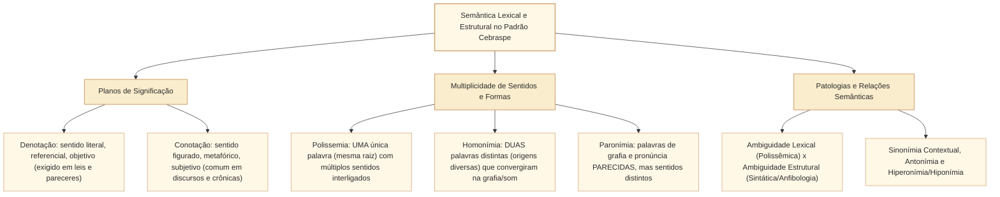

# Significação lexical, polissemia, homonímia, paronímia e ambiguidade no padrão Cebraspe

## 1. Situação-problema: entre a riqueza polissêmica, a troca paronímica e a ambiguidade estrutural na redação legislativa

Na revisão de uma nota técnica e de um voto em separado na Câmara dos Deputados, o analista legislativo examina três passagens:

> **Passagem 1:** *"Cabe ao Congresso Nacional **ratificar** os erros materiais do autógrafo antes da promulgação e **descriminar** as condutas lesivas no quadro comparativo."*
> **Passagem 2:** *"O presidente da comissão discutiu com o relator do projeto em **seu** gabinete a **queda** de braço entre as bancadas."*
> **Passagem 3:** *"A aprovação do substitutivo pelo Plenário evitou o congelamento das verbas."*

Se o Cebraspe formular itens sobre a propriedade vocabular, a semântica e a estrutura sintática dessas três passagens, o candidato deverá identificar:

1. Na **Passagem 1**, há **duas graves impropriedades vocabulares por confusão entre parônimos**: quem corrige erros materiais deve ***retificar*** (corrigir, emendar), e não *ratificar* (confirmar, validar); e quem separa, lista ou especifica condutas em um quadro deve ***discriminar*** (distinguir, especificar), e não *descriminar* (tirar o caráter criminoso, absolver).
2. Na **Passagem 2**, ocorrem dois fenômenos distintos: a expressão ***"queda de braço"*** ilustra a **polissemia** e o sentido **conotativo/figurado** (metáfora de disputa política, perfeitamente legítima em pronunciamentos e crônicas parlamentares); porém, o segmento ***"discutiu com o relator ... em seu gabinete"*** apresenta **ambiguidade estrutural (anfibologia)** no emprego do pronome possessivo *seu*, pois o cotexto não esclarece se o gabinete pertence ao *presidente da comissão* ou ao *relator*.
3. Na **Passagem 3**, o sintagma ***"A aprovação do substitutivo pelo Plenário"*** está livre de ambiguidade graças à preposição *pelo* (agente), mas se estivesse redigido como *"A crítica da oposição foi severa"*, haveria **ambiguidade sintática entre adjunto adnominal (a oposição criticou) e complemento nominal (alguém criticou a oposição)**.

Esta unidade estuda a arquitetura da **semântica lexical e estrutural** exigida pelo Cebraspe: denotação e conotação, sinonímia contextual e hiperonímia, a fronteira teórica entre polissemia e homonímia, o vocabulário crítico de parônimos da administração pública e os mecanismos de diagnóstico e eliminação da ambiguidade.

---

## 2. Eixos da significação lexical: denotação, conotação, polissemia e homonímia

O significado das palavras não é uma etiqueta estática colada a um objeto, mas o resultado da interação entre o **potencial semântico de base** registrado no léxico da língua e as determinações do **cotexto linguístico** e do **contexto discursivo**.

### 2.1. Denotação versus Conotação

* **Denotação (sentido próprio, referencial ou literal):** É o significado básico, objetivo e dicionarizado em primeiro plano, compartilhado de modo estável pelos falantes e isento de figuração subjetiva. Na **redação oficial e legislativa** (leis, pareceres técnicos, ofícios), o princípio da clareza e precisão impõe o predomínio absoluto da linguagem denotativa: *"A **pauta** da sessão contém cinco projetos."*
* **Conotação (sentido figurado, translato ou metafórico):** É a ampliação expressiva e contextual do significado por meio de associações simbólicas, metáforas, metonímias ou ironia: *"O orçamento não pode ser uma **camisa de força** que **engesse** os investimentos públicos."*
  * **Como o Cebraspe cobra:** A banca destaca um vocábulo no texto (*engessar, espelhar, desenhar, pavimentar, naufragar, mergulhar*) e afirma que ele foi empregado em **sentido conotativo / figurado** $\rightarrow$ **CERTO**. Além disso, o Cebraspe costuma pedir a **tradução denotativa** do termo figurado (por exemplo, substituir *"pavimentar o acordo"* por *"viabilizar / preparar as condições para o acordo"* mantendo a coerência e o sentido geral).

### 2.2. Polissemia versus Homonímia: a fronteira teórica

Tanto na polissemia quanto na homonímia perfeita, uma mesma forma linguística apresenta mais de um significado. Qual é o critério científico que as distingue?

| Fenômeno Semântico | Definição Estrutural e Etimológica | Critério de Identificação em Prova | Exemplos Clássicos |
| :--- | :--- | :--- | :--- |
| **POLISSEMIA** | **Uma única palavra** (mesma origem etimológica e mesmo verbete) que, por extensão metafórica ou metonímica ao longo do tempo, adquiriu **vários sentidos inter-relacionados**, mantendo um núcleo semântico comum. | Há um **traço semântico comum** (parentesco de ideia) entre os sentidos. O contexto seleciona a acepção adequada. | • **Cabeça:** parte superior do corpo humano $\rightarrow$ *cabeça* do prego $\rightarrow$ *cabeça* de chapa / líder do movimento. • **Artigo:** divisão de uma lei $\rightarrow$ *artigo* jornalístico $\rightarrow$ *artigo* comercial. • **Peça:** parte de máquina $\rightarrow$ *peça* processual $\rightarrow$ *peça* teatral. |
| **HOMONÍMIA** | **Duas ou mais palavras diferentes** (origens etimológicas distintas e verbetes separados) que, por evolução fonética histórica, passaram a ter **a mesma grafia e/ou a mesma pronúncia**, sem relação semântica atual entre si. | **Não há parentesco de sentido** (ou pertencem a classes gramaticais distintas), dividindo-se em: 1. **Homônimos perfeitos** (mesmo som e mesma grafia); 2. **Homófonos** (mesmo som, grafia diferente); 3. **Homógrafos** (mesma grafia, som diferente). | • **Perfeitos:** *São* (sadio - de *sanu*), *são* (santo - de *sanctu*) e *são* (verbo *ser* - de *sunt*); *manga* (fruta) e *manga* (da camisa); *casa* (substantivo) e *casa* (verbo *casar*). • **Homófonos:** *sessão / seção / cessão*; *censo / senso*; *concertar / consertar*; *apressar / apreçar*. • **Homógrafos heterofônicos:** *colher* $[\text{ô}]$ (verbo) $\times$ *colher* $[\text{é}]$ (substantivo); *governo* $[\text{ê}]$ (subst.) $\times$ *governo* $[\text{é}]$ (verbo). |

---

## 3. Paronímia e homonímia na Administração Pública e no Processo Legislativo

A **paronímia** ocorre entre palavras que possuem **grafia e pronúncia semelhantes** (mas não idênticas) e **significados totalmente distintos**. O Cebraspe cobra intensamente a propriedade vocabular desses pares em questões de correção e reescrita:

| Par de Parônimos / Homófonos | Significado Exato do 1º Termo | Significado Exato do 2º Termo | Aplicação no Contexto da Câmara |
| :--- | :--- | :--- | :--- |
| **Ratificar $\times$ Retificar** | **Ratificar:** confirmar, validar, corroborar ato anterior. | **Retificar:** corrigir, emendar erro ou inexatidão. | *"O Plenário **ratificou** o acordo após o relator **retificar** o erro de cálculo."* |
| **Infringir $\times$ Infligir** | **Infringir:** violar, transgredir, desrespeitar norma ou lei. | **Infligir:** aplicar, impor pena, castigo ou derrota. | *"Por **infringir** o decoro, o Conselho **infligiu** censura ao parlamentar."* |
| **Deferir $\times$ Diferir** | **Deferir:** atender, conceder o que foi requerido; outorgar. | **Diferir:** 1. divergir, ser diferente; 2. adiar, procrastinar (*diferimento*). | *"O presidente **deferiu** o requerimento que propunha **diferir** a votação."* |
| **Avocar $\times$ Evocar** | **Avocar:** chamar para si competência ou processo de órgão inferior. | **Evocar:** lembrar, invocar à memória, trazer à recordação. | *"A Mesa **avocou** a análise do recurso e **evocou** precedentes históricos."* |
| **Discriminar $\times$ Descriminar** | **Discriminar:** 1. diferenciar, especificar, listar detalhadamente; 2. segregar. | **Descriminar:** descriminalizar, tirar a culpa ou o caráter de crime. | *"O anexo **discrimina** as despesas; o projeto penal **descrimina** a conduta."* |
| **Prescrever $\times$ Proscrever** | **Prescrever:** 1. ordenar, fixar norma; 2. extinguir-se a pretensão punitiva pelo decurso do tempo (*prescrição*). | **Proscrever:** proibir terminantemente, banir, abolir, desterrar. | *"O Regimento **prescreve** o rito e **proscreve** o anonimato."* |
| **Mandado $\times$ Mandato** | **Mandado:** ordem judicial ou administrativa escrita (*mandado de segurança, de prisão, de injunção*). | **Mandato:** delegação de poderes políticos (*mandato parlamentar*) ou procuração. | *"O deputado em pleno **mandato** impetrou **mandado** de segurança no STF."* |
| **Auferir $\times$ Aferir** | **Auferir:** obter, colher, receber lucros, rendas ou vantagens. | **Aferir:** medir, avaliar, cotejar com um padrão. | *"O tribunal busca **aferir** se a empresa **auferiu** vantagem indevida."* |
| **Elidir $\times$ Ilidir** | **Elidir:** suprimir, eliminar, apagar (*elisão fiscal / elisão de vogal*). | **Ilidir:** rebater, refutar, destruir argumento ou presunção contrária. | *"A defesa produziu provas para **ilidir** a acusação e **elidir** o débito."* |
| **Imigrar $\times$ Emigrar** | **Imigrar:** entrar em país estranho para nele viver. | **Emigrar:** sair do próprio país para viver em outro. | *"Fluxos de trabalhadores que **emigram** da origem e **imigram** no Brasil."* |
| **Flagrante $\times$ Fragrante** | **Flagrante:** evidente, manifesto, no ato (*em flagrante delito*). | **Fragrante:** perfumado, aromático. | *"Constatou-se **flagrante** inconstitucionalidade formal no dispositivo."* |
| **Eminente $\times$ Iminente** | **Eminente:** ilustre, elevado, excelente, sublime (*eminente jurista*). | **Iminente:** que está prestes a acontecer, imediato (*perigo iminente*). | *"O **eminente** relator alertou para o risco **iminente** de bloqueio da pauta."* |
| **Sortir $\times$ Surtir** | **Sortir:** abastecer, prover, variar mercadorias. | **Surtir:** produzir efeito ou resultado (*surtir efeito*). | *"A medida provisória passou a **surtir** efeitos jurídicos imediatos."* |
| **Subscrever $\times$ Sobrescrever** | **Subscrever:** assinar embaixo, aprovar, apor assinatura. | **Sobrescrever:** escrever por cima, substituir arquivo ou endereçar envelope. | *"Vinte líderes **subscreveram** o requerimento de urgência."* |
| **Vultoso $\times$ Vultuoso** | **Vultoso:** de grande vulto, volumoso, de grande soma financeira. | **Vultuoso:** inchado, vermelho na face (estado patológico: *congestão vultuosa*). | *"A emenda envolve recursos orçamentários **vultosos**."* |
| **Incipiente $\times$ Insipiente** | **Incipiente:** iniciante, que está no começo, embrionário. | **Insipiente:** ignorante, insensato, desprovido de saber. | *"O debate sobre regulação algorítmica ainda é **incipiente** no parlamento."* |
| **Intemerato $\times$ Intimorato** | **Intemerato:** íntegro, puro, incorruptível, imaculado. | **Intimorato:** destemido, corajoso, sem temor. | *"Magistrado de conduta **intemerata** e atuação **intimorata**."* |
| **Cessão $\times$ Sessão $\times$ Seção** | **Cessão:** ato de ceder (*cessão de servidor*). | **Sessão:** reunião deliberativa ou tempo (*sessão plenária*). **Seção:** repartição, setor ou divisão de lei. | *"Na **sessão** de hoje, a **Seção** de Pessoal aprovou a **cessão** do analista."* |
| **Acerca de $\times$ A cerca de $\times$ Há cerca de** | **Acerca de:** sobre, a respeito de. **A cerca de:** distância aproximada ou tempo futuro. | **Há cerca de:** tempo decorrido aproximado (passado) ou existência aproximada. | *"Discursou **acerca de** projeto apresentado **há cerca de** dois meses."* |
| **Ao encontro de $\times$ De encontro a** | **Ao encontro de:** a favor de, em conformidade com, na mesma direção harmoniosa. | **De encontro a:** contra, em oposição a, em choque com. | *"O parecer foi **ao encontro dos** anseios sociais e **de encontro aos** abusos."* |

---

## 4. Ambiguidade (anfibologia): causas léxicas e estruturais e como desfazê-la

A **ambiguidade** é a duplicidade de sentidos de uma palavra ou construção sintática no interior de um enunciado. Embora possa ser um recurso expressivo intencional na poesia e na publicidade, no **texto informativo, técnico e legislativo** constitui **vício de linguagem (anfibologia)** que compromete a clareza e a segurança jurídica.

O Cebraspe cobra os **cinco mecanismos estruturais geradores de ambiguidade** e as formas de corrigi-los:

### 4.1. Os cinco mecanismos clássicos de ambiguidade estrutural

1. **Emprego equívoco dos pronomes possessivos de 3ª pessoa (`seu, sua, seus, suas`) e oblíquos (`ele, ela, lhe`):**
   * *Ambiguidade:* *"O relator informou ao presidente da comissão que **seu** parecer fora publicado."* (O parecer é do relator ou do presidente?).
   * *Correção técnica:* Substituir por ***dele / dela*** ou reordenar o período: *"O relator informou ao presidente da comissão que o parecer **deste / daquele** fora publicado"* ou *"O relator, ao ter seu parecer publicado, informou o fato ao presidente"*.
2. **Sincretismo entre Adjunto Adnominal (agente/possuidor) e Complemento Nominal (paciente) junto a substantivo abstrato:**
   * *Ambiguidade:* *"A convocação do ministro gerou reação imediata."* (O ministro convocou alguém ou o ministro foi convocado pela Câmara?).
   * *Correção técnica:* Explicitar a preposição de agente (*por*) ou desenvolver em oração: *"A convocação **feita pelo** ministro..."* (agente) $\times$ *"A convocação **do ministro pela comissão**..."* (paciente).
3. **Posição inadequada de adjuntos adverbiais ou adnominais (escopo de modificação):**
   * *Ambiguidade:* *"Os parlamentares que criticaram a proposta **ontem** pediram vista."* (*Ontem* modifica *criticaram* ou modifica *pediram vista*?).
   * *Correção técnica:* Deslocar o advérbio para junto do verbo que se quer modificar ou pontuar adequadamente.
4. **Uso indistinto do pronome relativo `QUE` após dois substantivos antecedentes de mesmo gênero e número:**
   * *Ambiguidade:* *"Analisamos o substitutivo do projeto **que** altera a alíquota do imposto."* (Quem altera a alíquota: o *substitutivo* ou o *projeto*?).
   * *Correção técnica:* Quando os antecedentes têm gêneros ou números diferentes (*"a emenda do projeto"*), substitui-se *que* por ***o qual / a qual***. Quando têm o mesmo gênero e número, reestrutura-se a ordem dos termos.
5. **Coordenação de termos com escopo incerto do modificador:**
   * *Ambiguidade:* *"A comissão debateu projetos e requerimentos **urgentes**."* (Apenas os requerimentos são urgentes ou os projetos também?).

---

## 5. Casos progressivos e casos de fronteira em textos da Câmara dos Deputados

### Caso 1: Sinonímia contextual versus Identidade absoluta de sentido
Uma premissa teórica fundamental da semântica moderna, amplamente adotada pelo Cebraspe, é que **não existem sinônimos perfeitos em todos os contextos**: a **sinonímia é sempre contextual**.

Considere o período:
> *"A promulgação da emenda constitucional **sancionou** o entendimento histórico da Corte sobre a imunidade tributária."*

* **Análise de fronteira:**
  * No léxico geral do processo legislativo (art. 66 da CF/88), *sancionar* tem o sentido técnico-jurídico estrito de aquiescência do Presidente da República a um projeto de lei ordinária ou complementar (emenda constitucional não tem sanção presidencial, é promulgada pelas Mesas da Câmara e do Senado).
  * Contudo, no período acima, o verbo ***sancionou*** foi empregado em **acepção polissêmica mais ampla**, significando ***confirmou, ratificou, consagrou, validou***.
  * Se o Cebraspe perguntar: *"No contexto em questão, a forma verbal 'sancionou' foi empregada com o sentido de **consagrou / ratificou**, podendo por ela ser substituída sem prejuízo da correção e do sentido original"* $\rightarrow$ **CERTO**.

### Caso 2: A oposição semântica entre *"ao encontro de"* e *"de encontro a"*
Compare:
1. *"A emenda do relator vai **ao encontro das** reivindicações dos servidores."* $\rightarrow$ Sentido de **convergência, harmonia, concordância, favorabilidade**.
2. *"A emenda do relator vai **de encontro às** reivindicações dos servidores."* $\rightarrow$ Sentido de **choque, oposição, confronto, contrariedade**.
* **Como o Cebraspe cobra:** A banca propõe a substituição de *"ao encontro de"* por *"de encontro a"* afirmando que preserva o sentido original $\rightarrow$ **ERRADO** (inverte diametralmente o sentido do texto, transformando concordância em oposição).

---

## 6. Itens comentados no padrão Cebraspe (Certo/Errado)

*(Inédita: estilo Cebraspe / Câmara dos Deputados – Analista Legislativo)*
> **Texto de referência:**
> "Ao avocar o exame da matéria orçamentária ainda incipiente, a comissão especial buscou elidir distorções fiscais que vinham de encontro ao equilíbrio das contas públicas, evitando que o texto normativo se convertesse em letra morta antes mesmo de surtir efeitos práticos."

**Item 1.** *(Inédita: estilo Cebraspe / Câmara dos Deputados – Analista Legislativo)* Os vocábulos **avocar**, **incipiente** e **elidir** estão empregados com inteira propriedade vocabular no período, equivalendo contextualmente, na ordem em que ocorrem, a **chamar para si a competência**, **em estágio inicial** e **eliminar**.
* **Gabarito:** **CERTO**.
* **Fundamentação:** Os três termos respeitam rigorosamente a semântica culta: *avocar* significa chamar para si processo ou atribuição (em oposição ao parônimo *evocar*, que significa lembrar); *incipiente* significa iniciante, embrionário (em oposição ao homófono *insipiente*, que significa ignorante); e *elidir* significa suprimir, eliminar (em oposição ao parônimo *ilidir*, que significa refutar prova/argumento).

**Item 2.** *(Inédita: estilo Cebraspe / Câmara dos Deputados – Analista Legislativo)* A substituição da locução **de encontro ao** por **ao encontro do** manteria a correção gramatical e a coerência semântica original do texto, uma vez que ambas as expressões indicam direção convergente.
* **Gabarito:** **ERRADO**.
* **Fundamentação:** Embora a substituição mantivesse a correção gramatical estrita, **inverteria completamente o sentido original e destruiria a coerência do período**: no texto, as distorções fiscais *"vinham **de encontro ao** equilíbrio"* (isto é, chocavam-se **contra** o equilíbrio, opunham-se a ele). Substituir por *"ao encontro do equilíbrio"* passaria a afirmar que as distorções fiscais eram favoráveis e harmoniosas ao equilíbrio das contas públicas.

**Item 3.** *(Inédita: estilo Cebraspe / Câmara dos Deputados – Analista Legislativo)* A expressão **letra morta** foi empregada no texto em sentido conotativo, designando figuradamente uma norma jurídica destituída de eficácia social ou aplicação efetiva.
* **Gabarito:** **CERTO**.
* **Fundamentação:** A expressão cristalizada *"letra morta"* constitui metáfora / metonímia (linguagem conotativa ou figurada) consagrada no vocabulário jurídico-político para referir-se a dispositivos legais que, embora formalmente vigentes no papel, não produzem efeitos concretos na realidade social.

**Item 4.** *(Inédita: estilo Cebraspe / Câmara dos Deputados – Analista Legislativo)* Caso a forma verbal **surtir** fosse substituída pelo seu parônimo **sortir**, preservar-se-ia o sentido de produzir resultado, tratando-se de variantes gráficas abonadas pelo Vocabulário Ortográfico da Língua Portuguesa.
* **Gabarito:** **ERRADO**.
* **Fundamentação:** *Surtir* e *sortir* **não são variantes gráficas**, mas **parônimos com significados inconfundíveis**: *surtir* significa produzir efeito ou resultado (*surtir efeitos práticos*), ao passo que *sortir* significa abastecer, prover ou misturar mercadorias variadamente. A troca configuraria erro de propriedade vocabular.

**Item 5.** *(Inédita: estilo Cebraspe / Câmara dos Deputados – Analista Legislativo)* Na frase *"O presidente da comissão comunicou ao relator que sua proposta de retificação da ata seria apreciada na sessão vespertina"*, verifica-se ambiguidade estrutural decorrente do emprego do pronome possessivo **sua**, mas o vocábulo **retificação** está empregado de forma semanticamente adequada ao contexto de correção de texto.
* **Gabarito:** **CERTO**.
* **Fundamentação:** Há dois julgamentos exatos no item: (1) o pronome possessivo de 3ª pessoa **sua**, posposto a dois substantivos masculinos singulares (*O presidente* e *ao relator*), gera **ambiguidade estrutural (anfibologia)**, pois não permite determinar de forma unívoca de quem é a proposta; e (2) o substantivo **retificação** (ato de corrigir, emendar inexatidões) está empregado com perfeita propriedade vocabular.

**Item 6.** *(Inédita: estilo Cebraspe / Câmara dos Deputados – Analista Legislativo)* A multiplicidade de sentidos do vocábulo **comissão** — que pode designar um órgão colegiado parlamentar, uma percentagem financeira sobre vendas ou o ato de cometer uma infração (crime comissivo) — explica-se exclusivamente pela homonímia casual entre palavras de origens latinas distintas, sem qualquer relação polissêmica.
* **Gabarito:** **ERRADO**.
* **Fundamentação:** Todos os sentidos de *comissão* derivam de uma **mesma raiz etimológica latina** (*commissio*, do verbo *committere*: confiar um encargo a alguém, juntar, praticar um ato). Trata-se, portanto, de um caso clássico de **polissemia** (desdobramento histórico de acepções a partir de um núcleo semântico comum de encargo/ação confiada), e não de homonímia fortuita entre vocábulos de étimos diversos.

---

## 7. Relações com outros conceitos e notas da biblioteca

* **Ortografia e homônimos/parônimos gráficos:** [[3 - Materias/Portugues/17 - ortografia convencoes da escrita acentuacao e hifenizacao|17 • Ortografia e convenções da escrita (CAM-LP-006)]].
* **Coesão lexical, sinonímia, hiperonímia e hiponímia:** [[3 - Materias/Portugues/19 - substituicao elipse repeticao e coesao lexical|19 • Substituição, elipse, repetição e coesão lexical (CAM-LP-008)]].
* **Referenciação pronominal e desambiguação com *este/aquele*:** [[3 - Materias/Portugues/18 - referencia textual anafora catafora e deixis|18 • Referência textual: anáfora, catáfora e dêixis (CAM-LP-007)]].
* **Próximo passo direto (Reescrita: substituição lexical e preservação de sentido):** [[3 - Materias/Portugues/10 - reescrita semantica e preservacao de sentido|10 • Reescrita, semântica e preservação de sentido]] e Unidade `CAM-LP-021`.

## 8. Referências teóricas e normativas

* ILARI, Rodolfo; GERALDI, João Wanderley. **Semântica**. 11. ed. São Paulo: Ática, 2006.
* CANÇADO, Márcia. **Manual de Semântica: noções básicas e exercícios**. São Paulo: Contexto, 2012.
* BECHARA, Evanildo. **Moderna Gramática Portuguesa**. 39. ed. Rio de Janeiro: Nova Fronteira, 2019.
* BRASIL. Presidência da República. **Manual de Redação da Presidência da República**. 3. ed. rev., atual. e ampl. Brasília: Presidência da República, 2018.
