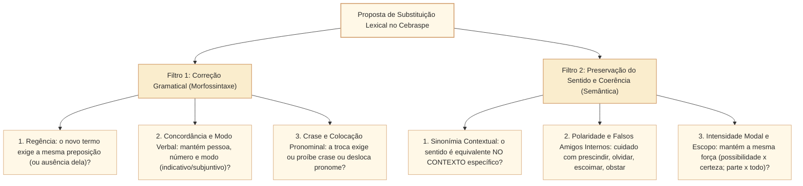

# Reescrita: substituição lexical, correção gramatical e preservação de sentido no padrão Cebraspe

## 1. Situação-problema: os dois filtros independentes da reescrita no Cebraspe

Nas provas da Câmara dos Deputados organizadas pelo Cebraspe, cerca de um terço dos itens de Língua Portuguesa propõe a substituição de uma palavra, locução ou segmento por outro e pergunta se a alteração **mantém a correção gramatical** e/ou **preserva o sentido original (a coerência) do texto**.

Considere o período original extraído de um parecer legislativo:
> **Texto original:** *"Embora o substitutivo **abarque** demandas históricas das carreiras, a comissão **rechaçou** os dispositivos que **careciam de** amparo constitucional."*

Analise três propostas de substituição lexical sobre esse período:

1. **Proposta A:** Substituir ***abarque*** por ***contemple*** $\rightarrow$ Tanto *abarcar* quanto *contemplar* (no sentido de incluir, abranger) são verbos transitivos diretos (VTD) e estão flexionados na 3ª pessoa do singular do presente do subjuntivo (exigido pela conjunção concessiva *Embora*). Logo, a substituição **mantém a correção gramatical E preserva o sentido original**.
2. **Proposta B:** Substituir ***rechaçou*** por ***opôs-se***, mantendo o restante do segmento (*"...a comissão **opôs-se os** dispositivos..."*) $\rightarrow$ Do ponto de vista semântico, *rechaçar* (rejeitar) e *opor-se* têm sentidos compatíveis; porém, do ponto de vista **sintático**, *rechaçar* é VTD (*rechaçou os dispositivos*), enquanto *opor-se* é transitivo indireto (VTI) e exige a preposição *a* (*opôs-se **aos** dispositivos*). Portanto, a substituição isolada **prejudica a correção gramatical** por erro de regência.
3. **Proposta C:** Substituir ***careciam de*** por ***prescindiam de*** $\rightarrow$ Ambos os verbos são transitivos indiretos e regem a preposição *de*, de modo que a **correção gramatical é mantida**; entretanto, os sentidos são **antônimos**: *carecer de* significa *não ter, precisar de, necessitar de*, enquanto *prescindir de* significa *dispensar, abrir mão de, não precisar de*. A substituição **inverte o sentido original e prejudica a coerência**.

Esta unidade sistematiza o método de resolução dos itens de **reescrita por substituição lexical** no Cebraspe, detalhando a independência entre o filtro gramatical e o filtro semântico, o repertório de verbos e vocábulos de alto risco (como *prescindir $\times$ imprescindível*), as substituições de locuções e conectivos e o controle de modalizadores e quantificadores.

---

## 2. O protocolo de duplo filtro na avaliação de substituição lexical

Para jamais cair nas armadilhas do Cebraspe em questões de substituição vocabular, o candidato deve aplicar sequencialmente **dois filtros autônomos**:

### 2.1. Atenção ao comando exato do item

O Cebraspe formula três tipos diferentes de comando sobre substituição lexical:
1. *"A substituição de X por Y **mantém a correção gramatical e o sentido original** do texto"* $\rightarrow$ Exige aprovação no **Filtro 1 E no Filtro 2**.
2. *"A substituição de X por Y **mantém a correção gramatical** do período, **ainda que altere o seu sentido**"* $\rightarrow$ Exige aprovação **apenas no Filtro 1**.
3. *"A substituição de X por Y **preserva a coerência e a correção** do texto"* $\rightarrow$ *Coerência* é mais ampla que *sentido literal idêntico*: uma troca por hiperônimo compatível preserva a coerência lógica, mas uma troca por palavra que contradiz a tese do parágrafo destrói a coerência.

---

## 3. Vocabulário erudito de alto risco no Cebraspe ("falsos amigos internos" do português)

Há um conjunto seleto de verbos, substantivos e adjetivos cultos que o Cebraspe repete em quase todos os concursos de nível superior porque induzem o candidato a pensar no sentido oposto ao verdadeiro:

| Vocábulo Culto Cobrado | O que o senso comum pensa (ERRADO) | Significado Real Dicionarizado (CERTO) | Equivalentes Válidos na Reescrita Cebraspe |
| :--- | :--- | :--- | :--- |
| **Prescindir (de)** | Pensa que é "precisar / ser imprescindível". | **Dispensar, abrir mão de, passar sem, não precisar de** (VTI com *de*). | *Dispensar (VTD), abdicar de, renunciar a, deixar de lado*. *(Nota: o antônimo é **imprescindível** = que não se pode dispensar).* |
| **Carecer (de)** | Confunde com *prescindir*. | **Não ter, sentir falta de, necessitar de, precisar de** (VTI com *de*). | *Necessitar de, precisar de, demandar (VTD)*. |
| **Olvidar(-se)** | Desconhece o termo. | **Esquecer(-se), deixar cair no esquecimento**. | *Esquecer (VTD) / esquecer-se de (VTI), omitir*. |
| **Obstar (a)** | Pensa que é "apoiar / instar". | **Impedir, causar embaraço, opor-se, obstaculizar** (VTD ou VTI com *a*). | *Impedir, dificultar, opor-se a, embargar*. |
| **Instar** | Confunde com *obstar*. | **Solicitar insistentemente, exortar, pedir com urgência**; ou **estar iminente**. | *Exortar, insistir, solicitar com veemência*. |
| **Escoimar (de)** | Pensa que é "sujar / incriminar". | **Limpar, livrar de coima/defeito/vício, depurar, expurgar**. | *Expurgar, depurar, livrar de vícios, sanear*. |
| **Dirimir** | Pensa que é "aumentar / dividir". | **Resolver, solucionar, extinguir dúvidas ou conflitos, decidir**. | *Solucionar, resolver, extinguir, dissipar*. |
| **Mitigar / Amainar** | Pensa que é "eliminar totalmente". | **Atenuar, suavizar, abrandar, diminuir a intensidade** (não equivale a extinguir). | *Atenuar, abrandar, suavizar, arrefecer*. |
| **Arrefecer** | Pensa que é "aquecer / aumentar". | **Esfriar, diminuir o entusiasmo ou a força, desanimar, abrandar**. | *Esfriar, diminuir, atenuar, desacelerar*. |
| **Recrudescer** | Pensa que é "diminuir / amadurecer". | **Agravar-se, tornar-se mais intenso/violento, aumentar** (crise, violência, debate). | *Agravar-se, intensificar-se, acirrar-se, exacerbar-se*. |
| **Suscitar** | Confunde com *sucitar* ou *solucionar*. | **Fazer nascer, provocar, levantar (dúvida, debate, questão), despertar**. | *Provocar, despertar, levantar, ensejar*. |
| **Ensejar** | Desconhece a transitividade. | **Dar ensejo a, propiciar, oferecer oportunidade, possibilitar** (VTD). | *Propiciar, possibilitar, ocasionar, permitir*. |
| **Corroborar** | Usa com preposição *com* (*"corroborar com"*). | **Confirmar, ratificar, comprovar, dar força a** (**VTD — sem preposição *com***). | *Confirmar, ratificar, referendar, respaldar*. |
| **Coadunar(-se)** | Troca a preposição. | **Harmonizar-se, combinar, ser compatível** (rege preposição ***com***). | *Harmonizar-se com, compatibilizar-se com, ajustar-se a*. |
| **Subsumir(-se)** | Desconhece o termo jurídico. | **Enquadrar (um caso concreto) em uma norma geral ou categoria mais ampla** (rege *a* ou *em*). | *Enquadrar-se em, incluir-se em, subordinar-se a*. |
| **Convalidar** | Confunde com *invalidar*. | **Tornar válido ato que possuía vício sanável, suprir defeito, ratificar**. | *Validar retroativamente, sanar, ratificar*. |
| **Perfunctório** | Pensa que é "profundo / definitivo". | **Superficial, ligeiro, feito apenas por rotina sem aprofundamento**. | *Superficial, sumário, aligeirado, raso*. |
| **Premente** | Confunde com *eminente*. | **Urgente, que comprime, inadiável, imperioso** (*necessidade premente*). | *Urgente, inadiável, imperioso, urgente*. |
| **Inequívoco / Inconteste** | — | **Sem margem para dúvida, evidente, indiscutível, incontestável**. | *Indubitável, incontestável, patente, manifesto*. |
| **Idôneo $\times$ Inidôneo** | — | **Idôneo:** apto, capaz, moralmente íntegro. **Inidôneo:** inapto, falso, sem idoneidade. | *Apto, adequado, legítimo, confiável*. |

---

## 4. Impactos morfossintáticos da substituição lexical

Mesmo quando o candidato conhece perfeitamente o significado das duas palavras, o Cebraspe monta armadilhas na **costura sintática** ao redor do termo substituído. Confira sempre os **quatro pontos de contato**:

### 4.1. Impacto na regência e no sinal indicativo de crase

* **Troca de VTD por VTI (ou vice-versa):**
  * Original: *"A comissão **analisou a** proposta."* (*analisar* = VTD $\rightarrow$ *a* é apenas artigo).
  * Substituição: *"A comissão **procedeu à** análise da proposta."* (*proceder* = VTI $\rightarrow$ exige preposição *a* + artigo *a* = crase obrigatória *à*).
  * Se o item propuser substituir *"analisou a proposta"* por *"ateve-se a proposta"* **sem acento grave**, o item está **ERRADO**, pois *ater-se* rege a preposição *a*, tornando obrigatório o acento em *"ateve-se **à** proposta"*.
* **Troca de verbo mantendo o mesmo complemento:**
  * Original: *"A reforma **visa ao** equilíbrio fiscal."*
  * Substituição: *"A reforma **busca ao** equilíbrio fiscal."* $\rightarrow$ **ERRADO**: *buscar* é estritamente VTD e rejeita a preposição *a* (*"busca **o** equilíbrio fiscal"*).

### 4.2. Impacto na substituição de conjunções e locuções conectivas

Ao substituir um conector por outro de mesmo valor semântico (por exemplo, concessivo por concessivo, causal por causal), verifique se o novo conector exige **mudança de modo verbal** ou **ajuste de preposição**:

1. **Conjunção subordinativa $\leftrightarrow$ Locução prepositiva + Infinitivo:**
   * *"Embora **reconheça** (subjuntivo) o mérito..."* $\leftrightarrow$ *"Apesar **de reconhecer** (infinitivo) o mérito..."*.
   * Se o item propuser substituir *Embora* por *Apesar de* mantendo o verbo no subjuntivo (*"Apesar de reconheça"*), é **erro gramatical**. Se propuser substituir *Embora* por ***Apesar de que*** mantendo o subjuntivo, a gramática normativa aceita, embora seja construção menos usual.
2. **Troca entre conectivos concessivos que mantêm o subjuntivo:**
   * *Embora = conquanto = ainda que = mesmo que = posto que = se bem que = não obstante* $\rightarrow$ Todos admitem substituição mútua mantendo o verbo no subjuntivo.
3. **Troca entre conectivos causais/explicativos que mantêm o indicativo:**
   * *Porque = já que = visto que = uma vez que = dado que = porquanto = como (em início de período)* $\rightarrow$ Mantêm o sentido e o modo indicativo. *(Cuidado: **como** causal só pode substituir **porque** se a oração estiver **anteposta** no início do período).*

### 4.3. Substituição de locuções adjetivas por adjetivos (e locuções adverbiais por advérbios)

O Cebraspe frequentemente pergunta se uma locução preposicionada equivale a um adjetivo erudito ou se a troca de posição de um adjetivo preserva o sentido:

* **Locuções adjetivas eruditas:**
  * *Da Câmara / do Parlamento* $\rightarrow$ **parlamentar / camarário / legislativo**.
  * *Do Senado* $\rightarrow$ **senatorial**.
  * *De bispo* $\rightarrow$ **episcopal**; *de juiz* $\rightarrow$ **judicial / judiciário**; *de guerra* $\rightarrow$ **bélico**; *de moeda* $\rightarrow$ **monetário / numismático**; *de tarde* $\rightarrow$ **vespertino**; *de manhã* $\rightarrow$ **matutino**.
* **Cuidado com a mudança de escopo e de grau na substituição lexical:**
  * Substituir *"um resultado **possível**"* por *"um resultado **inevitável / necessário**"* altera a **modalidade epistêmica** (de possibilidade para certeza/necessidade).
  * Substituir *"mitigar os danos"* por *"erradicar os danos"* altera o **grau/intensidade** (de reduzir/atenuar para eliminar totalmente).

---

## 5. Casos progressivos e casos de fronteira em textos da Câmara dos Deputados

### Caso 1: O duelo clássico entre *Prescindir*, *Imprescindível* e *Carecer*
Considere as três sentenças abaixo sobre o rito de tramitação de uma Proposta de Emenda à Constituição (PEC):
1. *"A promulgação de emenda constitucional **prescinde de** sanção do Presidente da República."*
2. *"A aprovação em dois turnos em cada Casa do Congresso Nacional é **imprescindível** para a validade da emenda."*
3. *"A proposta apresentada **carece do** número mínimo de assinaturas exigido pelo art. 60 da Constituição."*

* **Análise semântica e de reescrita:**
  * Na sentença **1**, ***prescinde de*** significa **dispensa, não precisa de**. Se reescrevermos como *"A promulgação de emenda constitucional **dispensa a** sanção..."* (trocando VTI com *de* por VTD), mantemos a correção e o sentido exato.
  * Na sentença **2**, ***imprescindível*** tem o prefixo negativo *im-* ($im + prescindível$ = que **não** pode ser dispensado), equivalendo a **indispensável, essencial, necessário**.
  * Na sentença **3**, ***carece do*** significa **não possui, sente falta do, necessita do**.

### Caso 2: Substituição do verbo *Haver* por *Existir* em período composto
Considere o trecho:
> *"Constatou-se que **havia** divergências regimentais insanáveis entre os pareceres."*

* Se o Cebraspe propuser: *"A substituição da forma verbal **havia** por **existiam** preserva o sentido original e a correção gramatical do período"* $\rightarrow$ **CERTO**.
* Se o Cebraspe propuser: *"A substituição de **havia** por **existia** preserva a correção gramatical"* $\rightarrow$ **ERRADO**, pois *existir* é verbo pessoal e teria de concordar obrigatoriamente no plural (*existiam*) com o sujeito posposto *divergências regimentais insanáveis*.

---

## 6. Itens comentados no padrão Cebraspe (Certo/Errado)

*(Inédita: estilo Cebraspe / Câmara dos Deputados – Analista Legislativo)*
> **Texto de referência:**
> "Conquanto o debate parlamentar tenha recrudescido nas últimas sessões ordinárias, a Mesa Diretora logrou dirimir os impasses regimentais sem prescindir do diálogo institucional, corroborando a tese de que a estabilidade democrática demanda negociação permanente."

**Item 1.** *(Inédita: estilo Cebraspe / Câmara dos Deputados – Analista Legislativo)* A substituição da conjunção **Conquanto** por **Embora** ou por **Ainda que**, sem alterar a forma verbal **tenha recrudescido**, manteria a correção gramatical e o sentido concessivo original da primeira oração do texto.
* **Gabarito:** **CERTO**.
* **Fundamentação:** As construções **conquanto o debate tenha recrudescido**, **embora o debate tenha recrudescido** e **ainda que o debate tenha recrudescido** mantêm a oração concessiva com o verbo no subjuntivo. Essa troca preserva a oposição argumentativa relevante para o período. A versão revista retira **não obstante tenha**, construção discutida por gramáticos, e deixa de atribuir uma solução controvertida à banca. Trata-se de **item inédito**, não de questão oficial.

**Item 2.** *(Inédita: estilo Cebraspe / Câmara dos Deputados – Analista Legislativo)* No contexto em que ocorre, a forma verbal **recrudescido** tem o sentido de **arrefecido** ou **amainado**, podendo ser substituída por qualquer uma dessas formas sem prejuízo da coerência textual.
* **Gabarito:** **ERRADO**.
* **Fundamentação:** *Recrudescer* significa **intensificar-se, agravar-se, tornar-se mais acirrado**. Já *arrefecer* e *amainar* são seus **antônimos diretos**, significando *esfriar, diminuir, atenuar*. A substituição inverteria o sentido do texto e romperia a relação concessiva com a oração principal.

**Item 3.** *(Inédita: estilo Cebraspe / Câmara dos Deputados – Analista Legislativo)* A substituição de **logrou dirimir** por **conseguiu solucionar** preservaria tanto a correção gramatical quanto o sentido original do período.
* **Gabarito:** **CERTO**.
* **Fundamentação:** O verbo *lograr* significa *alcançar, conseguir, obter êxito em*, e o verbo *dirimir* significa *resolver, solucionar, extinguir conflitos ou dúvidas*. Ambos os pares possuem a mesma transitividade direta (*dirimir os impasses* $\equiv$ *solucionar os impasses*), preservando a correção e a semântica.

**Item 4.** *(Inédita: estilo Cebraspe / Câmara dos Deputados – Analista Legislativo)* No segmento *"sem prescindir do diálogo institucional"*, a expressão **sem prescindir do** equivale semanticamente a **sem abrir mão do**; contudo, caso se optasse por substituir apenas o infinitivo **prescindir** por **dispensar**, seria necessário substituir também a contração **do** pelo artigo **o** — escrevendo-se **sem dispensar o diálogo institucional** — para manter a correção gramatical.
* **Gabarito:** **CERTO**.
* **Fundamentação:** Dupla análise impecável: (1) *prescindir de* significa *dispensar, abrir mão de*; logo, *"sem prescindir de"* (dupla negação semântica: sem dispensar) equivale a *"sem abrir mão de / mantendo"*; e (2) enquanto *prescindir* é transitivo indireto (rege *de*), *dispensar* é transitivo direto (VTD), exigindo a retirada da preposição *de* (*"sem dispensar **o** diálogo"*).

**Item 5.** *(Inédita: estilo Cebraspe / Câmara dos Deputados – Analista Legislativo)* A inserção da preposição **com** logo após a forma verbal **corroborando** — escrevendo-se **corroborando com a tese** — manteria a correção gramatical do período, visto que esse verbo admite dupla regência na norma culta.
* **Gabarito:** **ERRADO**.
* **Fundamentação:** Na norma culta cobrada pelo Cebraspe, o verbo *corroborar* (confirmar, ratificar, dar força a) é **estritamente transitivo direto (VTD)** e **não admite a preposição *com***. A construção *"corroborar com"* é vício de linguagem resultante do cruzamento indevido com o verbo *colaborar com*.

**Item 6.** *(Inédita: estilo Cebraspe / Câmara dos Deputados – Analista Legislativo)* A substituição da forma verbal **demanda** por **carece de** manteria a correção gramatical do segmento final do texto, sem exigir qualquer outro ajuste morfossintático no complemento **negociação permanente**.
* **Gabarito:** **CERTO**.
* **Fundamentação:** No texto original, *"negociação permanente"* está empregado em sentido genérico, **sem artigo definido** (*"demanda negociação permanente"*). Ao substituir o verbo transitivo direto *demanda* pela locução transitiva indireta *carece de*, a preposição *de* liga-se diretamente ao substantivo sem artigo: *"a estabilidade democrática **carece de** negociação permanente"*, mantendo perfeitamente a correção gramatical e o sentido de *necessitar de*.

---

## 7. Relações com outros conceitos e notas da biblioteca

* **Nota de base preexistente sobre reescrita:** [[3 - Materias/Portugues/10 - reescrita semantica e preservacao de sentido|10 • Reescrita, semântica e preservação de sentido]].
* **Significação lexical, polissemia e paronímia (pré-requisito direto):** [[3 - Materias/Portugues/31 - significacao lexical polissemia homonimia paronimia e ambiguidade|31 • Significação lexical, polissemia, homonímia, paronímia e ambiguidade (CAM-LP-020)]].
* **Regência verbal e nominal (impacto sintático das trocas):** [[3 - Materias/Portugues/28 - regencia verbal e nominal transitividade e sentidos|28 • Regência verbal e nominal: transitividade, preposições e mudanças de sentido (CAM-LP-017)]].
* **Conectores e operadores argumentativos:** [[3 - Materias/Portugues/20 - conectores relacoes logicas e sequenciacao|20 • Conectores, relações lógicas e sequenciação (CAM-LP-009)]].
* **Próximo passo (Reorganização sintática e equivalência semântica):** Unidade `CAM-LP-022`.

## 8. Referências teóricas e normativas

* BECHARA, Evanildo. **Moderna Gramática Portuguesa**. 39. ed. Rio de Janeiro: Nova Fronteira, 2019.
* BRASIL. Presidência da República. **Manual de Redação da Presidência da República**. 3. ed. rev., atual. e ampl. Brasília: Presidência da República, 2018.
* GARCIA, Othon Moacyr. **Comunicação em Prosa Moderna**. 27. ed. Rio de Janeiro: FGV, 2010.
* HOUAISS, Antônio; VILLAR, Mauro de Salles. **Dicionário Houaiss da Língua Portuguesa**. Rio de Janeiro: Objetiva, 2009.
