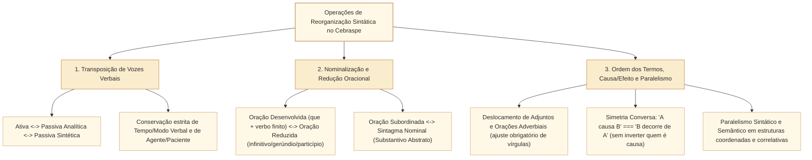

# Reorganização sintática e equivalência semântica: paráfrase, inversões e paralelismo no padrão Cebraspe

## 1. Situação-problema: quando reescrever um parágrafo inteiro preserva (ou corrompe) a sintaxe e a informação

Nas provas de Analista Legislativo da Câmara dos Deputados, o Cebraspe frequentemente apresenta um período de três ou quatro linhas do texto-base e propõe uma **reescrita integral** com profunda reorganização sintática (mudança da ordem dos termos, conversão de voz ativa em passiva, transformação de orações subordinadas em substantivos abstratos e troca de conectivos), perguntando se a nova redação **mantém a correção gramatical, o sentido original e a coerência**.

Considere o período original:
> **Período original:** *"Como a Comissão de Constituição e Justiça reconheceu a constitucionalidade da proposta, a Mesa Diretora incluiu a matéria na Ordem do Dia para que o Plenário a deliberasse com urgência."*

Veja três tentativas de reorganização sintática avaliadas pelo Cebraspe:

1. **Tentativa 1 (Nominalização + Voz Passiva):** *"Reconhecida a constitucionalidade da proposta pela Comissão de Constituição e Justiça, a matéria foi incluída na Ordem do Dia pela Mesa Diretora, a fim de ser deliberada com urgência pelo Plenário."*
   * **Julgamento:** **REESCRITA POSSÍVEL COM RESSALVA**. A oração causal com *como* foi substituída por construção reduzida de particípio (*"Reconhecida a constitucionalidade..."*), que **pode ser lida temporal ou causalmente** conforme o contexto. A principal passou à voz passiva analítica e a finalidade tornou-se infinitiva passiva, mantendo os agentes explicitados. A equivalência causal estrita **não fica assegurada pela redução isoladamente**. Para mantê-la inequívoca, prefira *"Como a constitucionalidade da proposta foi reconhecida pela CCJ, a matéria foi incluída..."*.
2. **Tentativa 2 (Inversão de Causa e Consequência):** *"A Comissão de Constituição e Justiça reconheceu a constitucionalidade da proposta porque a Mesa Diretora incluiu a matéria na Ordem do Dia..."*
   * **Julgamento:** **ERRADA (Inversão causal)**. Embora gramaticalmente correta, transferiu a conjunção causal para a segunda oração, transformando a consequência (inclusão na Ordem do Dia) em causa do reconhecimento da constitucionalidade.
3. **Tentativa 3 (Quebra de Paralelismo Sintático):** *"A comissão decidiu **pela aprovação** do relatório e **arquivar** as emendas inconstitucionais."*
   * **Julgamento:** **ERRADA (Assimetria sintática)**. Coordenou um complemento nominal preposicionado (*pela aprovação*) com uma oração reduzida de infinitivo não preposicionada (*arquivar*). O paralelismo exige simetria: *"decidiu **pela aprovação** do relatório e **pelo arquivamento** das emendas"* ou *"decidiu **aprovar** o relatório e **arquivar** as emendas"*.

Esta unidade sistematiza as cinco grandes operações de **reorganização sintática e paráfrase estrutural** cobradas pelo Cebraspe: transposição de vozes verbais, nominalização e desnominalização, conversão entre orações desenvolvidas e reduzidas, inversão da ordem dos termos e cláusulas de causa/consequência, e as leis do paralelismo sintático e semântico.

---

## 2. As cinco operações de reorganização sintática e equivalência semântica

Uma **paráfrase estrutural válida** é aquela em que mudam estruturas morfossintáticas de superfície e permanecem preservados, conforme o comando, a **proposição de base**, os **papéis temáticos** (agente, paciente, destinatário) e as **relações lógico-discursivas** (causa, concessão, condição, finalidade, tempo). A troca de uma oração desenvolvida por reduzida pode **introduzir leitura temporal ou causal concorrente**; esse efeito precisa ser testado, em vez de presumir equivalência automática.

---

## 3. Operação 1: Transposição de vozes verbais (Ativa $\leftrightarrow$ Passiva Analítica $\leftrightarrow$ Passiva Sintética)

A conversão entre as vozes verbais (exclusiva de verbos que possuem objeto direto: **VTD** e **VTDI**) é uma operação matemática de troca de funções sintáticas sem alteração dos papéis semânticos:

$$\begin{array}{ccccc}
\text{\textbf{Voz Ativa:}} & \underbrace{\text{As comissões}}_{\text{Sujeito Agente}} & \underbrace{\text{analisaram}}_{\text{VTD (Pret. Perf.)}} & \underbrace{\text{os projetos}}_{\text{Objeto Direto (Paciente)}} & \\
& \updownarrow & \updownarrow & \updownarrow & \\
\text{\textbf{Passiva Analítica:}} & \underbrace{\text{Os projetos}}_{\text{Sujeito Paciente}} & \underbrace{\text{foram analisados}}_{\text{SER (Pret. Perf.) + Particípio}} & \underbrace{\text{pelas comissões}}_{\text{Agente da Passiva}} & \\
& \updownarrow & \updownarrow & & \\
\text{\textbf{Passiva Sintética:}} & \underbrace{\text{Analisaram-se}}_{\text{VTD (Pret. Perf.) + SE}} & \underbrace{\text{os projetos}}_{\text{Sujeito Paciente}} & \text{(sem agente expresso)} &
\end{array}$$

### 3.1. Os três erros fatais que o Cebraspe insere na conversão de vozes verbais

1. **Mudança sub-reptícia do tempo ou modo verbal do verbo auxiliar `SER`:**
   * Na conversão para a passiva analítica, o verbo auxiliar ***ser*** deve assumir **exatamente o mesmo tempo e o mesmo modo** em que estava o verbo principal na voz ativa:
     * Ativa no presente (*analisam*) $\rightarrow$ Passiva (*"**são** analisados"*).
     * Ativa no pretérito imperfeito (*analisavam*) $\rightarrow$ Passiva (*"**eram** analisados"*).
     * Ativa no pretérito perfeito (*analisaram*) $\rightarrow$ Passiva (*"**foram** analisados"*) — **Cuidado:** se o item colocar *"tinham sido analisados"* (mais-que-perfeito) ou *"seriam analisados"* (futuro do pretérito), **altera o sentido temporal/modal**.
     * Ativa com locução (*devem analisar*) $\rightarrow$ Passiva (*"**devem ser** analisados"*).
2. **Perda de informação relevante (omissão do agente da passiva quando ele era essencial na ativa):**
   * Se a frase original diz *"O Supremo Tribunal Federal declarou a norma inconstitucional"*, reescrever apenas como *"Declarou-se a norma inconstitucional"* mantém a correção gramatical, mas **suprime a informação de quem praticou o ato** (o STF). Se o item afirmar que preserva *todas as informações originais do período*, está **ERRADO**.
3. **Tentativa de apassivar verbo transitivo indireto (VTI) ou intransitivo:**
   * *"Os deputados assistiram à sessão"* $\rightarrow$ Não admite passiva (*"A sessão foi assistida"* é rejeitado pela gramática normativa tradicional nas provas do Cebraspe, salvo *obedecer/desobedecer*).

---

## 4. Operação 2: Nominalização, redução e desenvolvimento de orações

### 4.1. Transformação de oração em sintagma nominal (Nominalização)

Substituir um verbo por um substantivo abstrato cognato (**nominalização**) condensa o período e permite mudar o conectivo por uma preposição:

* **Causal:** *"Porque **rejeitaram** o destaque..."* $\leftrightarrow$ *"Em razão **da rejeição** do destaque..."* / *"Devido **à rejeição** do destaque..."*.
* **Concessiva:** *"Embora **tenham alterado** o texto..."* $\leftrightarrow$ *"A despeito **da alteração** do texto..."* / *"Apesar **da alteração** do texto..."*.
* **Condicional:** *"Caso **aprovem** a medida..."* $\leftrightarrow$ *"No caso **de aprovação** da medida..."* / *"Mediante **a aprovação** da medida..."*.
* **Temporal:** *"Quando **encerraram** a sessão..."* $\leftrightarrow$ *"Por ocasião **do encerramento** da sessão..."* / *"Após **o encerramento** da sessão..."*.

### 4.2. Conversão entre orações desenvolvidas e orações reduzidas

| Tipo de Oração | Forma Desenvolvida (Com Conectivo + Verbo Finito) | Forma Reduzida Equivalente (Sem Conectivo + Infinitivo / Gerúndio / Particípio) |
| :--- | :--- | :--- |
| **Substantiva Subjetiva** | *"É indispensável **que se publiquem os atos**."* | *"É indispensável **publicarem-se os atos** (ou **publicar os atos**)."* |
| **Adjetiva Restritiva** | *"Proposições **que geram despesas** exigem estimativa."* | *"Proposições **geradoras de despesas / gerando despesas** exigem estimativa."* |
| **Adverbial Temporal / Causal** | *"Assim que **concluiu a leitura**, o relator abriu o debate."* | *"**Concluída a leitura** (particípio) / **Ao concluir a leitura** (infinitivo), o relator abriu o debate."* |
| **Adverbial Condicional** | *"Se **analisarmos os dados com rigor**, veremos a falha."* | *"**Analisando os dados com rigor** (gerúndio) / **A analisar os dados...**, veremos a falha."* |
| **Adverbial Concessiva** | *"Mesmo que **seja urgente**, o projeto respeitará o rito."* | *"Mesmo **sendo urgente** / **Apesar de ser urgente**, o projeto respeitará o rito."* |

* **Atenção ao gerúndio na reescrita:** O gerúndio anteposto indica ação **simultânea ou imediatamente anterior** (causa, condição, modo ou tempo). Jamais use o gerúndio para expressar uma ação futura desconexa ou que produza ambiguidade de sujeito (sujeito da oração reduzida diferente do sujeito da principal sem explicitação).

---

## 5. Operação 3: Inversão de causa/consequência, ordem dos termos e paralelismo sintático

### 5.1. O espelhamento legítimo entre Causa e Consequência (relações conversas)

Um dos testes mais elegantes do Cebraspe consiste em inverter os blocos da frase trocando um verbo ou conector de **causa** (*causar, provocar, gerar, acarretar, porque*) por um de **consequência/origem** (*decorrer de, resultar de, advir de, provir de, portanto*):

* **Exemplo de equivalência causal quando os referentes e a relação entre eventos permanecem explícitos:**
  $$\text{"A falta de quórum (\textbf{Causa}) \textbf{provocou} o adiamento da sessão (\textbf{Efeito})."}$$
  $$\equiv$$
  $$\text{"O adiamento da sessão (\textbf{Efeito}) \textbf{decorreu da / resultou da} falta de quórum (\textbf{Causa})."}$$
* **Distorção Lógica (Armadilha do Cebraspe):**
  * *"A falta de quórum **decorreu do** adiamento da sessão"* $\rightarrow$ **ERRADO** (inverteu quem é causa e quem é efeito).
  * **Regra prática:** Na reescrita, pergunte sempre: **"Quem aconteceu primeiro / quem gerou o quê?"**. Se a causa continuar sendo causa na frase reescrita, o sentido foi preservado.

### 5.2. Deslocamento de termos e o impacto no sentido e na pontuação

1. **Deslocamento de orações adverbiais e adjuntos adverbiais:** Mudar uma oração adverbial ou um adjunto adverbial do final para o início (ou meio) do período **mantém o sentido básico**, alterando apenas a ênfase (topicalização), desde que se insira a **vírgula obrigatória** após a oração adverbial anteposta (ou vírgulas duplas na intercalação).
2. **Deslocamento de advérbios de exclusão/foco (`só, somente, apenas, justamente, até, mesmo, inclusive`):**
   * **CUIDADO EXTREMO:** Ao contrário dos advérbios de tempo ou lugar, os **operadores de foco/exclusão** modificam **estritamente o termo ao lado do qual são posicionados**. Mudá-los de lugar **ALTERA RADICALMENTE O SENTIDO**:
     * *"Apenas **o relator** analisou o substitutivo hoje."* (Mais ninguém analisou).
     * *"O relator **apenas analisou** o substitutivo hoje."* (Ele só analisou, não votou nem alterou).
     * *"O relator analisou **apenas o substitutivo** hoje."* (Ele não analisou outras matérias).
     * *"O relator analisou o substitutivo **apenas hoje**."* (Ele não havia analisado nos dias anteriores).

### 5.3. Paralelismo sintático e semântico

O **paralelismo sintático** exige que ideias similares ou coordenadas dentro de um período sejam expressas por **estruturas gramaticais simétricas** (substantivo com substantivo, infinitivo com infinitivo, oração desenvolvida com oração desenvolvida, presença ou ausência simétrica de preposições e artigos):

| Tipo de Quebra de Paralelismo (ERRADO) | Reescrita Simétrica com Paralelismo (CORRETO) |
| :--- | :--- |
| **1. Mistura de substantivo com verbo no infinitivo:** *"O plano visa **à modernização** dos sistemas e **capacitar** os servidores."* | • Nominal: *"O plano visa **à modernização** dos sistemas e **à capacitação** dos servidores."* • Verbal: *"O plano visa **modernizar** os sistemas e **capacitar** os servidores."* |
| **2. Assimetria de preposição após regente único:** *"O parecer refere-se **às metas** fiscais e **os limites** de gasto."* | *"O parecer refere-se **às metas** fiscais e **aos limites** de gasto."* (Repete a preposição *a* em ambos os núcleos). |
| **3. Assimetria em estruturas correlativas (`não só... mas também`, `tanto... quanto`, `seja... seja`):** *"A medida afeta **não só aos** servidores ativos, **mas também os** aposentados."* | *"A medida afeta **não só os** servidores ativos, **mas também os** aposentados."* (Ou preposição antes do *não só*, valendo para ambos). |
| **4. Quebra de paralelismo semântico (zeugma ou coordenação disparatada):** *"O deputado apresentou três emendas, dois requerimentos e uma dor de cabeça."* | Manter apenas elementos da mesma esfera semântica/categorial na enumeração técnica. |

---

## 6. Casos progressivos e casos de fronteira em textos da Câmara dos Deputados

### Caso 1: Permuta entre Oração Adversativa (`mas`) e Oração Concessiva (`embora`) na reescrita
Relembre a fronteira estudada em `CAM-LP-009`:
> **Original:** *"O projeto apresenta falhas redacionais, **mas** atende ao interesse público."*
> **Reescrita 1:** *"Embora apresente falhas redacionais, o projeto atende ao interesse público."*
> **Reescrita 2:** *"Embora atenda ao interesse público, o projeto apresenta falhas redacionais."*

* **Critério do Cebraspe:**
  * A **Reescrita 1** **preserva a orientação argumentativa** do original, pois transforma a primeira oração (a ressalva superada: *apresenta falhas*) na subordinada concessiva e mantém a segunda oração (o argumento forte: *atende ao interesse público*) como oração principal.
  * A **Reescrita 2** **INVERTE a orientação argumentativa** (muda o sentido), pois rebaixa o argumento principal à condição de concessão fraca e transforma o defeito (*apresenta falhas*) na tese dominante.

### Caso 2: Reescrita de período complexo com manutenção de coesão, pontuação e regência
Quando o Cebraspe apresenta um item de **reescrita de parágrafo inteiro** (4 a 5 linhas), aplique este **checklist rápido de 5 segundos** procurando onde a banca escondeu o erro:
1. **Verifique a concordância verbal** (procurar um verbo no singular cujo sujeito passou para o plural, ou *"houveram / tratam-se de"*).
2. **Verifique a regência e a crase** (procurar um *"implica em"*, *"visando ao"* trocado por *"buscando ao"*, ou um *"a"* singular antes de plural com crase *"à propostas"*).
3. **Verifique a pontuação** (procurar uma vírgula separando sujeito e verbo, ou uma oração adjetiva restritiva que ganhou vírgulas virando explicativa).
4. **Verifique a colocação pronominal** (procurar *"que manifestou-se"*, *"não aprovou-se"* ou *"tinha aprovado-o"*).
5. **Verifique a relação lógica e a ordem causal** (procurar se A continuou sendo causa de B e se nenhum *apenas/não* mudou de escopo).

---

## 7. Itens comentados no padrão Cebraspe (Certo/Errado)

*(Inédita: estilo Cebraspe / Câmara dos Deputados – Analista Legislativo)*
> **Texto de referência:**
> "Porquanto a transparência orçamentária constitui pressuposto inafastável do controle social, a Câmara dos Deputados disponibiliza em tempo real os dados de execução financeira, permitindo que qualquer cidadão fiscalize a aplicação dos recursos públicos."

**Item 1.** *(Inédita: estilo Cebraspe / Câmara dos Deputados – Analista Legislativo)* A primeira oração do período poderia ser reescrita, mantendo-se a correção gramatical e o sentido causal original, da seguinte forma: **Haja vista que a transparência orçamentária constitui pressuposto inafastável do controle social**.
* **Gabarito:** **CERTO**.
* **Fundamentação:** A conjunção *Porquanto* é causal/explicativa (= *porque, visto que, já que*). A locução conjuntiva *Haja vista que* possui exatamente o mesmo valor causal e rege o verbo no modo indicativo (*constitui*), preservando tanto a correção gramatical quanto o sentido original.

**Item 2.** *(Inédita: estilo Cebraspe / Câmara dos Deputados – Analista Legislativo)* A conversão da oração principal para a voz passiva analítica — **os dados de execução financeira são disponibilizados em tempo real pela Câmara dos Deputados** — preserva a correção gramatical e a informação original do segmento.
* **Gabarito:** **CERTO**.
* **Fundamentação:** Na voz ativa, *"a Câmara dos Deputados"* é sujeito agente, *"disponibiliza"* é VTD no presente do indicativo e *"os dados de execução financeira"* é objeto direto. Na voz passiva analítica, o objeto direto passa a sujeito paciente plural (*"os dados..."*), o verbo auxiliar *ser* mantém o presente do indicativo no plural seguido do particípio (*"são disponibilizados"*), e o antigo sujeito converte-se em agente da passiva (*"pela Câmara dos Deputados"*), sem perda de informação nem desvio gramatical.

**Item 3.** *(Inédita: estilo Cebraspe / Câmara dos Deputados – Analista Legislativo)* Caso o segmento final *"permitindo que qualquer cidadão fiscalize a aplicação dos recursos públicos"* fosse reescrito por meio de nominalização na forma **o que permite a qualquer cidadão a fiscalização de como aplica-se os recursos públicos**, seriam mantidos o sentido original e a correção gramatical.
* **Gabarito:** **ERRADO**.
* **Fundamentação:** Na reescrita proposta, há **dois erros gramaticais graves** na parte final (*"de como aplica-se os recursos públicos"*): (1) erro de **concordância verbal** na voz passiva sintética, pois *os recursos públicos* é sujeito paciente plural e exige o verbo no plural (*aplicam-se*); e (2) erro de **colocação pronominal**, pois o advérbio interrogativo/conjunção *como* em oração subordinada exige próclise obrigatória (*"de como **se aplicam** os recursos públicos"*).

**Item 4.** *(Inédita: estilo Cebraspe / Câmara dos Deputados – Analista Legislativo)* Preservam-se a correção gramatical e a coerência das ideias originais do texto na seguinte proposta de reescrita integral do período: **A disponibilização em tempo real dos dados de execução financeira pela Câmara dos Deputados decorre do fato de a transparência orçamentária constituir pressuposto inafastável do controle social. Essa disponibilização permite que qualquer cidadão fiscalize a aplicação dos recursos públicos.**
* **Gabarito:** **CERTO**.
* **Fundamentação:** A locução ***decorre do fato de*** recupera a relação causal marcada por *porquanto*: o reconhecimento da transparência orçamentária como pressuposto do controle social fundamenta a disponibilização dos dados. A construção *do fato de a transparência constituir* mantém o sujeito expresso do infinitivo sem contração indevida. **Essa disponibilização** retoma explicitamente a ação de disponibilizar os dados, evitando que um pronome neutro como *o que* seja associado a toda a proposição precedente. A segunda frase preserva o efeito indicado pelo gerúndio original: o acesso aos dados permite que qualquer cidadão fiscalize a aplicação dos recursos. O comando avalia a preservação de relações relevantes e não identidade absoluta de todos os efeitos de estilo.

**Item 5.** *(Inédita: estilo Cebraspe / Câmara dos Deputados – Analista Legislativo)* Na sentença *"A Mesa Diretora determinou a publicação somente dos anexos aprovados em comissão"*, o deslocamento do advérbio **somente** para imediatamente antes da forma verbal **determinou** — *"A Mesa Diretora somente determinou a publicação dos anexos..."* — manteria a correção gramatical e o sentido original do período.
* **Gabarito:** **ERRADO**.
* **Fundamentação:** Embora a correção gramatical seja mantida, o deslocamento do operador de foco/exclusão **somente** **altera profundamente o sentido original**: na frase original, apenas os anexos aprovados (e nenhum outro documento) seriam publicados; na frase reescrita, a Mesa Diretora apenas determinou a publicação (isto é, limitou-se a dar a ordem, sem executar outras ações).

**Item 6.** *(Inédita: estilo Cebraspe / Câmara dos Deputados – Analista Legislativo)* O período *"Compete à consultoria legislativa tanto elaborar minutas de proposições quanto a revisão técnica dos pareceres"* respeita integralmente o princípio do paralelismo sintático.
* **Gabarito:** **ERRADO**.
* **Fundamentação:** Há **quebra de paralelismo sintático** na estrutura correlativa aditiva *tanto... quanto*: o primeiro membro é uma oração reduzida de infinitivo (*"elaborar minutas de proposições"*), enquanto o segundo membro é um sintagma nominal (*"a revisão técnica dos pareceres"*). Para restabelecer o paralelismo, deve-se usar dois infinitivos (*"tanto **elaborar** minutas ... quanto **revisar** tecnicamente os pareceres"*) ou dois substantivos (*"tanto **a elaboração** de minutas ... quanto **a revisão** técnica dos pareceres"*).

---

## 8. Relações com outros conceitos e notas da biblioteca

* **Reescrita por substituição lexical (pré-requisito complementar):** [[3 - Materias/Portugues/32 - reescrita substituicao lexical e preservacao de sentido|32 • Reescrita: substituição lexical, correção gramatical e preservação de sentido (CAM-LP-021)]] e [[3 - Materias/Portugues/10 - reescrita semantica e preservacao de sentido|10 • Reescrita, semântica e preservação de sentido]].
* **Coordenação e subordinação (transformações oracionais):** [[3 - Materias/Portugues/24 - coordenacao relacoes sintaticas e semanticas|24 • Coordenação (CAM-LP-013)]] e [[3 - Materias/Portugues/25 - subordinacao substantiva adjetiva e adverbial|25 • Subordinação (CAM-LP-014)]].
* **Pontuação nas inversões sintáticas:** [[3 - Materias/Portugues/26 - pontuacao e efeitos na estrutura e no sentido|26 • Pontuação e efeitos na estrutura e no sentido (CAM-LP-015)]].
* **Próximo passo e fechamento da trilha (Reescrita entre registros, formalidade e gêneros textuais):** Unidade `CAM-LP-023`.

## 9. Referências teóricas e normativas

* GARCIA, Othon Moacyr. **Comunicação em Prosa Moderna: aprenda a escrever, aprendendo a pensar**. 27. ed. Rio de Janeiro: FGV, 2010. (Capítulos sobre Paralelismo, Frase Débil e Construção do Período).
* BECHARA, Evanildo. **Moderna Gramática Portuguesa**. 39. ed. Rio de Janeiro: Nova Fronteira, 2019.
* BRASIL. Presidência da República. **Manual de Redação da Presidência da República**. 3. ed. rev., atual. e ampl. Brasília: Presidência da República, 2018.
* KOCH, Ingedore Villaça; ELIAS, Vanda Maria. **Ler e Escrever: estratégias de produção textual**. 2. ed. São Paulo: Contexto, 2014.
