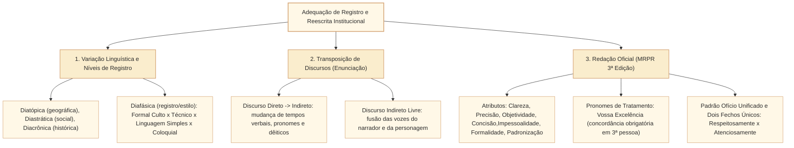

# Reescrita entre registros, níveis de formalidade, discurso direto e indireto e Redação Oficial no padrão Cebraspe

## 1. Situação-problema: adaptar o registro ao interlocutor, converter vozes discursivas e observar a Redação Oficial

No cotidiano da Secretaria de Comunicação Social (Secom) e das comissões da Câmara dos Deputados, o Analista Legislativo de Divulgação Institucional realiza constantemente operações de **transcodificação e reescrita entre registros e gêneros**:

1. Transformar um **pronunciamento oral espontâneo** de um parlamentar no Plenário (**discurso direto**, com marcas de oralidade e dêiticos de 1ª pessoa) em uma **nota jornalística da Agência Câmara** ou em registro de **ata taquigráfica em discurso indireto**.
2. Converter o texto técnico-jurídico denso de um **parecer legislativo** em um **comunicado em Linguagem Simples** destinado ao portal institucional ou às redes sociais, preservando a exatidão normativa sem cair na coloquialidade vulgar.
3. Redigir um **ofício oficial** da Presidência da Câmara a um Ministro de Estado ou ao Presidente do Supremo Tribunal Federal, considerando os **atributos de redação oficial**, os **pronomes de tratamento**, a **concordância na 3ª pessoa** e os padrões do *Manual de Redação da Presidência da República (MRPR, 3ª edição)* **como referência comparativa**; as normas próprias da Câmara precisam ser verificadas para expedientes desta Casa.

Esta unidade — que conclui integralmente a trilha de **Língua Portuguesa (`CAM-LP-023`, 23/23)** — sistematiza os três grandes eixos da reescrita pragmática e institucional cobrados pelo Cebraspe: (1) variação linguística, adequação de registro e marcas de oralidade $\times$ formalidade; (2) regras gramaticais de transposição entre **discurso direto**, **discurso indireto** e **discurso indireto livre**; e (3) normas vigentes da **Redação Oficial (MRPR 3ª ed.)**.

---

## 2. Variação linguística, níveis de formalidade e adequação estilística

A linguística moderna distingue quatro dimensões da variação dentro de uma mesma língua histórica, entre as quais a **variação diafásica (de registro)** é o foco central das questões de reescrita do Cebraspe:

### 2.1. As quatro dimensões da variação linguística

1. **Variação diatópica (geográfica ou regional):** diferenças fonéticas, lexicais e sintáticas conforme a região (*mandioca / aipim / macaxeira*).
2. **Variação diastrática (social):** diferenças associadas a grupos socioeconômicos, faixas etárias ou jargões profissionais (linguagem jurídica, jargão médico, gírias juvenis).
3. **Variação diacrônica (histórica):** evolução da língua ao longo do tempo (*Vossa Mercê $\rightarrow$ vosmecê $\rightarrow$ você*).
4. **Variação diafásica (situacional ou de registro):** adaptação consciente que o mesmo falante/redator realiza conforme o **grau de monitoramento estilístico**, a **formalidade da situação**, o **gênero textual** e o **interlocutor**.

### 2.2. Como o Cebraspe cobra marcas de oralidade e adequação ao registro formal

Em crônicas, artigos de opinião e entrevistas transcritas, o Cebraspe costuma apontar expressões como *"a gente"*, *"pra"*, *"tá"*, *"né"*, *"deixar quieto"*, *"bater o martelo"*, *"engolir seco"* ou o uso de *"ter"* no lugar de *"haver"* (*"Tem muitos projetos na fila"*) e formular duas perguntas:

* **Pergunta 1 (Identificação sociolinguística):** *"O emprego da expressão X confere ao texto um tom coloquial / aproxima o texto da modalidade oral, recurso compatível com o gênero crônica para estabelecer proximidade com o leitor"* $\rightarrow$ **CERTO**.
* **Pergunta 2 (Reescrita para o registro formal culto):** *"Caso o trecho fosse transposto para um documento oficial, a substituição de 'Tem muitos projetos' por 'Há muitos projetos' (ou 'Existem muitos projetos') adequaria o período à norma-padrão"* $\rightarrow$ **CERTO**.
* **Fronteira crucial (Linguagem Simples $\neq$ Linguagem Coloquial):** Adotar **Linguagem Simples** na comunicação pública da Câmara significa substituir jargões herméticos, períodos excessivamente longos e ordem inversa por vocabulário acessível, períodos diretos (Sujeito + Verbo + Complemento) e voz ativa, **mantendo 100% de obediência à norma-padrão gramatical** (jamais introduzindo gírias ou desvios de concordância/regência).

---

## 3. Transposição entre Discurso Direto, Discurso Indireto e Discurso Indireto Livre

Na reportagem legislativa e na redação de atas, a conversão da fala literal de um deputado (**discurso direto**) para a reprodução subordinada pelo relator ou jornalista (**discurso indireto**) exige **ajustes sistemáticos obrigatórios** em quatro categorias gramaticais:

### 3.1. Matriz de conversão: Discurso Direto $\rightarrow$ Discurso Indireto (com verbo *dicendi* no passado)

Quando o verbo de elocução (*disse, afirmou, declarou, perguntou, ordenou*) está no **pretérito perfeito**, todas as formas da fala original recuam um grau no tempo e na dêixis:

| Categoria Gramatical | No Discurso Direto (Fala Literal entre Aspas/Travessão) | No Discurso Indireto (Subordinado a *"O relator declarou que..."*) |
| :--- | :--- | :--- |
| **1. Tempos e Modos Verbais** | • **Presente do Indicativo** (*"Eu **voto** a favor."*) • **Pretérito Perfeito do Ind.** (*"Eu **votei** ontem."*) • **Futuro do Presente do Ind.** (*"Eu **votarei** amanhã."*) • **Presente do Subjuntivo** (*"Talvez **votem** hoje."*) • **Modo Imperativo** (*"**Votem** agora!"*) | • $\rightarrow$ **Pretérito Imperfeito do Ind.** (*...que **votava** a favor.*) • $\rightarrow$ **Pretérito Mais-que-Perfeito** (*...que **votara / havia votado**...*) • $\rightarrow$ **Futuro do Pretérito do Ind.** (*...que **votaria** no dia seguinte.*) • $\rightarrow$ **Pretérito Imperfeito do Subj.** (*...que talvez **votassem**...*) • $\rightarrow$ **Imperfeito do Subjuntivo** ou **Infinitivo** (*Ordenou que **votassem** / Mandou **votarem**.*) |
| **2. Pronomes Pessoais e Possessivos** | • **1ª pessoa** (*eu, nós, meu, nosso*) • **2ª pessoa** (*tu, vós, você, teu, seu*) | • $\rightarrow$ **3ª pessoa** (*ele, ela, eles, seu, sua, dele, dela*) |
| **3. Pronomes Demonstrativos** | • **1ª e 2ª pessoa** (*este, esta, isto, esse, essa, isso*) | • $\rightarrow$ **3ª pessoa** (*aquele, aquela, aquilo*) |
| **4. Advérbios Dêiticos de Tempo e Lugar** | • **Hoje / Agora** • **Ontem / Anteontem** • **Amanhã** • **Aqui / Cá** | • $\rightarrow$ **Naquele dia / Naquele momento (ou então)** • $\rightarrow$ **Na véspera (ou no dia anterior)** • $\rightarrow$ **No dia seguinte** • $\rightarrow$ **Ali / Lá / Naquele lugar** |
| **5. Pontuação e Conectivos** | • Dois-pontos, aspas ou travessão; • Interrogação direta (*?*). | • Conjunção integrante ***que*** (nas declarações) ou ***se*** / pronome interrogativo (nas **interrogativas indiretas**, **sem ponto de interrogação**). |

* **Exemplo completo de transposição:**
  * **Discurso Direto:** O presidente da comissão anunciou: *— **Hoje** não **votaremos** **este** destaque **aqui**, pois os líderes **pediram** prazo **ontem**.*
  * **Discurso Indireto:** O presidente da comissão anunciou **que**, **naquele dia**, não **votariam** **aquele** destaque **ali**, pois os líderes **haviam pedido** (*ou **pediram** $\rightarrow$ **pediram/tinham pedido***) prazo **na véspera**.

### 3.2. O Discurso Indireto Livre

Muito cobrado em textos literários e crônicas jornalísticas pelo Cebraspe, o **discurso indireto livre** é a modalidade híbrida em que a fala ou o pensamento da personagem penetra diretamente no tecido da narrativa em 3ª pessoa, **sem verbo de elocução (*disse que*) e sem conectivo subordinativo**, mantendo a pontuação expressiva (interrogações, exclamações) da personagem ao lado dos tempos verbais do narrador (geralmente pretérito imperfeito e futuro do pretérito):

* *Exemplo:* *"O relator fechou a pasta exausto. **Como aprovaria o substitutivo sem o apoio da própria bancada? Amanhã seria um novo dia.**"* (As duas últimas frases expressam a voz interior do relator fundida à voz do narrador em 3ª pessoa).

---

## 4. Redação Oficial no padrão Cebraspe (Manual de Redação da Presidência da República — 3ª Edição)

Quando a questão de reescrita envolve correspondências e atos oficiais do Poder Público, o Cebraspe aplica com rigor literal as normas atualizadas da **3ª edição do MRPR (2018)**:

### 4.1. Os sete atributos da Redação Oficial

1. **Clareza e Precisão:** texto inteligível imediatamente (clareza) e que utiliza o vocábulo exato, sem ambiguidade ou duplo sentido (precisão).
2. **Objetividade:** ir diretamente ao assunto central, sem rodeios, digressões ou opiniões pessoais.
3. **Concisão:** transmitir o máximo de informação relevante com o mínimo de palavras (economia linguística, eliminando redundâncias e adjetivação supérflua).
4. **Coesão e Coerência:** conexão harmônica entre as partes do texto.
5. **Impessoalidade:** decorre diretamente do art. 37, *caput*, da Constituição. Manifesta-se em **três planos**: (a) quem comunica é sempre o **Serviço Público** (o órgão/cargo), e não a pessoa física do agente; (b) o destinatário é tratado de forma homogênea e pública; e (c) o assunto é estritamente de interesse público, sendo vedadas impressões subjetivas, elogios pessoais ou sentimentalismos.
6. **Formalidade e Civilidade:** respeito às normas de tratamento e urbanidade institucional.
7. **Uso da Norma-Padrão da Língua Portuguesa e Padronização.**

### 4.2. Sintaxe dos pronomes de tratamento (`Vossa Excelência` e `Vossa Senhoria`)

Esta é a regra mais cobrada da Redação Oficial em provas de Língua Portuguesa:

* **1. Concordância Verbal e Pronominal (SEMPRE em 3ª pessoa):** Embora *Vossa Excelência* e *Vossa Senhoria* se refiram à **2ª pessoa do discurso** (a pessoa com quem se fala), toda a concordância gramatical (verbos, pronomes oblíquos e pronomes possessivos) faz-se **obrigatoriamente na 3ª pessoa** (*ele/ela, seu, sua, o, a, lhe, se*), sendo **proibido** usar *vosso, vossa, vos, convosco*:
  * **Correto:** *"Solicito a **Vossa Excelência** que **encaminhe** (3ª sing.) o **seu** (3ª) chefe de gabinete para **assessorá-lo** (3ª)."*
  * **Incorreto:** *"Solicito a Vossa Excelência que encaminheis o vosso chefe para vos assessorar."*
* **2. Concordância Nominal de Gênero (com o sexo do destinatário):** Os adjetivos e particípios que funcionam como predicativos concordam com o **sexo real da pessoa** a quem o documento é dirigido:
  * Para um deputado (homem): *"Vossa Excelência foi **designado** relator e está **comprometido**..."*
  * Para uma deputada (mulher): *"Vossa Excelência foi **designada** relatora e está **comprometida**..."*
* **3. Diferença entre `Vossa Excelência` e `Sua Excelência`:**
  * **Vossa Excelência:** fala-se **COM** a autoridade (destinatário direto do ofício).
  * **Sua Excelência:** fala-se **SOBRE** a autoridade (referência a uma terceira pessoa ausente).
* **4. Principais destinatários de `Vossa Excelência` e vocativo:**
  * Recebem *Vossa Excelência*: Presidente e Vice-Presidente da República, Ministros de Estado, Governadores, **Deputados Federais e Estaduais, Senadores**, Prefeitos, Embaixadores, Oficial-General das Forças Armadas, Ministros do STF e Tribunais Superiores, Juízes, Desembargadores, Auditores do TCU e Procuradores. *(As demais autoridades e particulares recebem **Vossa Senhoria**).*
  * **Vocativo:** ***Senhor Deputado,*** / ***Senhora Ministra,*** (seguido de vírgula). **Exceção de Excelentíssimo:** Apenas os **Chefes dos Três Poderes** (Presidente da República, Presidente do Congresso Nacional / da Câmara / do Senado e Presidente do Supremo Tribunal Federal) recebem o vocativo ***Excelentíssimo Senhor Presidente da Câmara dos Deputados,***.
  * **Abolição do tratamento "Doutor":** *Doutor* não é pronome de tratamento; é título acadêmico restrito a quem concluiu doutorado, devendo ser evitado em comunicações oficiais genéricas. **Abolidos também:** *Ilustríssimo (Ilmo.)*, *Digníssimo (DD.)* e *Mui Respeitosamente*.

### 4.3. Unificação do Padrão Ofício e os Dois Fechos Únicos (MRPR 3ª ed.)

A 3ª edição do MRPR **aboliu a antiga distinção entre Aviso, Ofício e Memorando**, unificando os três sob a denominação única de **Padrão Ofício** (utilizado tanto para comunicações internas entre órgãos quanto externas).

* **Fechos previstos no MRPR, 3ª edição, como padrão do Executivo federal (dois):**
  1. **`Respeitosamente,`** $\rightarrow$ Para autoridades de **hierarquia superior** à do signatário (inclusive o Presidente da República).
  2. **`Atenciosamente,`** $\rightarrow$ Para autoridades de **mesma hierarquia**, de **hierarquia inferior** ou para **demais casos** (incluindo particulares e autoridades de outros Poderes sem subordinação hierárquica, embora entre Chefes de Poder ou perante alta autoridade se admita a deferência de *Respeitosamente*).

---

## 5. Casos progressivos e casos de fronteira em textos da Câmara dos Deputados

### Caso 1: Transposição de pronunciamento em Plenário (Discurso Direto $\rightarrow$ Indireto)
Considere o trecho taquigráfico:
> *"O líder da bancada subiu à tribuna e afirmou: — **Senhores Deputados, não aceitaremos que esta medida provisória seja votada hoje sem o relatório prévio da nossa comissão!**"*

* **Reescrita padrão em Discurso Indireto:**
  > *"O líder da bancada subiu à tribuna e afirmou aos deputados **que não aceitariam que aquela medida provisória fosse votada naquele dia sem o relatório prévio da comissão deles (ou de sua comissão)**."*
* **Pontos críticos validados pelo Cebraspe:**
  * *não aceitaremos* (futuro do presente) $\rightarrow$ ***não aceitariam*** (futuro do pretérito);
  * *esta* $\rightarrow$ ***aquela***;
  * *seja votada* (presente do subjuntivo) $\rightarrow$ ***fosse votada*** (pretérito imperfeito do subjuntivo);
  * *hoje* $\rightarrow$ ***naquele dia***;
  * *nossa* $\rightarrow$ ***sua / deles***;
  * Supressão do vocativo e do ponto de exclamação.

### Caso 2: Adequação de Ofício Parlamentar às normas do MRPR
Analise a minuta abaixo:
> *"Ilustríssimo Senhor Doutor Secretário Executivo,*
> *Vimos, por meio deste memorando, informar a Vossa Excelência que vosso pedido de informações foi atendido e que esta Diretoria coloca-se à vossa inteira disposição.*
> *Mui respeitosamente,"*

* **Cinco desvios da Redação Oficial identificados pelo Cebraspe:**
  1. Uso indevido de *"Ilustríssimo"* e *"Doutor"* no vocativo (correto: ***Senhor Secretário Executivo,***).
  2. Circunlóquio vicioso *"Vimos, por meio deste..."* e uso da denominação extinta *"memorando"* (unificado no Padrão Ofício).
  3. Uso de *Vossa Excelência* para Secretário Executivo (que, salvo exceção legal equiparada a Ministro, recebe *Vossa Senhoria*, embora o erro gramatical central seja o próximo).
  4. **Erro gramatical grave de concordância em 2ª pessoa:** *"vosso pedido"* e *"à vossa disposição"* (correto: ***"seu pedido"*** e ***"à sua disposição"*** — 3ª pessoa).
  5. Fecho arcaico abolido *"Mui respeitosamente,"* (existem apenas *Respeitosamente,* e *Atenciosamente,*).

---

## 6. Itens comentados no padrão Cebraspe (Certo/Errado)

*(Inédita: estilo Cebraspe / Câmara dos Deputados – Analista Legislativo)*
> **Texto de referência:**
> "Ao abrir a reunião extraordinária, a presidente da comissão dirigiu-se ao ministro convidado:
> — Vossa Excelência está ciente de que os esclarecimentos prestados aqui hoje serão determinantes para que esta comissão delibere amanhã sobre o requerimento de convocação."

**Item 1.** *(Inédita: estilo Cebraspe / Câmara dos Deputados – Analista Legislativo)* Na fala da presidente da comissão, o emprego da forma masculina **ciente** (invariável em gênero) e da forma verbal **está** na terceira pessoa do singular em referência a **Vossa Excelência** respeita integralmente as normas de concordância da Redação Oficial; caso o adjetivo fosse substituído por **convidado**, este deveria flexionar-se no masculino singular, concordando com o sexo do destinatário.
* **Gabarito:** **CERTO**.
* **Fundamentação:** Os pronomes de tratamento exigem concordância verbal e pronominal na **3ª pessoa** (*está*), e a concordância nominal de gênero faz-se com o **sexo real da pessoa** a quem se refere (como se trata de um *ministro* do sexo masculino, o predicativo fica no masculino: *convidado*).

**Item 2.** *(Inédita: estilo Cebraspe / Câmara dos Deputados – Analista Legislativo)* Em relato elaborado alguns dias após a reunião, por narrador que já se encontra em outro local, a fala da presidente poderia ser transposta para o discurso indireto, introduzida por *"A presidente da comissão declarou ao ministro convidado que..."*, da seguinte maneira: **...Sua Excelência estava ciente de que os esclarecimentos prestados ali naquele dia seriam determinantes para que aquela comissão deliberasse no dia seguinte sobre o requerimento de convocação.**
* **Gabarito:** **CERTO**.
* **Fundamentação:** Na situação de relato **alguns dias posterior e fora do local da fala original**, as mudanças *Vossa Excelência* → *Sua Excelência*, *está* → *estava*, *aqui* → *ali*, *hoje* → *naquele dia*, *serão* → *seriam*, *esta* → *aquela*, *delibere* → *deliberasse* e *amanhã* → *no dia seguinte* são **possíveis e coerentes**. A referência temporal e espacial foi agora **fixada no comando**, evitando apresentar todas essas transposições como obrigatórias em qualquer relato: com narrador no mesmo local ou no mesmo dia, outras escolhas dêiticas podem ser adequadas. O gabarito CERTO refere-se apenas ao contexto especificado na questão inédita.

**Item 3.** *(Inédita: estilo Cebraspe / Câmara dos Deputados – Analista Legislativo)* Tomando expressamente como referência a **3ª edição do Manual de Redação da Presidência da República (MRPR)**, um expediente oficial dirigido a Ministro de Estado deveria ter a modalidade **Memorando**, o vocativo **Excelentíssimo Senhor Ministro,** e o fecho **Respeitosamente,**.
* **Gabarito:** **ERRADO**.
* **Fundamentação:** No âmbito do **MRPR, 3ª edição (Executivo federal)**, aviso, ofício e memorando foram unificados no **padrão ofício**, e o vocativo **Excelentíssimo Senhor** é reservado às autoridades tratadas como Chefes de Poder. Para ministro de Estado, o exemplo padrão é **Senhor Ministro,**. O item atualizado delimita expressamente sua **fonte normativa: o MRPR, próprio do Executivo federal**. Nessa fonte, **Memorando** não é modalidade separada do padrão ofício, e **Excelentíssimo Senhor Ministro** não é o vocativo recomendado. O fecho *Respeitosamente* deve ser analisado conforme a relação institucional; a incorreção dos dois outros elementos já sustenta o gabarito ERRADO. A aplicação à Câmara exige consulta adicional ao manual desta Casa.

**Item 4.** *(Inédita: estilo Cebraspe / Câmara dos Deputados – Analista Legislativo)* Estaria de acordo com a norma-padrão e as prescrições da redação oficial a seguinte frase dirigida a um parlamentar em um ofício: *"Encaminhamos a Vossa Excelência o relatório preliminar para que possais apresentar vossas sugestões de aprimoramento."*
* **Gabarito:** **ERRADO**.
* **Fundamentação:** Erro clássico de concordância com pronome de tratamento: foram empregados o verbo na 2ª pessoa do plural (*possais*) e o pronome possessivo de 2ª pessoa (*vossas*). Com *Vossa Excelência*, toda a concordância verbal e pronominal deve ocorrer na **3ª pessoa**: *"...para que **possa** apresentar **suas** sugestões"*.

**Item 5.** *(Inédita: estilo Cebraspe / Câmara dos Deputados – Analista Legislativo)* A adoção da Linguagem Simples na comunicação institucional da Câmara dos Deputados visa substituir termos herméticos e períodos excessivamente complexos por estruturas claras e diretas, sem que isso autorize a transgressão às regras de concordância, regência e ortografia da norma-padrão.
* **Gabarito:** **CERTO**.
* **Fundamentação:** A Linguagem Simples (*Plain Language*) promove a clareza, a concisão e a acessibilidade cognitiva ao cidadão (ordem direta, voz ativa, explicação de termos técnicos), operando integralmente **dentro da norma-padrão culta**, sem confundir-se com gírias ou desvios gramaticais.

**Item 6.** *(Inédita: estilo Cebraspe / Câmara dos Deputados – Analista Legislativo)* O atributo da impessoalidade na redação oficial impede que o signatário de um ofício utilize a primeira pessoa do singular (*"Informo"*) ou do plural (*"Informamos"*), exigindo exclusivamente o emprego da voz passiva ou do sujeito indeterminado.
* **Gabarito:** **ERRADO**.
* **Fundamentação:** Conforme expresso no *Manual de Redação da Presidência da República*, a impessoalidade veda manifestações de cunho subjetivo/pessoal, mas **permite perfeitamente o uso da 1ª pessoa do singular** (*"Encaminho a Vossa Excelência..."*, quando assinado individualmente pelo titular do cargo em nome da instituição) ou da **1ª pessoa do plural** (*"Encaminhamos..."*), bem como a 3ª pessoa (*"Esta Secretaria informa..."*). O que a impessoalidade proíbe é o personalismo subjetivo, e não a flexão gramatical de 1ª pessoa institucional.

---

## 7. Relações com outros conceitos e notas da biblioteca

* **Reescrita por substituição lexical e reorganização sintática:** [[3 - Materias/Portugues/32 - reescrita substituicao lexical e preservacao de sentido|32 • Reescrita: substituição lexical (CAM-LP-021)]], [[3 - Materias/Portugues/33 - reorganizacao sintatica e equivalencia semantica|33 • Reorganização sintática e equivalência semântica (CAM-LP-022)]] e [[3 - Materias/Portugues/10 - reescrita semantica e preservacao de sentido|10 • Reescrita, semântica e preservação de sentido]].
* **Gêneros textuais e situação sociocomunicativa:** [[3 - Materias/Portugues/16 - genero textual situacao de uso suporte e finalidade|16 • Gênero textual: situação de uso, suporte e finalidade (CAM-LP-005)]].
* **Correlação de tempos e modos verbais (base do discurso indireto):** [[3 - Materias/Portugues/21 - tempo modo e aspecto verbal na construcao do texto|21 • Tempo, modo e aspecto verbal na construção do texto (CAM-LP-010)]].
* **Referenciação e dêixis espacial/temporal/pessoal:** [[3 - Materias/Portugues/18 - referencia textual anafora catafora e deixis|18 • Referência textual: anáfora, catáfora e dêixis (CAM-LP-007)]].

## 8. Referências teóricas e normativas

* BRASIL. Presidência da República. Casa Civil. **Manual de Redação da Presidência da República**. 3. ed., rev., atual. e ampl. Brasília: Presidência da República, 2018.
* CÂMARA DOS DEPUTADOS. **Manual de Redação da Câmara dos Deputados** e **Manual de Linguagem Simples da Câmara dos Deputados**. Brasília: Edições Câmara.
* BECHARA, Evanildo. **Moderna Gramática Portuguesa**. 39. ed. Rio de Janeiro: Nova Fronteira, 2019.
* CUNHA, Celso; CINTRA, Lindley. **Nova Gramática do Português Contemporâneo**. 7. ed. Rio de Janeiro: Lexikon, 2017.
